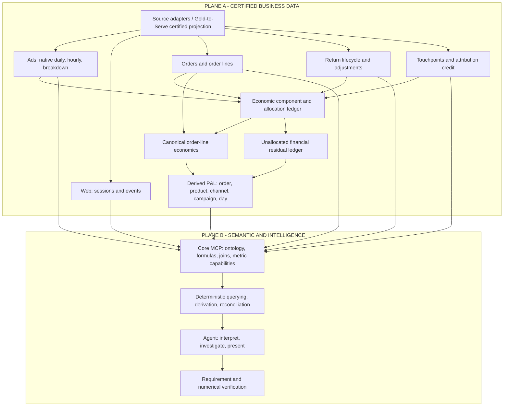
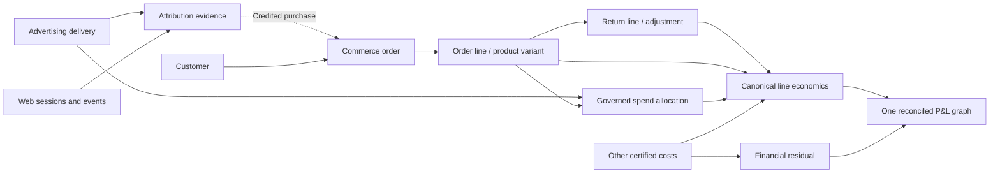
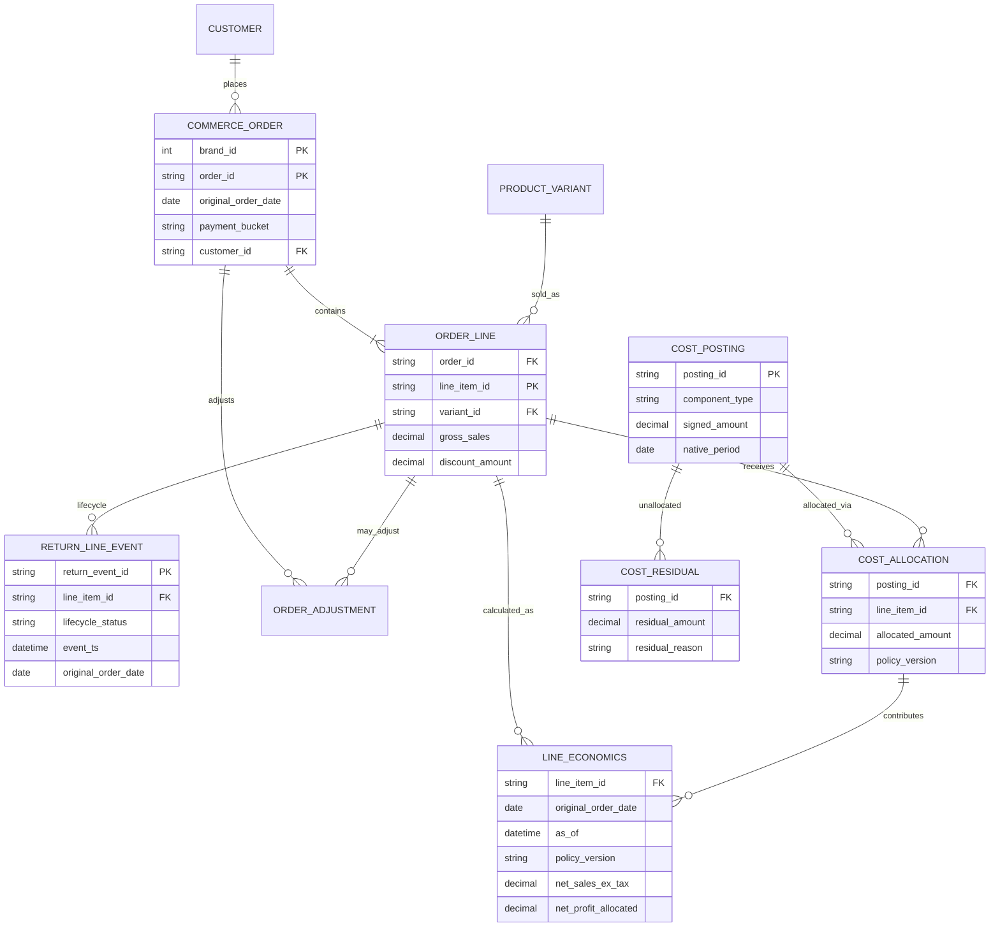
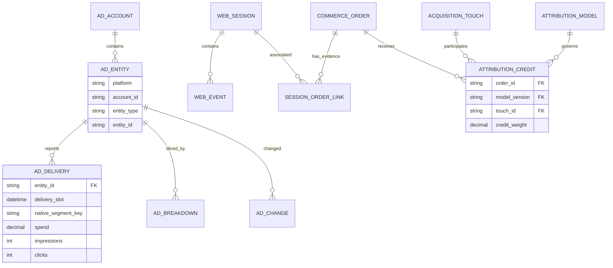
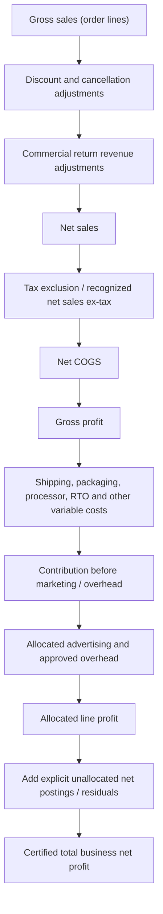
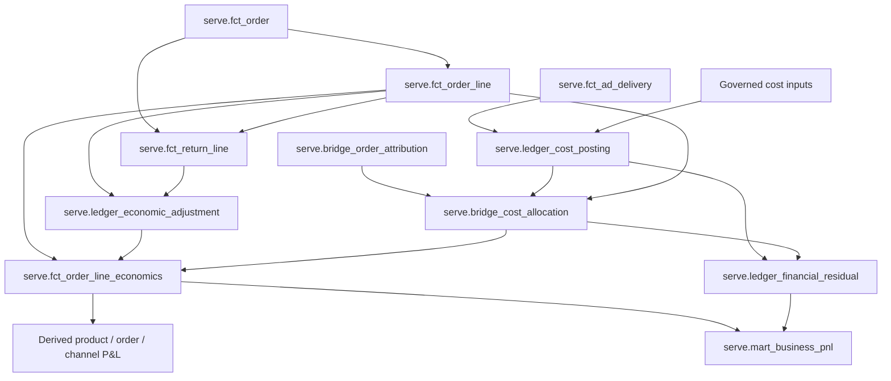

# Seleric — Unified Enterprise Data Model (Two-Plane, Order-Date-Cohort, Reconciled P&L)

**Status:** Proposed target architecture / implementation and migration specification  
**Version:** 2.0 — 2026-10-14  
**Replaces:** `Seleric_Enterprise_Three_Level_Data_Model(1).md` (three-plane proposal)  
**Inspected physical baseline:** `tables_202610131246.csv` — 55 `serve` views, 1,373 declared columns; static DDL and Cube/Core mappings as documented on 2026-10-13.  
**Scope:** Conceptual, logical, physical, semantic, finance conservation, default time policy, AI-Agent consumption and retirement plan.

> **Implementation status / limitations.** The 55-view inventory reflects the earlier supplied DDL, **not a new live production audit**. The target `fct_*`, `bridge_*`, `ledger_*` objects in this document are **proposed**; do not assume they exist. Any uniqueness, row-level cost coverage, return-vs-refund equivalence, P&L policy, current source consumers, and matching of financial totals require certification against actual data. This specification intentionally does not assert that a refund necessarily means a return, or that a delivery-date expense belongs to an order-date cohort without allocation evidence.

---

## 0. Executive architecture decisions (binding)

| ID | Decision | Architectural meaning |
|---|---|---|
| AD-01 | Exactly **two user-facing architectural planes** | Plane A: Certified Business Data (`serve` with governed upstream adapters). Plane B: Semantic & Intelligence (Core MCP + Agent). Existing Bronze/Silver/Gold ETL remain implementation tiers *within/behind* Plane A; they are not an additional agent-facing plane. |
| AD-02 | **One metric definition authority** | Seleric Core catalogue/source registry owns canonical metric algebra, units, valid axes, grain, population and policies; approved SQL/Cube execution mappings must be validated against it. |
| AD-03 | **Original order date** is default for order-associated business questions | Commerce, order lines, returns, attributed revenue, customer purchase cohorts and P&L use original `order_date` by default. Return/refund/payment posting-time views are hidden or explicitly requested. |
| AD-04 | **Ad delivery and sessions retain their real event clocks** | Daily/hourly Meta and Google data remain on delivery timestamps; website visits remain on session/event timestamps. They receive an order-date axis only through verified association/allocation. Never falsify native clocks. |
| AD-05 | **Returns are the public business concept** | No separate Agent-facing Refunds KPI family. Retain sufficient internal refund/financial events to prevent double deductions and reconcile actual money. |
| AD-06 | **Payment type is an order dimension** | No separate Agent-facing Payments KPI family. Preserve internal transaction/fee/reversal evidence for finance where necessary; do not multiply orders by transaction counts. |
| AD-07 | **Bottom-up, single-source financial algebra** | Published P&L derives from canonical component facts + allocation postings + residual postings exposed through `serve`; final P&L marts must NOT independently calculate values from `gold.*` or parallel `semantic.fct_*_pnl`. |
| AD-08 | **No unexplained financial delta** | Every source amount is counted once or lands in a versioned Unallocated/Unknown residual. Published P&L reconciles at the same scope, currency, cutoffs and policy version; otherwise block certified status. |
| AD-09 | **Full supported drilldown, not forced fake precision** | Product, line, order, customer, channel, campaign, ad and time breakdowns are allowed only with certified keys/cost assignments. An unallocated residual remains unallocated. |
| AD-10 | **No immediate physical deletions** | Hide duplicate/compatibility surfaces from Core first; change lineage under existing names only with compatibility tests; delete after dependent consumers and historical parity checks pass. |

### Terminology

- **Order cohort** = records grouped by the immutable original `order_date` of the associated commerce order.
- **As-of** = the latest admissible state of returns, cancellations, costs, attribution and other late-arriving facts at a known cutoff/watermark.
- **Component** = a signed monetary/count input with one business definition and source/event identity.
- **Allocation** = an explicit policy- and version-scoped assignment of a component to a line/order/dimension.
- **Residual** = the exact unallocated portion of an input component. It is financial evidence, **not** a synthetic order or ad.
- **Business P&L** = all eligible recognized economic components, including residual/overhead postings, under a specified accounting policy.
- **Order-cohort allocated P&L** = the part of economics validly attributed to actual orders; it may differ from business P&L until residuals are included.
- **Certified** = independently checked against published policies and sources. *A view being named canonical is not certification.*

## 1. Two planes



**Ownership:** Plane A computes/serves immutable or versioned evidence, allocation and financial postings. Plane B owns definitions, legal query semantics, method selection, independent checks and user-facing reasoning. Neither the Agent nor Cube may define an alternative net-profit formula.

### Six Agent-facing business families

| Public family | Includes | Public default grain/time | Hidden engineering detail |
|---|---|---|---|
| **Advertising** | Meta/Google delivery, campaigns, creative, native video/search KPIs, change history | Source-native ad/campaign × delivery day/hour | Source segmentation and API reconciliation |
| **Website** | Sessions, events, funnel, sources | Session/event clock; order-linked cohort only with valid bridge | Event ingestion/dedup timestamps |
| **Commerce** | Orders, order items, customers, variants, payment method/bucket and order financial status | Order / line × original order date | Processor transaction history |
| **Returns** | Returned orders, returned quantities, return stages/reasons, approved commercial adjustment | Order/line × original order date × as-of | Refund event transaction and cash ledger |
| **Attribution** | Touchpoints, matching, first/last/multitouch credit and channel | Credited order × original order date × model | Stitch confidence and source exceptions |
| **Economics & P&L** | Canonical revenue, COGS, logistics, ad allocation, contribution, net profit, residuals | Line/order-date cohort and explicit unallocated balance | Posting ledger, exact allocations and policy history |

Conformed dimensions (brand, customer, SKU/variant, campaign, platform, source/channel, geography, payment type) are shared across families and not separate competing financial surfaces. Operations/fulfillment and inventory can extend the physical model once certified; their conceptual existence does not imply a current first-class serving fact.

## 2. Conceptual business model



**Not all arrows are raw SQL joins.** Ads-to-orders is an attribution/assignment relationship; campaign revenue is credited commerce revenue, not observed ad-impression-to-order equivalence. The diagrams represent business dependencies, not licenses to join granular ad facts to order lines.

## 3. Logical data model

### 3.1 Primary entities and grains

| Entity / target object | Type | Proposed identity / grain | Default axis | Existing serving support | Agent role |
|---|---|---|---|---|---|
| Brand | Dimension | `brand_id` | N/A | `dim_brand` | Conformed scope |
| AdAccount | Dimension | brand, platform, account ID | N/A | Native ad facts; `dim_campaign` | Advertiser context |
| AdEntity | Dimension | brand, platform, account, native entity type + ID | Effective entity version | `dim_campaign`, `dim_adset`, `dim_ad` | Campaign/ad/creative hierarchies |
| AdCreativeAssociation | Bridge | scoped entity + asset + effective version | Effective date | Meta joins upstream; normalized bridge proposed | Prevent M:N fanout |
| AdDelivery | Fact | scoped entity + native time slot + source segment signature | Delivery timestamp | `ad_delivery_daily/hourly`, native Meta/Google | Common delivery |
| AdBreakdown | Fact | scoped entity + date + **exactly one** breakdown slice | Delivery date | `meta_ads_breakdown_daily` | Meta audience/placement analysis |
| WebSession | Fact | `brand_id, session_id` | Session start | `session_funnel` | Journey population |
| WebEvent | Fact | `brand_id, event_id` | Event timestamp | `web_events` | Behavior evidence |
| SessionOrderLink | Bridge | order + session + method/evidence version | Order-date when joined to orders | Proposed explicit certification | Link audit |
| Touchpoint | Fact | order-associated touch identity | Touch timestamp / order-date association | `touchpoints` | Attribution evidence |
| AttributionCredit | Bridge | order + model/version + credited touch or source + credit row ID | `order_date` | `order_attribution` partially; expanded bridge proposed | Credit weights |
| Customer | Dimension | brand + customer ID, guest handling | Order cohort | `customer_ltv`, `customer_data` | Customer analytics |
| ProductVariant | Dimension | brand + variant ID | Effective version | `dim_product_variant` | SKU/product hierarchy |
| CommerceOrder | Fact | `brand_id, order_id` | **Original `order_date`** | `commerce_orders` | Authoritative order cohort |
| OrderLine | Fact | `brand_id, order_id, line_item_id` | **Original `order_date`** | `product_performance` | Atomic commerce grain |
| ReturnLineLifecycle | Event/fact | stable return line ID + lifecycle event ID/version | **Associated order_date** | `return_lifecycle`, `commerce_order_events`; source semantics require audit | Return activity |
| EconomicAdjustment | Signed ledger | stable source adjustment ID + policy/version | **Associated order_date** when linked | Proposed from return/refund/payment/cost evidence | Prevent duplicate deductions |
| CostPosting | Signed ledger | stable source posting ID + component type/version | Native posting/expense period; order-date only if assigned | Proposed | Input cost conservation |
| CostAllocation | Bridge | source cost posting + target order line + policy/version | Assigned order_date | `product_ad_line` partial | Exact spend/cost allocation |
| OrderLineEconomics | Derived fact | brand + order ID + line ID + snapshot + finance policy/version | **Original `order_date`** | New single-source canonical fact | Bottom-up profitability |
| UnallocatedCostResidual | Signed ledger | input posting + policy/version + uncovered portion | Native cost period, **no invented order_date** | Proposed | Total-business reconciliation |
| BusinessPnl | Derived aggregation | scope + as-of + policy/version + dimensional grouping | `order_date` for assigned part; residual separately identified | Rebuild `pnl_daily` | One total truth |
| DataQualityObservation | Monitoring | contract/check/run/time | Observed time | Quality views | Engineering-only |

**Physical keys are candidates until tested.** Versioned facts must define how repeated source updates are resolved (never `SUM` every lifecycle snapshot). The catalog must distinguish a line-level component from an order-level value duplicated onto many lines.

### 3.2 Logical ERD — commerce, returns and economics



*ERD key fields are shortened for readability; every stored relationship must also include `brand_id` and where appropriate scope/version IDs.* An order can have zero returned lines; returned units cannot exceed the eligible quantity according to the approved lifecycle policy (exchange/multi-return rules need specification). An unallocated residual is not an order line and must never be joined as if it were one.

### 3.3 Logical ERD — advertising and attribution



### 3.4 Join contract — authorized logical relationships

| Relationship | Join identity | Cardinality | Critical restriction |
|---|---|---|---|
| Order → lines | `brand_id, order_id` | 1:M | Do not sum order-level gross/net amount after multiplying rows by line count. |
| Line → product | `brand_id, variant_id` + dimension validity | M:1 (conditional) | Preserve unmatched variants; avoid historical dimension fanout. |
| Line → return lifecycle | brand + stable line ID + eligible event set | 1:M | Deduplicate lifecycle/version transitions before deriving net returned quantities. |
| Order → customer | brand + customer ID | M:1 optional | Guest customers still included. |
| Order → session | certified link evidence, not arbitrary timestamp | M:N possible | Never assume 1:1 matching. |
| Order → attribution credits | brand, order, **selected model/version** | 1:M | Credits aggregate to eligible order weight; preserve Unknown. |
| Ad → delivery | brand + platform + account + native entity scope | 1:M | Meta ad-level != Google campaign-level in current serving. |
| Spend cost → line allocation | source posting ID + allocation policy | 1:M | Amount conservation; zero or many targets, residual separately. |
| Payments/refund monetary evidence → order | stable transaction/event IDs | 1:M | Internal matching only; no public raw fact fanout. |
| Derived P&L → dimensions | line-level keys / verified credit-allocation bridge | M:1 or policy-bound allocation | Query-time relationships may not duplicate finance postings. |

**Forbidden:** raw `ad_delivery` × raw `order_line` joins on date/campaign, summing `return_lifecycle` updates, mixing multiple attribution models in one total, summing reach across ads/days/hours, summing different Meta breakdown types, multiplying expenses via order lines, and assigning all campaign spend to purchases without explicit policy.

## 4. Temporal model: order-date by default, as-of always

| Data / measure | Default user-facing axis | Other axis only by explicit request | Caveat |
|---|---|---|---|
| Orders, order items, product sales | Immutable `order_date` | Created hour, source update | Order cohort includes permitted late amendments as-of. |
| Returns and returned items | **Associated original `order_date`** | Return requested/approved/received date | Return state is as-of sensitive. |
| Refund evidence and commercial return money | **Associated original `order_date`** when order-linked | Refund posting/effective date | Internal posting is not automatically a return. |
| Customer acquisition/repeat sales | Associated order date | Customer created date | Guest cohorts and identification policy explicit. |
| Attribution credit and attributed orders | Credited order date | Touchpoint date | Model and window required. |
| Financial line economics, order P&L | Associated original order date | Accounting period | Coherent policy/as-of mandatory. |
| Meta/Google spend/clicks/video | **Native delivery date/hour** | Cohort allocated cost when linked | Delivery is not an order event. |
| Website sessions/events | **Native session/event timestamp** | Order-linked cohort where proven | Not all sessions convert or link to orders. |
| Unallocated advertising/overhead | **Native cost/reporting period** | Order-date only if defensible allocation is enacted | Never fabricate an order or order date. |

**Answer behavior:** An unqualified “returns last week” means *orders placed last week that are returned as of the chosen cutoff*, **not** returns processed last week. The Agent should say “Returned orders from the [order dates] cohort, as of [cutoff].” A user asking “returns processed last week” triggers the alternative event-time policy. For advertising-only or session-only questions, the native event clock is used, because no order cohort exists for non-converting impressions/visits.

**Example:** Order placed 2026-10-01; return approved 2026-10-10. Cohort 2026-10-01 as of 2026-10-05 excludes that return; as of 2026-10-14 includes its *approved economic adjustment* if policy recognizes the event. This is reproducible only with source event history or versioned/snapshot state, not just a mutable current-status field.

**As-of boundary:** A logical as-of cut must be compatible with **source-specific watermarks** (orders, return events, ad spend, costs, attribution). Persist both the requested as-of and actual source cutoffs. Do not claim perfectly synchronized data when the pipelines have different freshness.

### 4.1 Business P&L date consistency

“Business P&L by order date” is not equivalent to “all business expenses by order date” unless every expense has an approved order-cohort assignment. To avoid hiding this distinction, output:

- **Order-cohort allocated P&L**: recognized order lines, associated return adjustments and allocated costs assigned to those order dates.
- **Financial residual / overhead**: cost postings with no justified cohort assignment, held with original cost/reporting period and a real Unallocated key.
- **Total business P&L**: sum of the two, under a compatible *reporting scope and cutoff*. For a requested order-date series, show unassigned costs as separate residual/period or Unknown cohort; don't distribute them across dates invisibly.

A cohort chart and a complete-business period chart may thus have different temporal semantics even if the **all-period grand total** reconciles. This is an intentional accounting truth, not a defect to be “fixed” with arbitrary allocation.

## 5. Canonical monetary component contract

### 5.1 One financial input, one economic role

Each adjustment/cost line must carry at least:

```yaml
posting_contract:
  posting_id: stable_source_event_or_component_id
  brand_id: required
  source_system: required
  source_event_id: required
  component_code: required
  signed_amount_minor: required
  currency: required
  native_event_ts: required
  associated_order_id: optional
  associated_line_item_id: optional
  original_order_date: derived_only_if_order_linked
  business_recognition_status: required
  as_of_cutoff: required
  finance_policy_version: required
  deduplication_policy: required
```

Prefer **integer minor currency units or exact Decimal** for posting/allocation storage, and control display rounding separately. Source feeds may use Float64; cast/normalize explicitly at ingress, then independently audit conversion differences.

**Mutually exclusive deduction rule:** A returned item's commercial revenue reversal must be recognized exactly once, regardless of how many lifecycle notifications, return requests or refund transactions represent it. A refund/cash movement may require an additional posting only where it represents a **distinct** fee, goodwill payment or correction under the policy—not simply the same return loss again.

### 5.2 Approved financial component tree



**Financial definitions are policy-bound.** The diagram is a component dependency sketch. Tax, VAT/GST, whether gross sales include discounts, treatment of refunded COGS, cancellations, reverse logistics, COD fees, and company overhead must be chosen from **signed-off finance policy**, not guessed from a table label. Return-adjusted COGS must reflect recoverability and stock disposition if that affects the chosen policy.

### 5.3 Illustrative algebra (MUST replace variables with approved Core components)

Let each component be a monetary vector over the *same* eligible order-line population, currency, as-of and policy version.

```text
net_sales_incl_tax       = gross_sales - discounts - cancellations - return_revenue_adjustment
net_sales_ex_tax         = net_sales_incl_tax - recognized_tax_component
net_cogs                 = approved_cogs - approved_cogs_reversals
pre_marketing_contrib    = net_sales_ex_tax - net_cogs - recognized_variable_costs
allocated_line_profit   = pre_marketing_contrib - allocated_ad_cost - allocated_other_cost
business_net_profit     = sum(allocated_line_profit)
                        + sum(unallocated_net_revenue_postings)
                        - sum(unallocated_net_expense_postings)
```

**Important:** These are target *algebraic relationships*, not a claim that Seleric's existing `canonical_pnl`, `pnl_daily` and `product_pnl` are implemented this way. For example, the current inspected `canonical_pnl` is much narrower than a complete operating-expense definition. Do not publish “net profit” as certified until the included cost component set is agreed, complete and verified.

### 5.4 Metric authority and derived mart rules

- One Core metric ID for each distinct financial meaning (`net_sales`, `net_sales_ex_tax`, `net_cogs`, `allocated_ad_spend`, `unallocated_ad_spend`, `contribution_margin`, `business_net_profit`, etc.). Define *precisely* what components each includes.
- `serve` holds certified component values and the canonical derived ledger/line model. Cube/ClickHouse execute the aggregation defined in Core; they must not implement different algebra under the same name.
- A reporting mart is a **projection or preaggregation of the canonical component graph**, never an independent financial source or alternative `gold.*` computation.
- Ratios (`margin_pct`, ROAS, MER, return rate, CAC, AOV) recompute from approved additive numerators/denominators at the requested grain, not from averaged per-row ratios.
- Product and ad economics are only available where a valid allocation/credit path exists. “Unallocated” must remain a real grouping member in financial reporting.

## 6. Finance conservation and zero-difference reconciliation

### 6.1 Financial conservation equations

For each certified scope `S = (brand, source, currency, posting_period/basis, as_of, policy_version, component_type)`:

```text
INPUT_COMPONENT_AMOUNT(S)
     = SUM(ALLOCATED_POSTINGS(S)) + SUM(RESIDUAL_POSTINGS(S))

SALES_COMPONENT_FROM_ORDERS(S)
     = SUM(SALES_COMPONENT_FROM_UNIQUE_ORDER_LINES(S))
       + EXPLICIT_ORDER_LEVEL_ADJUSTMENTS(S)

PUBLISHED_BUSINESS_NET_PROFIT(S)
     = SUM(CERTIFIED_LINE_ALLOCATED_PROFIT(S))
       + SUM(UNALLOCATED_NET_REVENUE(S))
       - SUM(UNALLOCATED_NET_EXPENSE(S))

GROUPED_PROFIT_BY_AXIS(S, dimension)
     = SUM(ALL_NAMED_DIMENSION_MEMBERS(S))
       + SUM(UNKNOWN_OR_UNALLOCATED_MEMBER(S))
     = PUBLISHED_BUSINESS_NET_PROFIT(S)
```

**Quantized monetary arithmetic:** Reconcile **exactly in stored minor units** where the monetary source supports them. Where upstream currency conversion, tax rounding or source precision causes a gap, record it as an explicit rounding adjustment with a source and policy; never loosen reconciliation tolerance to absorb a known data defect.

**Partial populations:** An ad-specific view cannot report the entire brand's net profit if it has only attributed orders and spend. It can report allocated ad-level profit plus Unassigned. A pure product detail slice may not contain overhead until an explicit policy assigns it. Do not claim arbitrary drilldowns reconcile without showing the residual population.

### 6.2 Canonical controls (must pass before finance certification)

| Control ID | Check | Pass condition | Failure behavior |
|---|---|---|---|
| FIN-01 | Order ↔ unique order lines | Every recognized order component matches approved sum of lines + order adjustments | Fail affected orders and trace component mismatch |
| FIN-02 | Return event dedup | No lifecycle update counted as a second return; quantity/status policy valid | Quarantine uncertain return adjustments |
| FIN-03 | Refund/payment double-count prevention | Same commercial loss isn't deducted twice; distinct charges traced | Fail duplicate source economic event |
| FIN-04 | Advertising input ↔ allocation | Every source spend posting = assigned cost + explicit residual | Block incomplete allocation scope |
| FIN-05 | Other costs ↔ allocation | Same conservation per shipping/COD/COGS/operating cost component | Retain residual; fail unexpected gap |
| FIN-06 | Line → order → date → total rollups | Additive finance components reconcile with identical policy/as-of | Reject conflicting P&L calculation |
| FIN-07 | Axis rollups | Product/channel/campaign/customer grouping includes Unknown/Unallocated and matches parent | Mark invalid axis or show residual |
| FIN-08 | Order-date attribution | Only order-associated postings have order date; ad delivery itself remains delivery-clock | Reject fabricated cohort timestamps |
| FIN-09 | Snapshot consistency | Reproduction using agreed as-of and source cutoffs | Mark provisional/incomplete otherwise |
| FIN-10 | Cross-source certification | Serve input components match independently signed-off source accounting policies | Block certified label until independently resolved |
| FIN-11 | Identity / fanout | Each posting has one stable identity; joins don't multiply it | Reject duplicating query plan |
| FIN-12 | Currency integrity | Costs and revenue share conversion policy and reporting currency | Reject incompatible currency sums |

### 6.3 Return coverage proof before hiding refund_events

Compare by brand/order/line and as-of: **actual return requests, approved returns, received returns, refunded line quantities, commercial reversal amount, refund money, exchanges, and goodwill refunds**. If `return_lifecycle` only follows the refund feed, it cannot be trusted as an independent census of physical returns. Until audited, keep `serve.refund_events` and `serve.payments` as engineering-only reconciliation inputs; never delete them based on overlapping names.

### 6.4 Order-date cohort reversals and late arrivals

Store append-only event/adjustment identities and an as-of materialization rule:

1. Original order date is never overwritten by a late return/cancel/refund.
2. Each late event records its true event timestamp but **rests in the original order cohort** for default commerce/P&L queries.
3. Snapshot at cutoff `T` includes only recognized events effective by `T`, with compatible pipeline watermarks.
4. An explicit “returns processed on date X” query uses the event timestamp; it is not the default.
5. History can be reconstructed by `as_of`, not inferred from today's mutable order status.

### 6.5 Cost allocation policy and its boundaries

Use a separate versioned assignment policy for each cost class:

- Direct line cost (eligible COGS): map with certified line/variant/source cost identity.
- Direct order fee or shipping: assign to order and optionally distribute across lines using a **signed-off line weighting** (e.g. net line sales, units, physical weight; **do not pick automatically**).
- Advertising spend: preserve source platform/account/campaign/ad + delivery date, and an explicit eligible attribution population. Allocate per chosen, versioned rule; never join cost rows directly to raw order lines. Preserve unassigned cost pool.
- Business overhead: allocate only if approved; otherwise hold as business-level residual.
- Returns: commercial deduction follows approved lifecycle rule, independent of cash refund transaction count; reverse COGS according to recoverability policy.

**Ad-cost warning:** A media spend incurred on 2026-10-10 might support purchases whose orders are dated 2026-10-09 or 2026-10-11. If an allocation associates the spend to those cohorts, document windows and complete source-cost conservation. Never infer this association from equal dates alone.

## 7. Advertising, Website and Attribution semantics (retain native capabilities)

| Area | Available / target | Native grain / default | Semantic rule |
|---|---|---|---|
| Meta daily | Existing `meta_ads_daily` | Ad × delivery day | Keep native video, link and creative attributes. |
| Meta hourly | Existing `meta_ads_hourly` | Ad × delivery hour | Hourly hook/hold components exist; certify bindings. |
| Meta breakdowns | Existing `meta_ads_breakdown_daily` | Ad × day × **one breakdown_type** | Do not aggregate multiple breakdown families as independent spend. |
| Google daily | Existing `google_ads_daily` | Campaign × delivery day | No native ad-group/ad claim from current unified serving. |
| Google hourly | Existing `google_ads_hourly` | Campaign × hour × device × network | Unified `ad_delivery_hourly` hides segments; repair grain or explicitly collapse with grouping. |
| Common delivery | Existing `ad_delivery_daily/hourly` | Native heterogeneous entity level | Spend/clicks/impressions; unsupported platform-specific measures = NULL, not zero. |
| Platform-native conversions | Target extension | Action/window/date basis | Separate from attributed first-party store orders. |
| Website | Existing `session_funnel`, `web_events` | Session/event time | Sessions with no order remain on their own clock. |
| Attribution | Existing `touchpoints`, `order_attribution`; extended credit bridge proposed | Order × selected model/version | Credited revenue uses order date; unmatched preserved. |

**Examples of canonical ratio algebra:** `ctr = SUM(clicks)/NULLIF(SUM(impressions),0)`, `cpm = 1000*SUM(spend)/NULLIF(SUM(impressions),0)`, Meta `hook_rate = SUM(video_3s_views)/NULLIF(SUM(impressions),0)`, Meta `hold_rate = SUM(thruplays)/NULLIF(SUM(video_3s_views),0)`. Derived rates must be calculated from the valid platform population and native source-grain components. Reach is non-additive.

Meta hook/hold **daily definitions already exist** in Core but hourly metric bindings require capability and evidence contract extension. Google interactions aren't the same as Meta link clicks. Platform-reported ROAS, modeled attributed ROAS and financial net ROAS are different metrics.

## 8. Target physical serving layout

These target object names are **proposed interfaces**; use migration aliases instead of creating conflicting parallel business authorities.

| Target `serve` object | Type / grain | Physical purpose | Source policy |
|---|---|---|---|
| `fct_ad_delivery` | Fact: platform-native entity × delivery time × segment | Common additive ad delivery | Sourced via existing certified Meta/Google views; preserve native dimensional availability |
| `fct_web_session` | Fact: one session | Funnel population, attribution signals | Source certified session view |
| `fct_web_event` | Fact: one event | Recorded behavior | Source certified event view |
| `fct_order` | Fact: one order | Original order date, customer, payment type, order statuses | Source `commerce_orders` adapter |
| `fct_order_line` | Fact: one order line | Product, quantity, revenue components | Source `product_performance` adapter |
| `fct_return_line` | Event/fact: stable return line and status history | Physical return lifecycle and recognized returned units | Validate coverage independent of refund feed |
| `bridge_order_attribution` | Bridge: order × model/version × credit | Credited marketing revenue | Based on certified order attribution + touch evidence |
| `ledger_economic_adjustment` | Signed posting: distinct adjustment event | Revenue reversal, COD/payment fee, financial correction | Sources remain auditable, internal |
| `ledger_cost_posting` | Signed posting: one native cost component | Advertising/COGS/fulfillment/overhead cost | Governed source-to-Serve contracts |
| `bridge_cost_allocation` | Posting × target line/order × allocation policy | Explicit unit/order association | Allocation shares and amounts conserved |
| `fct_order_line_economics` | Derived fact: line × policy version × as-of | Canonical financial vectors and allocated profit | **Only** approved finance component engine |
| `ledger_financial_residual` | Posting × policy version × unassigned scope | Unallocated financial amounts | Preserve native period and reason |
| `mart_order_pnl` | Derived view: order × required axes | Approved P&L at order cohort | Query/reaggregate canonical line components + residual where applicable |
| `mart_product_pnl` | Derived view: variant/product/cohort × required axes | SKU/product economics | Same canonical components |
| `mart_business_pnl` | Derived view: reporting scope × selected basis | Company totals | **Includes** residual posting arms; one approved policy |

### 8.1 Serve dependency DAG (no alternate P&L)



**Cycle rule:** Nothing in the canonical finance calculation path may read its own derived mart, including indirect dependencies through a compatibility view. Marts are DAG sinks, never cost input sources.

### 8.2 Physical exposure and permissions

- Agent → Core MCP: **only** six business families, allowed metric IDs, valid axes and provenance-aware tools.
- Core / Cube: private certified fact/dimension/bridge access; may read audited finance postings through governed query templates.
- Finance transformation service: write approved ledgers, allocations, line economics and residual snapshots; cannot silently overwrite posted versions.
- Engineering QA: keep hidden internal return/refund/payment views, source lineage and reconciliation datasets; not available as autonomous competing KPI families.
- Live `serve` compatibility: existing view names may remain while their underlying lineage is migrated, subject to semantic regression gates.

## 9. Metric catalogue, axes and AI Agent behavior

### 9.1 Core metric contract example

```yaml
metric_id: business_net_profit
owner: Finance
metric_version: pending_finance_signoff
status: proposed
formula:
  type: additive_components
  source: canonical_financial_component_graph
  includes: [allocated_line_profit, unallocated_net_revenue, unallocated_net_expense]
  signs: {allocated_line_profit: 1, unallocated_net_revenue: 1, unallocated_net_expense: -1}
axes:
  default_order_associated_time: original_order_date
  non_order_costs_time: native_cost_period
  required: [brand_id, currency, as_of, finance_policy_version, allocation_policy_version]
valid_dimensions: [product, variant, order, customer, finance_channel, platform, campaign, ad]
restrictions:
  allow_dimension_only_when_allocation_valid: true
  include_unknown_or_unallocated: true
  reject_unmatched_period_mixing: true
  currency_precision: exact_minor_unit_or_approved_decimal
bindings:
  detail: serve.fct_order_line_economics
  residual: serve.ledger_financial_residual
  total: serve.mart_business_pnl
```

This is **proposed specification syntax**, not a deployed metric definition. Business policy version is intentionally pending. Core source registry/generator must be authoritative; generated Cube and Agent-facing catalogue definitions must be parity-checked.

### 9.2 What the Agent is allowed to do

1. Resolve the user's requested business concept, filters, entity scope, comparison, grain and time axis.
2. Apply original order date automatically to orders/returns/attributed orders/P&L unless the user explicitly requests another event date.
3. Retain native Meta/Google delivery and web timestamps for questions that do not refer to orders.
4. Fetch only certified component measures and derived financial aggregations from Core.
5. Drill order → line → variant/product, order → return, customer → order, and platform → campaign → ad hierarchy only where certified.
6. Include `Unattributed`/`Unallocated` groups whenever their omission would cause a denominator/total mismatch.
7. Require a common `as_of`, allocation policy, attribution model (where used), currency, source coverage and financial basis before comparing or combining components.
8. If requested granularity cannot be supported without arbitrary cost allocation, report partial coverage and the reconciled parent total; never invent unit-level precision.
9. Never query `refund_events`/`payments` as independent public KPI concepts unless an internal reconciliation tool is expressly invoked.
10. Explain the *difference* between order-cohort allocated P&L and full business P&L if financial residuals cannot be dated to orders.

### 9.3 Example query resolution

| User asks | Default interpretation | Execution / check |
|---|---|---|
| “Returns last week by SKU” | SKUs ordered last week, returned as of cutoff | Unique return-line lifecycle linked to original order date |
| “How many refunds were processed yesterday?” | Explicit monetary event-date query | Internal governed refund evidence; clearly label as refund **money**, not returned units |
| “Net profit by campaign yesterday” | Order-date cohort profitability credited/allocated to campaigns | Order lines + selected attribution model + allocated costs + residual classification; no raw ad spend join |
| “Meta hourly hook rate yesterday” | Meta ad delivery hours yesterday | Native Meta hourly components and certified ratio binding |
| “Why did checkout conversion fall?” | Web session/event timestamp | Distinct-session cohort, not forced order date |
| “Daily net profit and product split” | Order-date cohort daily series | Line economics + explicit residual bucket; don't silently assign overhead to specific dates or products |

## 10. Migration and view retirement plan

### 10.1 Migration gates (order is intentional)

| Stage | Deliverable | Hard acceptance test |
|---|---|---|
| M0 | Freeze current P&L metrics, SQL definitions, 55-view dependency graph and production consumers | Reproducible baseline across order, return, spend and finance edge cases |
| M1 | Approve revenue/return/COGS/tax/expense recognition policies and canonical metric IDs | Finance sign-off; distinguish policy mismatch from pipeline defect |
| M2 | Certify `fct_order`, `fct_order_line`, return-line population and unique source adjustment IDs | Grain uniqueness, dedup and event-vs-refund coverage |
| M3 | Build signed posting and adjustment ledger **from serve-visible certified input projections** | Every source event maps to exactly one eligible economic component identity |
| M4 | Build versioned cost allocation and residual ledger | For each source cost posting, assigned + residual = source cost |
| M5 | Build `fct_order_line_economics` and business P&L | Order-to-lines, all cost arms and grand total reconcile at same snapshot and policy |
| M6 | Rebuild old `product_pnl`, `order_pnl_daily`, `pnl_daily`, `channel_pnl` as projections of one component graph | Their approved overlapping totals equal; no independent Gold or semantic finance mart dependency |
| M7 | Core metric/binding registry, Cube parity, supported grain/time/axis validators | Agent cannot select conflicting financial formula or unsupported axis |
| M8 | Shadow old/new Agent queries, dashboards, exports, scheduled jobs | No functional regression; zero unexplained material finance delta |
| M9 | Hide / deprecate duplicated public families and retiring wrappers | All external consumers migrated; only then physical drop |

### 10.2 Retirement classifications

- **KEEP + expose through Core:** `commerce_orders`, `product_performance`, `ad_delivery_daily`, `ad_delivery_hourly`, `session_funnel`, `web_events`, `touchpoints`, `order_attribution`, `dim_product_variant`, traffic/brand/ad dimensions. Native Meta and Google sources stay private behind unified bindings as needed.
- **KEEP as internal audit evidence:** `refund_events`, `payments`, existing return lifecycle source, platform status history, traffic and product hierarchy quality views. These no longer imply standalone business KPI families.
- **REBUILD from the one component graph:** `product_pnl`, `order_pnl_daily`, `pnl_daily`, `channel_pnl`, and `product_ad_line` (allocation model). Exact compatibility columns may be kept during migration.
- **FINANCE CONFLICT CANDIDATES:** `canonical_pnl`, `ad_channel_pnl_daily`, `finance_waterfall_daily`, `ltv_cac_daily`, `meta_ad_attribution_daily`, `platform_attribution_commerce`; parity + consumer check before retirement.
- **WRAPPER CANDIDATES:** `orders_all_channels`, `sales_all_channels`, `returns_cancels_all_channels`, `channel_attribution_daily`; use canonical measures and verified filtered definitions, then retire if consumers are zero.
- **CONFIG/GOVERNANCE:** `cfg_traffic_platforms`, `cfg_traffic_source_rules`, `traffic_unmapped`, `*_hierarchy_conflicts`; keep engineering-private.

### 10.3 Backward compatibility and change control

- Keep existing API/Cube metric aliases during a documented transition. Map retired IDs to one canonical metric, not to multiple plausible variants.
- Require same-scope comparison on frozen closed cohorts and late-return/as-of replays; isolate snapshot drift, policy differences, missing cost arms, currency and join inflation.
- A currently certified numeric measure cannot become “equivalent” merely because two wrong views match. Build an independent source-based calculation per approved policy to certify the new component graph.
- Do not widen metric tolerance to fit a known 1%+ discrepancy. Resolve it or block the certification of that metric.
- Core's published contract versions, not ad-hoc SQL naming, determine which financial model is authoritative.

## 11. Acceptance tests and example SQL contracts

The following SQL is **illustrative target schema**, not executable against your current 55-view database before the proposed objects/field names are implemented.

### 11.1 Source cost conservation by posting and policy

```sql
-- Proposed names. Sign and dedup normalization is part of the posting contract.
SELECT
    p.brand_id,
    p.posting_id,
    p.currency,
    p.amount_minor AS source_minor,
    coalesce(a.allocated_minor, 0) AS allocated_minor,
    coalesce(r.residual_minor, 0) AS residual_minor,
    p.amount_minor - coalesce(a.allocated_minor, 0) - coalesce(r.residual_minor, 0) AS delta_minor
FROM serve.ledger_cost_posting p
LEFT JOIN (
    SELECT brand_id, posting_id, allocation_policy_version, sum(allocated_amount_minor) AS allocated_minor
    FROM serve.bridge_cost_allocation
    WHERE allocation_policy_version = {policy_version:String}
    GROUP BY brand_id, posting_id, allocation_policy_version
) a ON p.brand_id = a.brand_id AND p.posting_id = a.posting_id
LEFT JOIN (
    SELECT brand_id, posting_id, allocation_policy_version, sum(residual_amount_minor) AS residual_minor
    FROM serve.ledger_financial_residual
    WHERE allocation_policy_version = {policy_version:String}
    GROUP BY brand_id, posting_id, allocation_policy_version
) r ON p.brand_id = r.brand_id AND p.posting_id = r.posting_id
WHERE delta_minor != 0;
-- Must return ZERO rows for a closed, same-policy / same-as-of snapshot.
```

The production query must additionally bind the **same snapshot/as-of and finance-policy versions** across posting, allocation and residual records; the sample intentionally omits those fields because physical implementation is pending. If costs can be negative (credit or reversal), use signed conservation with the same economic polarity.

### 11.2 Order versus line revenue reconciliation

```sql
-- Proposed names and approved fields; do NOT SUM duplicated order values after a line join.
WITH lines AS (
  SELECT brand_id, order_id,
         sum(net_sales_ex_tax_minor) AS line_net_sales_minor
  FROM serve.fct_order_line_economics
  WHERE as_of = {as_of:DateTime} AND finance_policy_version = {finance_policy_version:String}
  GROUP BY brand_id, order_id
)
SELECT o.brand_id, o.order_id,
       o.approved_net_sales_ex_tax_minor AS order_expected_minor,
       lines.line_net_sales_minor AS observed_minor
FROM serve.fct_order o
LEFT JOIN lines USING (brand_id, order_id)
WHERE o.approved_net_sales_ex_tax_minor != coalesce(lines.line_net_sales_minor, 0);
```

### 11.3 Source-specific grain and snapshot validation

- Assert `count()` equals `uniqExact(tuple(candidate_key))` at the **native** source grain, including Google device and network segments.
- Assert generated detail join results don't inflate distinct `posting_id`, `order_id`, `line_item_id`, return event ID or attribution credit ID.
- Assert `SUM` of line contribution plus signed residual postings equals **business-level** P&L for the same source cutoff and financial policy.
- Assert published P&L by channel/product/customer/ad includes Unknown/Unallocated or explicitly states why it is a subset, rather than silently losing expenses.
- Assert return events posted after order date update only matching **historical order cohort as-of** snapshots.
- Assert existing Cube/Agent metrics map to the same component definition, with no circular finance lineage.

## 12. Open business-policy decisions (must be resolved before certified P&L)

| Policy question | Reason this cannot safely be assumed |
|---|---|
| What exactly counts as `net_sales`? | Discount, GST, cancellation, return recognition and realized vs booked sales vary by accounting policy. |
| What is the event that makes a return economically recognized? | Request, approval, receipt, refund and restock are different. |
| Is the order's payment method a single immutable category? | Partial/combined payments, COD conversions and post-order switches can occur. Use `payment_bucket` as normalized grouping and state its policy. |
| Which COGS basis is used? | Sold-unit historical cost, landed cost, moving average and recovered-return cost differ. |
| Which fees and operating expenses count in net profit? | Processor, shipping, COD, RTO, storage, agency, salaries, overhead and tax policy. |
| How is ad cost assigned to orders or product lines? | Spend date and credited order date differ; attribution weights are not automatically cost shares. |
| Are campaign/ad profit requests full business profit or attributable contribution? | Residual overhead and unassigned ad spend cannot automatically be claimed by a named ad. |
| Which as-of/watermark is the closing snapshot? | Different sources ingest and restate at different cadences. |
| Which currency conversion and rounding policy is approved? | Exact conservation requires stable precision and FX semantics. |

## 13. Final target interface

```text
Seleric user
  -> Agent (question, follow-up and investigative plan)
  -> Core MCP (canonical metric/axis/population capability)
  -> Serve certified component facts / economics / derived marts
  -> Core verifies allocation, reconciliation, calculation and evidence
  -> Agent produces report with evidence, residuals and limitations
```

**Definition of done:** A user can navigate **brand → channel → campaign → ad → order → item → return → cost components → allocated profit**, at every *actually supported* grain and compatible axis, without a different P&L answer appearing when they roll back to the parent. Unassigned cost must remain visible and contribute to the audited business total. At no point may the Agent choose between equally named, independently calculated net profits.

---

### Appendix A — Inspected inventory of all 55 original `serve` views
| Existing physical view | Domain | Declared cols | Candidate row identity | Date/time axes | Upstream refs (extracted) | Previous review disposition (not final target) |
|---|---|---:|---|---|---|---|
| `serve.ad_changes` | Advertising / delivery | 18 | `brand_id, ad_platform, entity_type, entity_id, changed_at` | changed_at, data_as_of | serve.meta_ads_status_history, serve.google_ads_status_history | KEEP — Cube v2 binding |
| `serve.ad_channel_pnl_daily` | Finance / economics | 30 | `brand_id, report_date, channel, campaign_id, adset_id, ad_id, row_type` | report_date | serve.channel_pnl, gold.fct_ad_channel_pnl_daily | CANDIDATE — reconcile first |
| `serve.ad_delivery_daily` | Advertising / delivery | 25 | `brand_id, ad_platform, account_id, report_date, campaign_id, adset_id, ad_id` | report_date, data_as_of | serve.meta_ads_daily, serve.google_ads_daily | KEEP — Cube v2 binding |
| `serve.ad_delivery_hourly` | Advertising / delivery | 21 | `brand_id, ad_platform, account_id, report_hour_ts, campaign_id, adset_id, ad_id` | report_date, hour_of_day, report_hour_ts, data_as_of | serve.meta_ads_hourly, serve.google_ads_hourly | KEEP — Cube v2 binding |
| `serve.attribution_paths` | Identity / attribution | 21 | `brand_id, order_id, attribution_model` | order_created_at, first_touch_ts, last_touch_ts, order_date, data_as_of | gold.fct_attribution_paths | KEEP — Cube v2 binding |
| `serve.campaign_products` | Commerce / products | 4 | `brand_id, platform, campaign_id, variant_id` | — | serve.product_performance, serve.commerce_orders | KEEP — Cube v2 binding |
| `serve.canonical_pnl` | Finance / economics | 32 | `brand_id, report_date, sub_channel, is_new_customer, shipping_region, payment_bucket` | report_date | serve.commerce_performance_daily, gold.fct_order_items, serve.meta_ads_daily +1 | CANDIDATE — reconcile first |
| `serve.cfg_traffic_platforms` | Identity / attribution | 6 | `platform` | loaded_at | semantic.cfg_traffic_platforms | KEEP — governance/config |
| `serve.cfg_traffic_source_rules` | Identity / attribution | 18 | `rule_id` | loaded_at | semantic.cfg_traffic_source_rules | KEEP — governance/config |
| `serve.channel_attribution_daily` | Identity / attribution | 15 | `brand_id, report_date, channel, is_paid, source_platform` | report_date, data_as_of | serve.order_attribution | CANDIDATE — retire wrapper |
| `serve.channel_pnl` | Finance / economics | 25 | `NO SINGLE SAFE CANDIDATE — multi-arm line/order/spend mixture` | report_date, order_date | gold.fct_order_attribution, semantic.dim_traffic_source, semantic.cfg_traffic_platforms +4 | KEEP — Cube v2 binding |
| `serve.commerce_order_events` | Commerce / products | 9 | `brand_id, order_id, event_type, event_at` | event_date, event_at, order_date | gold.fct_order_items | KEEP — Cube v2 binding |
| `serve.commerce_orders` | Commerce / products | 95 | `brand_id, order_id` | order_date, order_created_at, order_created_at_ist, source_updated_at | gold.fct_orders, serve.product_performance, gold.fct_order_attribution | KEEP — Cube v2 binding |
| `serve.commerce_performance_daily` | Commerce / products | 12 | `brand_id, report_date` | report_date | serve.commerce_orders, serve.commerce_order_events | KEEP — serve dependency |
| `serve.customer_data` | Customers / retention | 29 | `brand_id, customer_id` | email_marketing_consent_updated_at, sms_marketing_consent_updated_at, customer_created_at, customer_updated_at, data_as_of | gold.dim_customers | CANDIDATE — external consumer audit |
| `serve.customer_ltv` | Customers / retention | 26 | `brand_id, customer_id` | customer_created_at, first_order_at, last_order_at | gold.fct_orders, gold.dim_customers | KEEP — Cube v2 binding |
| `serve.dim_ad` | Advertising / dimensions | 11 | `brand_id, platform, ad_id` | — | gold.dim_ad | KEEP — Cube v2 binding |
| `serve.dim_adset` | Advertising / dimensions | 11 | `brand_id, platform, adset_id` | — | gold.dim_adset | KEEP — Cube v2 binding |
| `serve.dim_brand` | Governance / QA | 10 | `brand_id` | — | gold.fct_orders, gold.fct_meta_ads_daily, gold.fct_google_ads_daily +2 | KEEP — Cube v2 binding |
| `serve.dim_campaign` | Advertising / dimensions | 13 | `brand_id, platform, campaign_id` | start_date, end_date | gold.dim_campaign, serve.google_ads_daily, serve.meta_ads_daily | KEEP — Cube v2 binding |
| `serve.dim_product_variant` | Commerce / products | 17 | `brand_id, variant_id` | compare_at_price, first_ordered_date, last_ordered_date, refreshed_at | semantic.dim_product_variant | KEEP — Cube v2 binding |
| `serve.dim_traffic_source` | Identity / attribution | 23 | `traffic_source_key` | refreshed_at | semantic.dim_traffic_source | KEEP — Cube v2 binding |
| `serve.finance_waterfall_daily` | Finance / economics | 24 | `brand_id, report_date, waterfall_key` | report_date, data_as_of | gold.fct_finance_waterfall_daily | CANDIDATE — reconcile first |
| `serve.funnel_daily` | Customer journey / web | 21 | `brand_id, report_date, channel` | report_date, data_as_of | gold.mart_funnel_daily | KEEP — Cube v2 binding |
| `serve.funnel_orders` | Customer journey / web | 6 | `brand_id, order_id` | order_date | gold.fct_order_attribution, serve.order_attribution | KEEP — Cube v2 binding |
| `serve.google_ads_daily` | Advertising / delivery | 21 | `brand_id, customer_account_id, report_date, campaign_id` | report_date, data_as_of | gold.fct_google_ads_daily, gold.dim_campaign | KEEP — serve dependency |
| `serve.google_ads_hourly` | Advertising / delivery | 24 | `brand_id, customer_id, report_hour_ts, campaign_id, segment_device, segment_ad_network_type` | report_date, hour_of_day, report_hour_ts, data_as_of | gold.fct_google_campaigns_hourly, gold.dim_campaign | KEEP — serve dependency |
| `serve.google_ads_status_history` | Advertising / delivery | 26 | `brand_id, entity_type, entity_id, changed_at` | changed_at, prev_snapshot_at, data_as_of | gold.fct_google_ads_status_history | KEEP — serve dependency |
| `serve.ltv_cac_daily` | Finance / economics | 5 | `brand_id, report_date` | report_date | serve.order_attribution, serve.meta_ads_daily, serve.google_ads_daily | CANDIDATE — reconcile first |
| `serve.meta_ad_attribution_daily` | Identity / attribution | 28 | `brand_id, report_date, campaign_id, adset_id, ad_id` | report_date, data_as_of | serve.order_attribution, gold.mart_meta_ad_daily_attribution, gold.dim_ad +3 | CANDIDATE — reconcile first |
| `serve.meta_ads_breakdown_daily` | Advertising / delivery | 50 | `brand_id, ad_account_id, report_date, ad_id, breakdown_type, breakdown_dimension_1, breakdown_dimension_2` | report_date, data_as_of | gold.mart_meta_ad_breakdown_daily, gold.dim_creative, gold.dim_ad +3 | KEEP — Cube v2 binding |
| `serve.meta_ads_daily` | Advertising / delivery | 64 | `brand_id, ad_account_id, report_date, campaign_id, adset_id, ad_id` | report_date, data_as_of, campaign_start_date, campaign_end_date | gold.fct_meta_ads_daily, gold.dim_creative, gold.dim_ad +3 | KEEP — serve dependency |
| `serve.meta_ads_hourly` | Advertising / delivery | 39 | `brand_id, ad_account_id, report_hour_ts, campaign_id, adset_id, ad_id` | report_date, hour_of_day, report_hour_ts, data_as_of | gold.fct_meta_ads_hourly, gold.dim_creative, gold.dim_ad +3 | KEEP — serve dependency |
| `serve.meta_ads_status_history` | Advertising / delivery | 27 | `brand_id, entity_type, entity_id, changed_at` | changed_at, prev_snapshot_at, data_as_of | gold.fct_meta_ads_status_history | KEEP — serve dependency |
| `serve.order_attribution` | Identity / attribution | 50 | `brand_id, order_id` | order_date, order_created_at, touch_ts, data_as_of | gold.fct_order_attribution, semantic.dim_traffic_source, semantic.cfg_traffic_platforms +1 | KEEP — Cube v2 binding |
| `serve.order_pnl_daily` | Finance / economics | 32 | `brand_id, order_date, finance_channel, is_paid, ad_platform, campaign_id, adset_id, ad_id, row_type, sub_channel, is_new_customer, shipping_state, payment_bucket, shipping_region` | order_date, refreshed_at | semantic.fct_order_pnl_daily | KEEP — Cube v2 binding |
| `serve.orders_all_channels` | Commerce / products | 14 | `brand_id, order_key` | report_date | serve.commerce_orders | CANDIDATE — retire wrapper |
| `serve.payments` | Returns / payments | 21 | `brand_id, transaction_id` | transaction_date, transaction_created_at, data_as_of | gold.fct_payments | KEEP — Cube v2 binding |
| `serve.platform_attribution_commerce` | Identity / attribution | 11 | `brand_id, order_id` | report_date | serve.commerce_orders, serve.order_attribution | CANDIDATE — reconcile first |
| `serve.pnl_daily` | Finance / economics | 27 | `brand_id, report_date, finance_channel, ad_platform, campaign_id, adset_id, ad_id, row_type` | report_date, refreshed_at | semantic.fct_pnl_daily | KEEP — Cube v2 binding |
| `serve.product_ad_line` | Finance / economics | 17 | `brand_id, line_item_id, order_id` | order_date | serve.product_performance, serve.commerce_orders, serve.ad_delivery_daily | KEEP — Cube v2 binding |
| `serve.product_hierarchy_conflicts` | Governance / QA | 4 | `brand_id, product_id` | — | semantic.dim_product_variant | KEEP — monitoring |
| `serve.product_performance` | Commerce / products | 79 | `brand_id, order_id, line_item_id` | order_date, created_at_ist, source_updated_at | gold.fct_order_items, gold.fct_orders | KEEP — Cube v2 binding |
| `serve.product_pnl` | Finance / economics | 30 | `brand_id, order_id, line_item_id` | report_date, order_date | semantic.fct_product_pnl | KEEP — Cube v2 binding |
| `serve.purchase_sequence` | Customers / retention | 33 | `brand_id, order_id` | order_date, order_created_at_ist, data_as_of | gold.fct_orders, gold.dim_customers | KEEP — Cube v2 binding |
| `serve.refund_events` | Returns / payments | 37 | `brand_id, refund_id` | refund_date, refund_created_at, refund_processed_at, order_date, data_as_of | gold.fct_refunds, gold.fct_orders | KEEP — Cube v2 binding |
| `serve.return_lifecycle` | Returns / payments | 32 | `brand_id, refund_line_item_id` | refund_date, refund_created_at, order_date, data_as_of | gold.fct_refund_line_items | KEEP — Cube v2 binding |
| `serve.returns_cancels_all_channels` | Returns / payments | 5 | `brand_id, report_date, channel` | report_date | serve.commerce_order_events | CANDIDATE — retire wrapper |
| `serve.sales_all_channels` | Commerce / products | 14 | `brand_id, report_date, channel` | report_date | serve.commerce_orders | CANDIDATE — retire wrapper |
| `serve.session_funnel` | Customer journey / web | 74 | `brand_id, session_id` | session_date, session_start, session_end, session_hour, first_page_view_at, first_product_view_at, first_add_to_cart_at, first_checkout_at, first_purchase_at, purchase_at, data_as_of | gold.fct_session_funnel, gold.dim_campaign, gold.dim_ad | KEEP — Cube v2 binding |
| `serve.touchpoints` | Identity / attribution | 19 | `brand_id, order_id, touch_id` | touch_ts, order_date, data_as_of | gold.fct_touchpoints | KEEP — Cube v2 binding |
| `serve.traffic_hierarchy_conflicts` | Governance / QA | 5 | `channel` | — | semantic.dim_traffic_source | KEEP — monitoring |
| `serve.traffic_unmapped` | Governance / QA | 13 | `traffic_source_key` | refreshed_at | semantic.dim_traffic_source | KEEP — monitoring |
| `serve.web_events` | Customer journey / web | 38 | `brand_id, event_id` | event_timestamp, event_date, data_as_of | gold.fct_web_events | KEEP — Cube v2 binding |
| `serve.web_events_daily` | Customer journey / web | 12 | `brand_id, report_date, channel, event_type` | report_date, data_as_of | gold.mart_web_events_daily | KEEP — Cube v2 binding |


---

### Appendix B — Inspected original physical key columns and declared types

The following columns and types are reproduced from the supplied `serve` DDL. These are **not** claims that every view contains all of them:

#### `serve.ad_delivery_daily`
**Candidate grain:** `brand_id, ad_platform, account_id, report_date, campaign_id, adset_id, ad_id`. **Date axes:** `report_date`, `data_as_of`

**Key fields/components:** `brand_id` Int64; `report_date` Date; `ad_platform` LowCardinality(String); `account_id` Nullable(String); `campaign_id` Nullable(String); `adset_id` Nullable(String); `ad_id` Nullable(String); `creative_id` Nullable(String); `spend` Float64; `impressions` Float64; `clicks` Float64; `video_3s_views` Nullable(Float64); `thruplays` Nullable(Float64); `data_as_of` DateTime64(6, 'UTC')

#### `serve.ad_delivery_hourly`
**Candidate grain:** `brand_id, ad_platform, account_id, report_hour_ts, campaign_id, adset_id, ad_id`. **Date axes:** `report_date`, `hour_of_day`, `report_hour_ts`, `data_as_of`

**Key fields/components:** `brand_id` Int64; `report_date` Date; `hour_of_day` Int32; `report_hour_ts` DateTime64(6, 'UTC'); `ad_platform` LowCardinality(String); `account_id` Nullable(String); `campaign_id` Nullable(String); `adset_id` Nullable(String); `ad_id` Nullable(String); `spend` Float64; `impressions` Float64; `clicks` Float64; `video_3s_views` Nullable(Float64); `thruplays` Nullable(Float64); `data_as_of` DateTime64(6, 'UTC')

#### `serve.meta_ads_daily`
**Candidate grain:** `brand_id, ad_account_id, report_date, campaign_id, adset_id, ad_id`. **Date axes:** `report_date`, `data_as_of`, `campaign_start_date`, `campaign_end_date`

**Key fields/components:** `brand_id` Int64; `report_date` Date; `ad_account_id` String; `campaign_id` String; `adset_id` String; `ad_id` String; `creative_id` Nullable(String); `meta_video_3s_views` Int64; `meta_thruplays` Int64; `data_as_of` DateTime64(6, 'UTC'); `model_version` LowCardinality(String)

#### `serve.meta_ads_hourly`
**Candidate grain:** `brand_id, ad_account_id, report_hour_ts, campaign_id, adset_id, ad_id`. **Date axes:** `report_date`, `hour_of_day`, `report_hour_ts`, `data_as_of`

**Key fields/components:** `brand_id` Int64; `report_date` Date; `hour_of_day` Int32; `report_hour_ts` DateTime64(6, 'UTC'); `ad_account_id` String; `campaign_id` String; `adset_id` String; `ad_id` String; `creative_id` Nullable(String); `meta_video_3s_views` Int64; `meta_thruplays` Int64; `data_as_of` DateTime64(6, 'UTC'); `model_version` LowCardinality(String)

#### `serve.google_ads_daily`
**Candidate grain:** `brand_id, customer_account_id, report_date, campaign_id`. **Date axes:** `report_date`, `data_as_of`

**Key fields/components:** `brand_id` Int64; `report_date` Date; `customer_account_id` String; `campaign_id` String; `google_interactions` Int64; `data_as_of` DateTime64(6, 'UTC'); `model_version` LowCardinality(String)

#### `serve.google_ads_hourly`
**Candidate grain:** `brand_id, customer_id, report_hour_ts, campaign_id, segment_device, segment_ad_network_type`. **Date axes:** `report_date`, `hour_of_day`, `report_hour_ts`, `data_as_of`

**Key fields/components:** `brand_id` Int64; `report_date` Date; `hour_of_day` Int32; `report_hour_ts` DateTime64(6, 'UTC'); `campaign_id` String; `segment_device` String; `segment_ad_network_type` String; `google_interactions` Int64; `data_as_of` DateTime64(6, 'UTC'); `model_version` LowCardinality(String)

#### `serve.session_funnel`
**Candidate grain:** `brand_id, session_id`. **Date axes:** `session_date`, `session_start`, `session_end`, `session_hour`, `first_page_view_at`, `first_product_view_at`, `first_add_to_cart_at`, `first_checkout_at`, `first_purchase_at`, `purchase_at`, `data_as_of`

**Key fields/components:** `brand_id` Int64; `session_id` String; `platform` Nullable(String); `campaign_id` Nullable(String); `adset_id` Nullable(String); `ad_id` Nullable(String); `data_as_of` DateTime64(6, 'UTC'); `model_version` LowCardinality(String)

#### `serve.web_events`
**Candidate grain:** `brand_id, event_id`. **Date axes:** `event_timestamp`, `event_date`, `data_as_of`

**Key fields/components:** `brand_id` Int64; `event_id` String; `platform` Nullable(String); `event_timestamp` Nullable(DateTime64(6, 'UTC')); `event_date` Nullable(Date); `session_id` Nullable(String); `product_id` Nullable(String); `variant_id` Nullable(String); `order_id` Nullable(String); `revenue` Float64; `data_as_of` DateTime64(6, 'UTC'); `model_version` LowCardinality(String)

#### `serve.commerce_orders`
**Candidate grain:** `brand_id, order_id`. **Date axes:** `order_date`, `order_created_at`, `order_created_at_ist`, `source_updated_at`

**Key fields/components:** `brand_id` Int64; `order_id` Int64; `order_date` Nullable(Date); `return_status` Nullable(String); `model_version` LowCardinality(String)

#### `serve.product_performance`
**Candidate grain:** `brand_id, order_id, line_item_id`. **Date axes:** `order_date`, `created_at_ist`, `source_updated_at`

**Key fields/components:** `brand_id` Int64; `order_id` Int64; `line_item_id` Int64; `order_date` Nullable(Date); `product_id` Nullable(Int64); `variant_id` Nullable(Int64); `return_status` Nullable(String); `model_version` LowCardinality(String)

#### `serve.touchpoints`
**Candidate grain:** `brand_id, order_id, touch_id`. **Date axes:** `touch_ts`, `order_date`, `data_as_of`

**Key fields/components:** `brand_id` Int64; `order_id` Int64; `touch_id` String; `session_id` Nullable(String); `touch_ts` Nullable(DateTime64(6, 'UTC')); `order_date` Date; `data_as_of` DateTime64(6, 'UTC')

#### `serve.order_attribution`
**Candidate grain:** `brand_id, order_id`. **Date axes:** `order_date`, `order_created_at`, `touch_ts`, `data_as_of`

**Key fields/components:** `brand_id` Int64; `order_id` Int64; `order_date` Nullable(Date); `touch_id` String; `touch_ts` Nullable(DateTime64(6, 'UTC')); `attribution_model` LowCardinality(String); `data_as_of` DateTime64(6, 'UTC'); `model_version` LowCardinality(String)

#### `serve.return_lifecycle`
**Candidate grain:** `brand_id, refund_line_item_id`. **Date axes:** `refund_date`, `refund_created_at`, `order_date`, `data_as_of`

**Key fields/components:** `brand_id` Int64; `refund_line_item_id` Int64; `refund_id` Nullable(Int64); `order_id` Nullable(Int64); `line_item_id` Nullable(Int64); `refund_date` Nullable(Date); `order_date` Nullable(Date); `return_status` Nullable(String); `product_id` Nullable(Int64); `variant_id` Nullable(Int64); `data_as_of` DateTime64(6, 'UTC'); `model_version` LowCardinality(String)

#### `serve.refund_events`
**Candidate grain:** `brand_id, refund_id`. **Date axes:** `refund_date`, `refund_created_at`, `refund_processed_at`, `order_date`, `data_as_of`

**Key fields/components:** `brand_id` Int64; `refund_id` Int64; `order_id` Nullable(Int64); `refund_date` Nullable(Date); `order_date` Nullable(Date); `return_status` Nullable(String); `data_as_of` DateTime64(6, 'UTC'); `model_version` LowCardinality(String)

#### `serve.payments`
**Candidate grain:** `brand_id, transaction_id`. **Date axes:** `transaction_date`, `transaction_created_at`, `data_as_of`

**Key fields/components:** `brand_id` Int64; `transaction_id` Int64; `order_id` Nullable(Int64); `transaction_date` Nullable(Date); `data_as_of` DateTime64(6, 'UTC'); `model_version` LowCardinality(String)

#### `serve.pnl_daily`
**Candidate grain:** `brand_id, report_date, finance_channel, ad_platform, campaign_id, adset_id, ad_id, row_type`. **Date axes:** `report_date`, `refreshed_at`

**Key fields/components:** `brand_id` Int64; `report_date` Date; `finance_channel` LowCardinality(String); `ad_platform` Nullable(String); `campaign_id` Nullable(String); `adset_id` Nullable(String); `ad_id` Nullable(String); `row_type` LowCardinality(String); `net_sales` Float64; `net_profit` Float64

#### `serve.order_pnl_daily`
**Candidate grain:** `brand_id, order_date, finance_channel, is_paid, ad_platform, campaign_id, adset_id, ad_id, row_type, sub_channel, is_new_customer, shipping_state, payment_bucket, shipping_region`. **Date axes:** `order_date`, `refreshed_at`

**Key fields/components:** `brand_id` Int64; `order_date` Date; `finance_channel` LowCardinality(String); `ad_platform` Nullable(String); `campaign_id` Nullable(String); `adset_id` Nullable(String); `ad_id` Nullable(String); `row_type` LowCardinality(String); `net_sales` Float64; `net_profit` Float64

#### `serve.product_pnl`
**Candidate grain:** `brand_id, order_id, line_item_id`. **Date axes:** `report_date`, `order_date`

**Key fields/components:** `brand_id` Int64; `report_date` Nullable(Date); `order_date` Nullable(Date); `order_id` Nullable(Int64); `line_item_id` Nullable(Int64); `variant_id` Nullable(Int64); `finance_channel` String; `ad_platform` Nullable(String); `campaign_id` Nullable(String)

#### `serve.product_ad_line`
**Candidate grain:** `brand_id, line_item_id, order_id`. **Date axes:** `order_date`

**Key fields/components:** `brand_id` Int64; `line_item_id` Int64; `order_id` Int64; `order_date` Nullable(Date)

#### `serve.dim_campaign`
**Candidate grain:** `brand_id, platform, campaign_id`. **Date axes:** `start_date`, `end_date`

**Key fields/components:** `brand_id` Int64; `platform` Nullable(String); `campaign_id` Nullable(String)

#### `serve.dim_product_variant`
**Candidate grain:** `brand_id, variant_id`. **Date axes:** `compare_at_price`, `first_ordered_date`, `last_ordered_date`, `refreshed_at`

**Key fields/components:** `brand_id` Int64; `variant_id` Int64; `product_id` Int64


### Appendix C — Baseline evidence and source limitations

- DDL export: `tables_202610131246.csv`, SHA-256 `cf132c1ee87499ee5e312a29fa32b804d050973ad0266e1bbfe3a1f9187db4de`.
- The inventory is a **static source-derived baseline**. `CREATE VIEW` does not enforce primary keys; candidate keys require live checks.
- `serve.pnl_daily`, `serve.order_pnl_daily` and `serve.product_pnl` currently project upstream `semantic.fct_*` financial objects; rework these dependencies as part of the bottom-up Serve P&L migration.
- Other actual views read Gold today. **This is allowed for certified atomic input adapters**, but not for an independently computed competing P&L mart. The proposed finance graph must derive from inputs exposed and versioned through Serve.
- No consumer-usage, production reconciliation, source transaction coverage or Finance sign-off was obtained by this document.
- Previous 'KEEP' and 'CANDIDATE' dispositions in Appendix A are historical observations, not deletion authorization.
