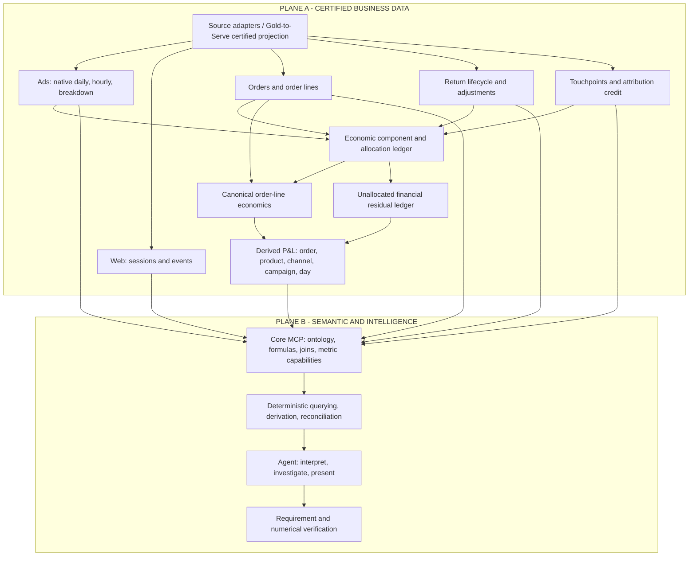
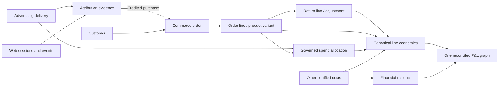
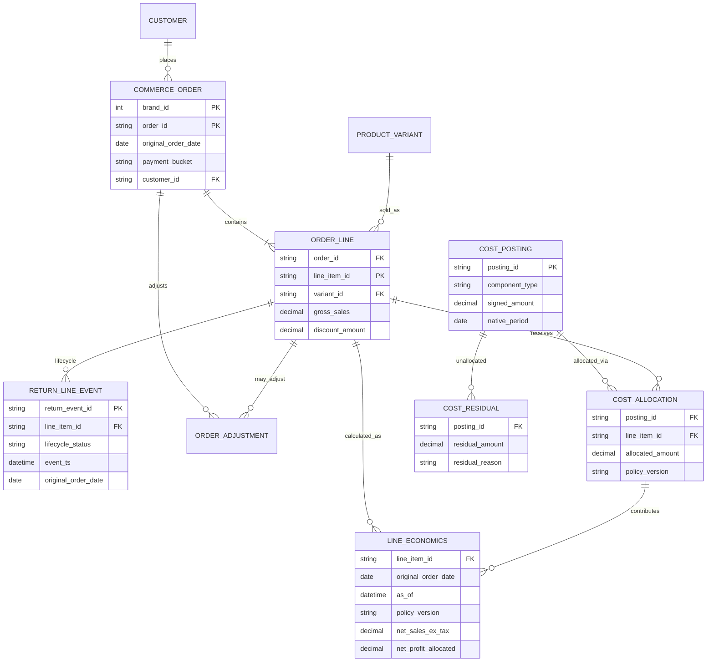
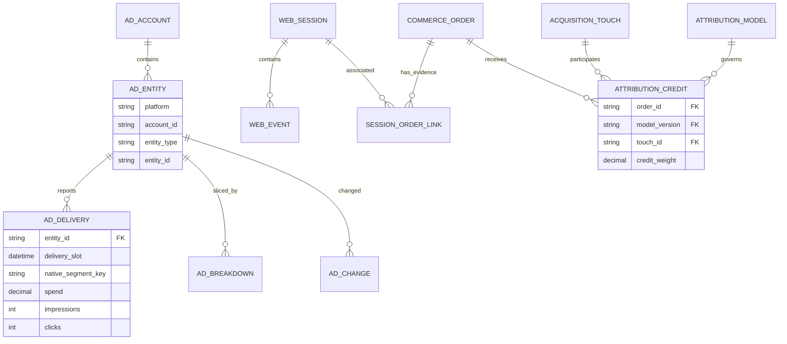
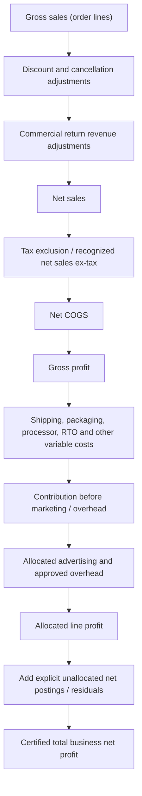
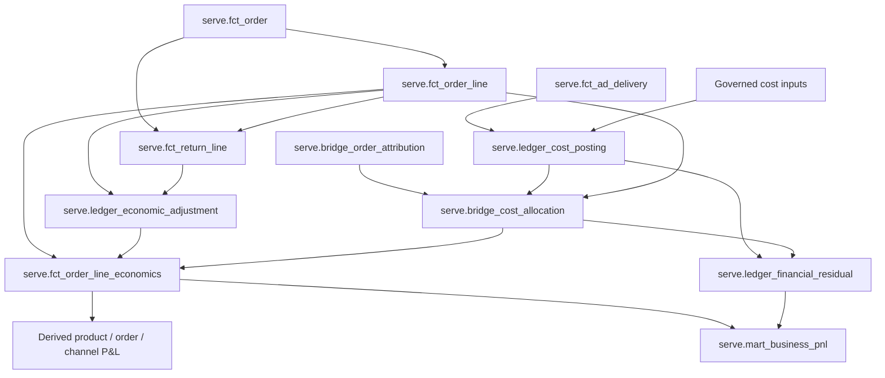

# Seleric — Unified Enterprise Data Model (Two-Plane, Order-Date-Cohort, Reconciled P&L)

**Status:** Proposed target architecture / implementation and migration specification — **refined against live data; business decisions recorded 2026-10-14 (§0B); target semantics in §0C; implementation plan in `plan/SEMANTIC_V3_REBUILD_PLAN.md`; governing constraint: **no capability loss** (§0D)**  
**Version:** 2.3 — 2026-10-14 (v2.3 adds the date-axis contract: §0B D-28…D-37, §0C C8; aligned with the rebuild plan `/opt/seleric/Seleric_Agent_Core/plan/SEMANTIC_V3_REBUILD_PLAN.md`; v2.0 preserved as `Seleric_Enterprise_Data_Model_v2.0_ORIGINAL.bak.md`)  
**Replaces:** `Seleric_Enterprise_Three_Level_Data_Model(1).md` (three-plane proposal)  
**Inspected physical baseline:** v2.0 used static DDL (`tables_202610131246.csv`). **v2.1 adds a read-only live audit of ClickHouse `gold` (82 objects), `semantic` (13) and `serve` (55 views) on 2026-10-14**, all queries run with `readonly=1`; plus Cube v2 model `mage-ai/infra/cube/model_v2`.  
**Scope:** Conceptual, logical, physical, semantic, finance conservation, default time policy, AI-Agent consumption and retirement plan.

> **Implementation status / limitations.** The target `fct_*`, `bridge_*`, `ledger_*` objects in this document are **proposed**; do not assume they exist. §0A lists facts *observed* in live data on 2026-10-14 (brand 20 unless stated, INR, order dates in IST). Facts are not policy: every place where the data forces a business choice is recorded in §0B as **PENDING** until the business owner answers. This specification intentionally does not assert that a refund necessarily means a return, or that a delivery-date expense belongs to an order-date cohort without allocation evidence.

## 0A. Live data audit — observed facts (2026-10-14)

All figures are brand 20 (Tilting Heads), all time (2024-10-23 → 2026-10-13), from `gold.* FINAL` unless stated. Gold tables were already deduplicated at audit time (`count() = count() FINAL` on every core fact). Every number below is reproducible by a read-only query.

### A1. Scope of the warehouse

| ID | Observation | Modelling consequence |
|---|---|---|
| F-01 | Only **brand 20** has real commerce data (24,097 orders). Brands 24/25/26/27 have 1–32 orders each; brand 21 is `test`; brand 28 (Commbitz) has **Meta + Google spend only** (₹4.66L Meta, ₹23.6L Google) and no commerce. | Brand scope must be a first-class capability flag (`has_commerce`, `has_paid_media`, `has_web`). Profit/ROAS/AOV must be refused, not computed, for brands without commerce. |
| F-02 | Brand 20 also sells on **Amazon**: `gold.fct_amazon_sp_*` (3,810 SP orders since 2025-12-02, settlements, finance events, returns, `fct_amazon_sp_order_pnl`) and **Amazon Ads** (`fct_amazon_ads_*` since 2026-04-11). **None of this is in v2.0 or in any `serve` view / `canonical_pnl`.** | The overview roll-up currently omits a whole sales channel and its ad spend. Decision D-04. |
| F-03 | All ad accounts report in **INR**; Shopify is INR. Order dates are IST (`order_created_at_ist`). | Single reporting currency today; FX policy can stay dormant but the column must remain. |
| F-04 | Data freshness: orders, Meta, Google, sessions all have max date 2026-10-13. | Watermarks per source still required (§4); they happen to align today. |

### A2. Orders — population and order types

| ID | Observation | Modelling consequence |
|---|---|---|
| F-05 | `fct_orders.pnl_refund_class`: ACTIVE 19,232 · RETURN 2,707 · CANCELLATION 2,077 · ADJUSTMENT 81. `revenue_eligible=1` only on ACTIVE (18,149). | Existing classification is a single mutable current-state label; no as-of history. |
| F-06 | `source_name` is the **checkout app**, and it changes over time: `273200054273` (2025-08→2026-02), `325265719297` (2026-02→2026-08), `235916197889` (Pragma 1-checkout, 2026-08→now), `web`, `pos` (113, Dec-2025 only), `shopify_draft_order` (293, of which 45 `is_revenue_adjustment`). Order-name prefix changes from `TC-001…` to `TH/26-27/…` in Apr-2026 (FY numbering). | `source_name` is not a sales channel; must not be exposed as one. Draft/POS/test inclusion is D-08. |
| F-07 | **Exchange replacement orders exist as separate Shopify orders** (from 2026-06): names `Ex-1-TH/…`, `Ex-2-…` up to `Ex-5-…` (chained exchanges), tags `exchange-replacement`, `ex-origin:<original order name>`, `ex-req:<id>`; payment gateway `manual`; created by exchange apps `258451668993` and `235916197889` (Logisy/Pragma tags `logisy_exchange_order`, `pragma_same/higher/lower_value_exchange`). 498 orders are flagged `is_exchange_replacement=1` in `fct_order_attribution`; tag/name detection finds the same 498. | A replacement is a **fulfilment of an existing sale**, not a new customer purchase (pending D-01). It needs an explicit `order_type` and a `parent_order_id` link (the `ex-origin` tag resolves 100% of replacements to an original). |
| F-08 | Replacement orders are currently **counted as sales**: mostly ACTIVE + `revenue_eligible=1`; the 498 flagged replacements carry ₹8.39L net revenue all-time; they get product COGS and placement costs. Attribution already isolates them (`lt_platform='exchange'`, `attribution_method='exchange_replacement'`), e.g. Sep-2026: 167 orders / ₹2.81L net. Commerce, `canonical_pnl`, product sales and order counts do **not** isolate them. | Today: order count, AOV, product units sold, new-vs-repeat, and "unattributed/other" share are inflated; revenue is shifted from the original order date to the replacement date. |
| F-09 | The **original** order of an exchange is classed `RETURN`; Shopify records a refund on it of ₹7.14L with `has_money_refund=0`, `restock=1` (no money moved). ~390 of the 2,707 RETURN orders are exchange originals. | Return rate and "refunds" are overstated by exchanges. Exchange ≠ return ≠ refund — three separate concepts. |
| F-10 | A second exchange mechanism exists **inside the same order**: `exchange_reversed_revenue` / `exchange_reversed_quantity` populated on 111 orders (₹2.45L, from 2026-08). | Both mechanisms must map to the same business concept `exchange`. |
| F-11 | `CANCELLATION` mixes **pre-dispatch cancellations** and **RTO** (return-to-origin / failed delivery): of 1,914 COD cancellations, 643 have `shipped_at` and 1,192 carry an `RTO` tag. RTO also appears inside `RETURN` (392 COD returns tagged RTO). There is no RTO class. | Cancel, RTO and customer return have different economics (no cost / forward+reverse shipping + no revenue / reverse shipping + restock). Decision D-05. |
| F-12 | Shopify "refund" ≠ money: COD cancellations carry ₹30.1L of `refund_total_amount` with **zero** transaction amount (COD never collected). Only `fct_refunds.has_money_refund=1` rows moved cash (₹25.7L transaction amount). | Refund money must come from transactions (`fct_payments` / `refund_transaction_amount`), never from `refund_total_amount`. |
| F-13 | Order header `gross_revenue` = `subtotal_price + total_shipping_charged` (tax-inclusive, `taxes_included=1` on 99%). Matches for 23,876/24,097. Line `total_price` sums equal header gross only for 19,261 orders because **shipping charged (₹1.52L on 2,146 orders) lives only on the header**. `subtotal_price = Σ(line total_price − line discount)` for 100% of orders. | Order-level components that no line owns (shipping charged, order-level adjustments) must be explicit order-level postings, or line totals will never reconcile to order totals. |
| F-14 | `int_finance_order_lines` already carries recognition flags: `is_realized_eligible`, `is_delivery_recognized`, `is_deferred_revenue`, `first_fulfilled_date`. 1,267 ACTIVE lines (₹22.2L) are not yet delivery-recognized. | Booked vs delivered (realised) revenue is a real choice the data supports. Decision D-02. |

### A3. Costs and COGS

| ID | Observation | Modelling consequence |
|---|---|---|
| F-15 | **`gross_cogs` is not product cost.** For the legacy era it is exactly `product_cost + packaging + forward_shipping + gateway_fee (prepaid only)` (22,204 / 22,240 ACTIVE lines, 99.8%). Brand-20 ACTIVE lines: product ₹1.06Cr, packaging ₹2.3L, shipping ₹27.9L, gateway ₹10.3L → `gross_cogs` ₹1.42Cr. | "COGS" in every current view is a **landed variable cost**. Pure product COGS, landed COGS and contribution costs must be separate named components. Decision D-03. |
| F-16 | **COGS method changes by era** (`cost_source`): `legacy_metafield` (all orders to 2026-08), `pg_order_cogs` (from 2026-09; adds COD handling fee, RTO cost, checkout fee, weight discrepancy, `product_cost_credit`), `provisional_scd2` (gross = product + `estimated_ops_cost`, status `provisional`). | A margin step-change at 2026-09 is a **method change, not a business change**. Must be flagged or back-filled (D-11). `cost_status` (final/provisional/missing) must be a filterable dimension. |
| F-17 | Cost coverage: 470 lines `cost_status='missing'` (gross_cogs = 0), concentrated in 2025-03 → 2026-04. | Missing cost must not silently mean zero cost; expose coverage % and an Unknown-cost bucket. |
| F-18 | Order-level cost columns in `fct_orders` (`product_cost`, `forward_shipping_cost`, `gross_cogs`, …) are **NULL for every order before 2026-09**; only `fct_order_items` holds historical cost. | Lines are the only cost grain for history; order-level cost must be the sum of lines + order-level postings, never read from the header. |
| F-19 | Shipping, packaging, gateway, RTO are **per-unit rate-card estimates** (`shipping_cost_per_unit` 117/336 etc.) multiplied by quantity, not courier/gateway invoices. | Label as `estimated_*`. Actual courier invoices (if they exist) would be a separate cost source and residual. |
| F-20 | Return cost handling exists per line: `refunded_product_cost`, `product_cost_credit`, `cogs_return_basis` (`return`, `rto`, `exchange`, `return_exchange`, `cancelled`, `reverse_ship_no_line_detail`), `restock_type`. For RETURN lines: gross_cogs ₹20.9L, net_cogs ₹8.4L. | Restock / recovery policy already partially encoded; needs a business sign-off (D-03). |
| F-21 | Product cost history: `fct_product_variant_cost_history` (SCD2, effective_from/to), `fct_shopify_product_cost_history` (versioned), `dim_sku_cost_aliases` (empty), plus a stale backup `fct_product_variant_cost_history__bak_20261001`. | One cost-history authority must be named; the backup table is a clean-up candidate. |

### A4. Advertising platforms

| ID | Observation | Modelling consequence |
|---|---|---|
| F-22 | **Meta** gold grain = ad × day (24,020 rows brand 20, ₹2.33Cr spend), with full creative, targeting, video, and platform-conversion fields (`purchases`, `purchase_value`, `landing_page_views`, `add_to_cart`…). | Drill path: account → campaign → ad set → ad → creative. |
| F-23 | **Google** gold grain = campaign × ad group × ad × **device × network** × day (unique at that key). `serve.google_ads_daily` **collapses to campaign × day** (`GROUP BY brand_id, report_date, campaign_id`); v2.0 statement "Google is campaign-level only" describes serve, not the source. | Ad-group/ad/device/network drill is possible for non-PMax campaigns but is currently thrown away. |
| F-24 | **Performance Max = ₹32.1L of ₹43.6L Google spend (74%)** and uses synthetic IDs: `ad_id='pmax'`, `adset_id='pmax_<campaign_id>'`. By network: SEARCH ₹28.2L, YOUTUBE ₹6.3L, DISCOVER ₹3.4L, CONTENT ₹2.8L, MIXED ₹1.6L. | Google hierarchy is **not** Meta's. For PMax the deepest level is campaign (+ device/network segment); "ad" must be NULL/“PMax (no ad level)”, never a fake ad. |
| F-25 | Platform-reported vs first-party, Meta Sep-2026: platform `landing_page_views` 21,067 vs website Meta sessions 30,040; platform `purchase_value` ₹15.5L vs website-observed purchase revenue ₹11.9L vs Shopify last-touch Meta orders ₹12.8L gross / ₹10.1L net. | Platform numbers are a different metric family. The user has ruled (D-00) that LPV and revenue for ads come from the website/Shopify, not the platform. |
| F-26 | **Violations of D-00 today:** `serve.ad_delivery_daily.landing_page_views`, `serve.meta_ads_daily.meta_landing_page_views`, Cube `paid_media.landing_page_views` / `cost_per_landing_page_view`, and `serve.product_ad_line.allocated_landing_page_views` (Cube `product_landing_page_views`) all expose **Meta-reported** LPV under a generic name. `ad_delivery_daily` carries Meta `reach` per ad-day (correct at native grain; Cube does not expose it today) — any future roll-up must not sum it. Platform `purchase_value`/`conversion_value` are not exposed in serve (correct). | Remove platform LPV from serve/Cube (D-13) and bind `landing_page_views` to website sessions (D-17). |
| F-27 | Ad ↔ website linkage, Sep-2026: Meta sessions carry `ad_id` 81% (24,307/30,040); Google sessions carry `campaign_id` 71% but `ad_id` only 12%. Order attribution: Meta orders with `lt_ad_id` 519/592, Google 40/259. | Meta website metrics can drill to ad; Google website metrics stop at campaign (+ ad only for non-PMax). |

### A5. Website, attribution and journeys

| ID | Observation | Modelling consequence |
|---|---|---|
| F-28 | `fct_session_funnel` (480k sessions) is the website population: platform, channel, UTM, `campaign_id/adset_id/ad_id`, landing page, funnel stage flags, `shopify_order_id`, `purchase_revenue`. `mart_landing_page_daily` and `mart_ad_funnel_daily` already derive sessions/PDP/ATC/checkout/orders per landing page and per ad. | Website LPV/sessions per ad/campaign are available first-party. |
| F-29 | `fct_order_attribution` (1 row/order) carries last-touch platform/channel/campaign/ad + `identity_resolution_method` + `attribution_method` + exchange flags. `fct_order_attribution_credit` has 4 models (`first_touch_v1`, `last_touch_v1`, `last_non_direct_v1`, `linear_v1`) but covers **only 6,291 orders** (journey tracking era); credits sum to 1.0 per order. | Multi-touch is only valid for the covered period; the agent must show coverage. Default model is D-06. |
| F-30 | Sep-2026 identity resolution: `purchase_session_id` (most), `cart_token`, `unstitched` (exchange replacements 245, others ~44). | Unstitched orders must remain an explicit "Unattributed" member. |

### A6. Current P&L surfaces (what is wrong today)

| ID | Observation | Consequence |
|---|---|---|
| F-31 | `serve.canonical_pnl` (`canonical_pnl_v4`, "composed_fe_parity") is **event-dated**: placement costs on order date, cancel costs on `cancellation_date`, return/RTO costs on `return_event_date`. | Contradicts AD-03 (order-date cohort). Cannot be the order-cohort P&L. |
| F-32 | In `canonical_pnl`, `net_cogs` = product + shipping + packaging + gateway + RTO (i.e. includes operating costs); `operating_cost` is the same components again; `gross_profit = contribution_margin`; `shopify_ad_spend = total_ad_spend`. | Names do not match content; duplicated measures invite double counting. |
| F-33 | `canonical_pnl.sub_channel='unattributed'`, `is_new_customer=0`, `shipping_region=''`, `payment_bucket=''` are **hard-coded constants**. | Any drill on these columns returns one bucket — silently wrong. |
| F-34 | Ad spend in `canonical_pnl` is all Meta + Google spend joined **on equal date** to order-date commerce; Amazon Ads absent; replacement orders inside net sales. | Brand-day profit mixes delivery clock and order clock; acceptable only as a labelled *period* view. |
| F-35 | Three further P&L engines exist: `semantic.fct_pnl_daily / fct_order_pnl_daily / fct_product_pnl` (materialised views from gold), `gold.fct_daily_pnl`, `gold.fct_finance_waterfall_daily`, `gold.int_finance_daily_rollups`, `gold.fct_ad_channel_pnl_daily`, `gold.fct_amazon_daily_pnl`, `gold.fct_amazon_sp_order_pnl`. | Confirms AD-07: one component graph, everything else retired or re-projected. |

## 0B. Decision register (business owner answers required)

Status values: **PENDING** (not answered), **DECIDED** (owner answer recorded with date). No modelling choice below is to be implemented while PENDING.

Machine-readable register (implementation location, evidence codes, tests, how to change): `doc/semantic_v3/DECISIONS.yaml`; consistency check `scripts/check_decisions_v3.py`.

| ID | Decision | Options | Evidence / ₹ impact | Status |
|---|---|---|---|---|
| D-00 | Source of truth for ad-facing LPV and revenue | Website sessions for LPV; Shopify orders (via attribution) for revenue; platform conversion numbers hidden (D-13) | F-25, F-26 | **DECIDED (2026-10-14, owner instruction)** — platform-reported LPV/revenue must not be used as the ad metric |
| D-01 | Exchange treatment | (a) replacement = continuation of original sale (no new order, no new revenue; price difference only) (b) replacement = new order/sale (today) | F-07–F-10: 498 replacement orders, ₹8.39L counted as sales; ~390 originals counted as returns; ₹7.14L non-cash "refunds" | **DECIDED 2026-10-14: Continuation + separate exchange lifecycle.** Original order is the only commercial sale (keeps order date, customer, attribution). Replacement = linked fulfilment child: no order count, no sales revenue. Price-difference charges/refunds adjust the **original** order cohort. Exchange COGS, inventory recovery, shipping and handling are separate economic components. Non-cash exchange credits are internal transfers — not cash refunds, not sales deductions. Exchanged items never enter ordinary return metrics. All exchange components reconcile to the original order's line economics and the canonical P&L. |
| D-02 | Revenue recognition basis | booked at order (minus cancels/returns as-of) vs delivery-recognised (realised) | F-14: ₹22.2L ACTIVE not yet delivered; of which ₹21.5L (1,226 lines, 90% COD) are >45 days old and still lack delivery evidence | **DECIDED 2026-10-14:** owner: "all Actives means actually delivered" → net sales = delivered. **D-02a DECIDED 2026-10-14:** an ACTIVE line (not cancelled / RTO / returned) **is treated as delivered**; missing delivery flags are considered incomplete tracking. Net sales = ACTIVE lines as of cutoff. (Recent in-transit ACTIVE ≈ ₹2.2L will therefore count as sales and move to RTO/return if they fail.) |
| D-03 | COGS definition and return recovery | pure product COGS vs landed (product+packaging+shipping+gateway); restocked returns credit product cost back or not | F-15, F-20 | **DECIDED 2026-10-14: Split layers.** COGS = product (landed purchase) cost only. Packaging, forward/reverse shipping, gateway, COD handling, RTO, checkout fee, weight discrepancy = separate *fulfilment & payment cost* components. Gross profit = net sales − product COGS; contribution = gross profit − fulfilment & payment costs − ad spend. Restock-credit policy: see D-03a |
| D-04 | Amazon in overview roll-up | include marketplace sales + Amazon Ads as a channel vs separate P&L | F-02 | **DECIDED 2026-10-14: Out of scope for this rebuild.** Brand overview is labelled D2C (Shopify) only; Amazon remains a documented gap; Amazon gold tables are untouched (not deleted) |
| D-05 | Cancel vs RTO vs return as separate concepts | three classes with own costs vs today's two | F-11: ≥643 shipped "cancellations" | **DECIDED 2026-10-14: Three concepts.** *Cancelled* (before dispatch: no fulfilment cost), *RTO* (shipped, not delivered: forward + reverse shipping, no revenue, stock recovered), *Customer return* (delivered then returned: revenue reversed, reverse shipping, restock). Each has its own rate and cost components, all on the original order date. Exchanges (D-01) are a fourth, separate lifecycle. **Refined by D-22** (four evidence-based outcomes incl. Unknown). |
| D-06 | Default attribution model for campaign/ad revenue | last_touch / last_non_direct / first / linear | F-29 coverage | **DECIDED 2026-10-14: `last_non_direct` is the default**; model must be a parameter so the default can be changed later; other models selectable explicitly and never mixed in one total. |
| D-07 | Ad cost allocation to orders/products | none (spend stays at ad level, revenue credited) vs allocate by attribution credit | §6.5 | **DECIDED 2026-10-14: Period match, no allocation.** Period profit = contribution of orders placed in the period − ad spend delivered in the period. Campaign drill = attributed contribution (default model D-06) − that campaign's spend; *Unattributed/organic* contribution and *spend without attributed orders* are explicit rows so Σ campaigns + unattributed = brand total exactly. Product/line profit stops before ad spend unless explicitly requested. No spend-to-order allocation ledger in this rebuild. Default unchanged; the explicit `allocated` product family (D-19o) is the only allocation and never feeds default/overview answers. |
| D-08 | Draft / POS / test / revenue-adjustment orders | include vs exclude per type | F-06 | **DECIDED 2026-10-14:** count as sales orders — draft orders (293), POS orders (113), revenue-adjustment orders (45). **Excluded** — zero-value/free orders (gross after discount ≤ ₹1). Test orders: see D-08a. |
| D-09 | Ad revenue measure | Shopify order net revenue via attribution vs website purchase-event value | F-25 | **DECIDED 2026-10-14:** primary first-party ad revenue = **attributed gross sale** (Shopify, at placement) → *Gross ROAS*; *Net ROAS* also provided (attributed revenue net of cancels/RTO/returns as of cutoff). Website purchase-event value is a tracking-quality metric only. **D-09a DECIDED 2026-10-14:** gross sale = line price − discounts, **ex-GST**, at placement (before cancels/RTO/returns), excluding exchange replacements. |
| D-10 | Shipping charged to customer | revenue vs cost offset | F-13: ₹1.52L | **DECIDED 2026-10-14: Order-level revenue.** Shipping charged is an explicit order-level net-sales component (ex-GST), not spread to lines; product-level sales exclude it; order/brand totals include it. |
| D-11 | COGS era break 2026-09 | back-fill legacy era with new components vs flag method change | F-16 | **DECIDED 2026-10-14: Back-fill with rates.** Legacy era recomputed with the same component set using the rate cards/rules effective at the time; values marked `cost_method='estimated_backfill'`. |
| D-12 | As-of / closing cutoff | rolling (today) vs locked monthly snapshot | §4 | **DECIDED 2026-10-14: Live + monthly close.** Default = latest state; locked month-end snapshots make closed months reproducible; recent cohorts flagged `maturing` for a defined window (D-12a). |
| D-02b | GST | ex-GST vs incl. GST | F-13 | **DECIDED 2026-10-14: ex-GST** for all revenue, margin and ROAS metrics; GST (CGST/SGST/IGST) is its own component; tax-inclusive GMV only as a separately labelled metric. |
| D-03a | Returned/RTO stock cost recovery | credit if restocked / always / never | F-20 | **DECIDED 2026-10-14: Always credit back** product COGS for every returned or RTO unit (and exchanged-back unit); reverse shipping/handling remain costs. |
| D-12a | Maturity window | 30 / 45 / 60 days | F-11, F-14 | **DECIDED 2026-10-14: 45 days** after order date a cohort is `maturing`. |
| D-13 | Platform-reported conversions (Meta purchases/value/LPV, Google conversions/value) | keep labelled / hide | F-25, F-26 | **DECIDED 2026-10-14: Hide completely** — not exposed in `serve`, Cube or to the Agent. **Relaxed by D-13r** for LPV only: hidden-by-default diagnostic twin `platform_reported_landing_page_views` is kept. |
| D-14 | Google hierarchy | native per platform / campaign only | F-23, F-24 | **DECIDED 2026-10-14: Native per platform** — account → campaign type → campaign → ad group → ad (non-PMax) + device and network as Google-only breakdowns; PMax stops at campaign (+device/network). Cross-platform overview uses only common levels. |
| D-17 | Website LPV definition | sessions with ≥1 page view / all sessions / engaged | F-27, F-28 | **DECIDED 2026-10-14:** LPV = website sessions attributed to the platform/campaign/ad (UTM/click-id) with **≥1 tracked page view**. Sessions without `ad_id`/`campaign_id` roll up as explicit `ad unknown` / `campaign unknown` members (Meta 19% / Google 88% of sessions lack ad_id). |
| D-18 | Net profit | contribution only / rename / add opex | F-32 | **DECIDED 2026-10-14: Contribution only.** Top published metric = *contribution after ads*. No metric named "net profit" until an opex source exists; Agent explains the gap. `canonical_pnl.net_profit` retired with it. **Refined by D-18r:** existing `net_profit` ids are kept and resolve to contribution after ads, labelled "excludes opex". |
| D-19 | Product-level ad metrics | credit-based / allocated family / retire | §0C-C5 | **DECIDED 2026-10-14: Credit-based, no spend split.** Product drill shows attributed orders/sales per campaign/ad (which products each ad sold); `product_ad_spend`, `product_gross_roas`, `product_net_roas`, `product_mer`, `product_landing_page_views` and spend allocation in `serve.product_ad_line` are retired. **OVERRIDDEN by D-19o** (no-capability-loss rule): product-level ad metrics are kept as an explicit `allocated` family. |
| D-20 | Exchange edge cases | evidence-based / as returns / review bucket | F-07–F-10 (≈54 exchange-tagged RETURN originals have no replacement order) | **DECIDED 2026-10-14: Evidence-based.** (a) Exchange-tagged with no replacement: money refund exists → customer return; otherwise `exchange_in_progress` (not a return). (b) Replacement later returned/refunded in cash → customer return of the **root** sale's line on the root order date. |
| D-11a | Back-fill rates not present in data | owner rate card / leave missing | F-16: legacy rows have RTO rate (variant cost history) but **no** COD-handling, checkout-fee or weight-discrepancy rates before 2026-09 | **DECIDED 2026-10-14 (owner): leave it — no extra data.** Legacy COD handling, checkout fee and weight discrepancy stay as gold has them (absent) with `cost_method='not_recorded'`; never estimated. Rates that *are* in the data (packaging, shipping, gateway, RTO per unit) are used per D-11 (e.g. legacy RTO reverse shipping ₹2.75L, `estimated_backfill`). |
| D-19o | Product-level ad metrics vs no-capability-loss | keep as allocated family / retire | ~25 `product_*` spend/ROAS/MER/CAC/delivery ids exist today | **DECIDED 2026-10-14 (plan):** kept as an explicit `allocated` family — allocation = attribution credit (default model) × line gross-sales share; `allocation_rule_version` on every row; Unallocated spend row so totals reconcile; never used in default/overview answers. Period rule for allocation still open (§0D Q2). |
| D-21 | Event-date P&L family (`pnl_*`, 25 ids) | keep explicit / retire | dashboard-style "processed in period" | **DECIDED 2026-10-14 (plan):** kept as explicit family, rebuilt on the same component ledger. Order-date cohort stays the default. Reconciliation: equal over all history; per period, event − cohort = itemised cross-period bridge with 0 unexplained ₹ (not equal per month, see §4.1). **AMENDED 2026-10-14 by D-28:** the `pnl_*` ids stop being a separate family; they become deprecated aliases of the base metric with `date_axis=event_date` (Phase 4.5). |
| D-21a | Event-date family (`pnl_*`): date of the product-cost restock credit (D-03a) | order date (as v2) / event date | Brand 20 Sep 2026: event-date product cost differs by ₹3,60,032 (Aug ₹26,475); all-history totals identical either way; v2 event − cohort product cost = 0 in every month | **DECIDED 2026-10-14 (owner): order date, as v2.** In `mart_pnl_event` the `product_cogs_credit` stays on the order's placement date; every other component falls on its own event date. The itemised event − cohort bridge uses the same rule. Scope: only `product_cogs_credit`; the exchange stock-return components are new in v3 (no v2 timing) and stay on their event date. **RE-OPENED 2026-10-14: superseded by D-30** (the credit follows its deduction) when Phase 4.5 lands; live until then. |
| D-21b | Event-date family: month-by-month differences to v2 `pnl_daily` | accept v3 dating / itemise v2 line by line | Brand 20 net profit v3 − v2: Jul −₹1.65L, Aug −₹1.14L, Sep −₹0.25L (cohort leg bridged with causes; the rest is event dating, where v2 uses another gold fact plus an undated `reconciliation` plug row of −0.84L / −3.44L / −1.96L contribution); all history identical | **DECIDED 2026-10-14 (owner): accept v3 dating.** v2's plug is recorded as a v2 defect; month-by-month differences go into the Phase 7 variance report for sign-off. |
| D-18r | `net_profit` ids | keep relabelled / hard-cut | ids exist today | **DECIDED 2026-10-14 (plan):** ids kept; resolve to contribution after ads; description and Agent answer state opex is excluded. |
| D-13r | LPV ids | website source / + platform twin | F-26 | **DECIDED 2026-10-14 (plan):** `landing_page_views` / `cost_per_landing_page_view` rebound to website LPV (D-17), major version bump; hidden-by-default `platform_reported_landing_page_views` kept for diagnostics. All other platform conversions stay hidden. |
| D-22 | RTO / return / cancel evidence rule | class+status / unknown bucket / … | Ambiguous: 256 shipped no-status cancels, 898 shipped no-status returns, 93+84 shipped non-delivered, 38 delivered cancels | **DECIDED 2026-10-14 (owner text):** four outcomes — Not shipped + cancelled → *Cancellation*; shipped + confirmed RTO → *RTO*; delivered + confirmed return → *Customer Return*; conflicting or insufficient evidence → *Unknown*. Never assume every shipped cancellation is RTO or every delivered cancellation a return. Original order_date kept; each financial deduction counted once; Unknown kept visible for reconciliation; `outcome_evidence` code on every row. |
| D-23 | Rebuild scope and consumers | keep old surface / migrate dashboard / compat views | consumer scan 2026-10-14 | **DECIDED 2026-10-14 (owner text):** `seleric_systems` web dashboard is not used — it and Cube v1 are excluded. Scope = Seleric Agent, Core MCP, Cube v3, new canonical serve. Migrate only `/opt/seleric/reports` scripts still in use. Reconcile new serve financial components to gold at line, order, product, channel, campaign and business level. Retire legacy views after verifying no active consumers; no compatibility for unused systems. |
| D-24 | Cutover style | parallel then switch / in place | no staging ClickHouse/Cube | **DECIDED 2026-10-14:** parallel build (new serve objects, Cube v3 on :4003, catalogue_v3), switch after the no-capability-loss gate; rollback = env flip; old objects dropped after 2 stable weeks + zero-read check. |
| D-25 | Committed-but-unapplied `semantic.fct_line_pnl` (mage-ai `f645091`) | supersede / apply now | not live in ClickHouse | **DECIDED 2026-10-14:** superseded — never applied; its line-GST and shipping-tax SQL reused in the new ledger; file removed in cleanup. |
| D-08a | Test orders | exclude / include | F-05 | **DECIDED 2026-10-14: excluded everywhere.** |
| D-15 | New-customer definition | first placed / first delivered | — | **DECIDED 2026-10-14: first placed order** (regardless of outcome). |
| D-16 | Guest identity | match guests by phone/email / keep separate | — | **DECIDED 2026-10-14: guest checkouts matched to customers by phone/email** for repeat/LTV. Feasible: `gold.dim_customers` has `phone`, `phone_hash`, `email_hash`. *Proposed (not yet decided): use hashed keys in serve, no raw PII to the Agent.* |
| D-26 | Live v2 defects F0-1 (4 tax metrics error) / F0-2 (customers × first-order product errors) | fix in v2 now / leave until v3 | Phase 0 sweep 2026-10-14: 7 of 739 Cube v2 members fail; caused by unapplied mage-ai f645091 / 8a2b333 | **DECIDED 2026-10-14 (owner):** leave broken in v2; v3 delivers them (CAPABILITY_MAP `live_defect`). No v2 production write. |
| D-27 | Allocated product-ad family: period rule (Q2) | same day + default-model credit / reproduce v2 last-touch same-day / same month | Sep 2026 brand 20, spend ₹11,93,322: same day (default credit) allocates ₹7,87,188 (₹4,06,134 unallocated); v2 last-touch same day ₹4,15,479 (₹7,77,843 unallocated); same month ₹10,70,692 (₹1,22,630 unallocated) | **DECIDED 2026-10-14 (owner): same day, default-model credit.** A campaign-day's spend is spread over the lines of orders credited to that campaign (`last_non_direct`) on that cohort day, by credit × line gross-sales share; spend with no credited order that day is the `Unallocated` row; `allocation_rule_version` on every row. |
| D-27b | Allocated product family: landing-page-view source (Q2b) | website sessions / platform twin / drop | F-26 (platform LPV under a generic name) | **DECIDED 2026-10-14 (owner): website sessions (D-17).** Product LPV = website LPV sessions allocated by the same rule; the number changes versus today's Meta-reported `product_landing_page_views` (decision id on the entry). |
| D-12b | Monthly close: months before the first snapshot (Q3) | reconstructed + flagged / not offered / back-lock now | snapshots exist only from the first close | **DECIDED 2026-10-14 (owner): reconstructed, flagged.** Earlier months are rebuilt from today's state and carry `close_status = 'reconstructed'` (never presented as locked); real closes carry `locked`. |
| D-22a | Bare `RTO` tag on unshipped cancellations | real RTO / pre-dispatch cancel / unknown | 949 orders, ₹18.9L ex-GST, Apr–Nov 2025, 97% COD; unfulfilled, no tracking; 93% of 2025-Q3 cancellations carry the tag | **DECIDED 2026-10-14 (owner): real RTO** — shipment record lost on cancellation. Evidence code `cancel_rto_tag_shipment_record_lost`. |
| D-22b | RETURN with merchant-created return record, no money refund, no delivery status, no RTO evidence | RTO / customer return / unknown | 707 orders, ₹13.8L, Jan–Jun 2026 (no RTO tagging existed then), 94% COD, return reason `unknown` | **DECIDED 2026-10-14 (owner): RTO.** Code `return_record_no_money_no_delivery`. |
| D-22c | Shipped cancellation, never delivered, no RTO evidence | RTO / unknown | 346 orders, ₹7.0L, mostly Oct–Dec 2025, 98% COD, fulfilled with tracking | **DECIDED 2026-10-14 (owner): RTO.** Code `cancel_shipped_never_delivered`. |
| D-22d | RETURN with money refunded but no delivery status | customer return / unknown | 256 orders, ₹5.8L (125 with return request, 131 without) | **DECIDED 2026-10-14 (owner): customer return (all 256).** Codes `return_request_money_refund`, `return_money_refund_only`. |
| D-22e | ACTIVE order with RTO evidence (Logisy rto_in_transit / rto_delivered tags, courier `failure`, or the 2025 bare `RTO` tag) | RTO / unknown / active | 46 orders, ₹88k (24 Logisy/courier, 22 bare tag) | **DECIDED 2026-10-14 (owner): RTO** — tag is newer evidence than the Shopify status; overrides D-02a for these orders. Code `active_with_rto_evidence`. |
| D-22f | Line refunded with no return (ACTIVE / ADJUSTMENT orders) | cancelled / active + adjustment | 76 lines (66 on sale orders, ₹1.1L ex-GST); on 52 orders every line is refunded with no return | **DECIDED 2026-10-14 (owner): cancelled.** Line code `line_refund_without_return`; an order whose every line is refunded with no return is `cancelled` (`refund_without_return_all_lines`). |
| D-22g | Returned quantity with no refund on an ACTIVE order | returned / unknown | 2 sale lines (₹3.2k) | **DECIDED 2026-10-14 (owner): returned.** Line code `line_return_qty_without_refund`. |
| D-22h | Ledger treatment of Unknown-outcome orders | separate bucket / delivered / cancelled | 68 sale orders, ₹96k | **DECIDED 2026-10-14 (owner): treat as cancelled** in the ledger (sales deducted, product cost credited, no fulfilment cost, shipping revenue reversed); `outcome='unknown'` stays visible on every row. |
| D-10a | Shipping revenue on undelivered / returned orders | reverse on cancel+RTO / +returns / never | shipping charged incl. GST: cancelled ₹4.5k, RTO ₹23.1k, returned ₹1.8k, exchanged ₹5.3k | **DECIDED 2026-10-14 (owner): reversed for cancelled and RTO orders** (and Unknown, D-22h); returned and exchanged orders keep it. |
| D-01a | Exchange price-adjustment basis | value difference / money moved | Pragma tags check: lower −₹4.1k, higher +₹8.2k, same ≈ 0 (₹134 mean noise) | **DECIDED 2026-10-14 (owner): value difference** — replacement value − exchanged item value, ex-GST, on the root order cohort; 0 when the replacement is cancelled / RTO. In-order exchanges (F-10): − exchanged-out line value. |
| D-01b | Which payments are non-cash exchange credits | manual + store credit only / + blank + partially_paid | replacements: manual ₹7.6L + ₹1.6L pending, blank/'other' ₹2.36L, partially_paid ₹42k, COD ₹26k | **DECIDED 2026-10-14 (owner):** on exchange replacements, gateways manual, shopify_store_credit, partially_paid and blank / 'other' are exchange credits (refunds on exchanged originals through them too); COD and named card / UPI gateways are cash. `serve.fct_payment.payment_class`. |
| D-22i | Which lines a cancel / RTO / return deducts | whole order / item level | RTO orders: 132 lines ₹1.99L had no item evidence; returned orders with no line evidence: 116 lines ₹1.43L | **DECIDED 2026-10-14 (owner): item level for everything** — only lines with item evidence (returned / refunded / exchanged quantity, or gold line cancelled / returned revenue) are deducted; other lines of the order stay sold. **Clarified:** when NO line of the order has item evidence, the order outcome applies to every line (e.g. D-22e RTO-tagged active orders, and returned orders whose refund / return exists only at order level — 116 lines ₹1.43L; re-confirmed by the owner 2026-10-14: deduct them). |
| D-11c | Legacy RTO reverse-shipping back-fill | add from line rate / leave out | 1,861 legacy RTO lines with no posting, rate on the line, ₹2.75L | **DECIDED 2026-10-14 (owner): add from the line rate** (`estimated_backfill`). |
| D-01c | In-order exchange (item swapped inside the same order) in gross sales | remove swapped-out value / keep | 32 lines, ₹79k | **DECIDED 2026-10-14 (owner): remove from gross** — gross = what the customer finally kept; memo row `in_order_exchange_swapped_out` keeps the placed value traceable. |
| D-05a | Packaging on shipped orders when gold refunds it | charge full / follow gold | ₹41k refunded packaging on shipped lines | **DECIDED 2026-10-14 (owner): charge full packaging** once shipped. |
| D-05b | Gateway fee on pre-dispatch cancellations | keep / remove | ₹30k | **DECIDED 2026-10-14 (owner): keep as cost** (the gateway charged it). |
| D-01d | Exchange whose replacement was cancelled / RTO (customer never got the swap) | original becomes a return / keep sale / unknown | 17 replacements, ₹37.7k exchanged value | **DECIDED 2026-10-14 (owner): original becomes a customer return** when all its replacements failed (6 originals; others have a delivered replacement). Code `exchange_failed_replacement`. |
| D-08c | Costs of zero-value / free orders | count / exclude | 18 orders, ₹15.8k | **DECIDED 2026-10-14 (owner): count the costs** in contribution (no revenue, D-08). |
| D-22j | How much a cancel / RTO / return deducts | item value / refunded amount | gold line deduction vs item value; no line had a partial refund below item value on 2026-10-14 (₹0 effect today) | **DECIDED 2026-10-14 (owner): the refunded amount** — the deduction is gold's line cancelled / returned revenue (ex-GST) when present. |
| D-22k | Item came back but nothing was refunded (unpaid COD RTO) | deduct item value / keep in sales | 97 lines, ₹1.51L (mostly COD RTO with a return record, no refund, no gold deduction) | **DECIDED 2026-10-14 (owner): deduct the item value** (nothing paid + item returned = no sale). |
| D-11d | Reverse shipping gold posted on lines v3 classes as kept / pre-dispatch cancelled | keep cost / drop | ₹20k | **DECIDED 2026-10-14 (owner): keep the cost** wherever gold posted it. |
| D-06a | Default-model attribution for orders without last_non_direct credit | last-touch fallback / unattributed / last-touch everywhere | credit exists from 2026-06-01: 16,484 earlier sale orders (₹2.87 Cr) + 811 since (₹17.5L) have none | **DECIDED 2026-10-14 (owner): fall back to gold last-touch**, every row flagged `model_used = last_touch_fallback`; coverage shown. Other models show an explicit `no_model_data` row instead (D-06: never mixed). |
| D-06b | Credited session without a campaign id | fill from same-platform last-touch / campaign unknown | last_non_direct: 792 Google (₹17.8L) + 279 Meta (₹5.6L) orders; 303 / 25 fillable | **DECIDED 2026-10-14 (owner): fill from the order's same-platform last-touch** (`campaign_source = last_touch_fill`); otherwise campaign unknown. |
| D-08b | COD order cancelled and re-placed as prepaid (C2P) | not a sale / cancelled sale | 11 pairs, ₹19.5k, since 2026-08-29 (tags logisy/pragma_c2p_cancelled, attribution supersedes_order_id) | **DECIDED 2026-10-14 (owner): cancelled sale** (today's behaviour); the pair is linked (`superseded_by_order_id`). Code `cancel_cod_to_prepaid`. |
| D-16a | Identity key in serve | hashed person key / customer id only | 7 phone + 5 email groups share identities across 41,180 customer ids; 40 guest orders carry no contact data | **DECIDED 2026-10-14 (owner): hashed person key** (phone_hash, else email_hash, else customer id; customers sharing an email hash merged); no raw phone / email / name / street address in serve, Cube or the Agent. |
| D-28 | Date axis switch (order_date / event_date) | one view + `date_axis` parameter / keep twin views `pnl` + `order_pnl` / both | Twin views today share one fact and literally the same SQL on `cohort_date` vs `event_date`; 9 catalogue concepts / 57 resolve rows switch by metric id; ~25 `pnl_*` + ~25 `product_pnl_*` ids duplicate base ids | **DECIDED 2026-10-14 (owner):** two switchable axes `order_date` (default) and `event_date`. One component ledger with both dates; Cube exposes both time dimensions and the same measures; Core MCP resolves a request-level `date_axis` (default `order_date`); the Agent never selects alternate metric ids; no duplicate P&L formulas or metric families (`pnl_*` / `product_pnl_*` ids survive only as deprecated aliases = base metric + `date_axis=event_date`; `date: finance` = alias of `event_date`). Both axes reconcile to identical totals over the same complete population, as-of and policy, including Undated. Axes are never mixed in one aggregation. |
| D-29 | Event date of a cancel / RTO / return | keep coalesce incl. `order_date` fallback + code / Undated bucket / refund date first; earliest vs first-by-precedence | 5,221 brand 20 outcome lines; 50 (₹77k) have no outcome date and fall back to `order_date` today; 2 RTO lines (₹1.9k) only have a cash `refunded_date`; earliest vs precedence differs on 14 lines; refund vs return-event date differs on 51 lines; no courier timestamp exists | **DECIDED 2026-10-14 (owner):** first non-null by precedence `reversal_event_date → cancellation_date → return_event_date → returned_date → cancelled_date`; never `order_date` or cash `refunded_date`; none → `event_date = NULL`, `event_date_source = 'undated'`, explicit `Undated` member kept in every reconciliation; `event_date_source` on every row. |
| D-30 | Restock credit date on the event axis (re-asks D-21a) | follow its deduction / keep D-21a / both labelled | Sep 2026 brand 20: credit ₹4,25,878 event-dated vs ₹65,846 order-dated (₹3,60,032 in event-axis product cost); 4,795 of 5,260 credit rows have `event_date ≠ cohort_date` (₹25.4L); all history identical | **DECIDED 2026-10-14 (owner): follow its deduction.** `product_cogs_credit` and the exchange credits carry the same event date as the sales they reverse; supersedes D-21a; the v2 `pnl_daily` difference is a leg of the Phase 7 variance report. |
| D-31 | Ratio contracts on the event axis | compute labelled / refuse unsafe / define each | Sep 2026 brand 20: 433 returned orders on the event axis against 931 placed (46%) vs 20 on cohort; net sales ₹4.21L event vs ₹15.7L cohort | **DECIDED 2026-10-14 (owner, table approved):** same clock or refused. Identical on both axes: gross ROAS, AOV, CAC, cost per order, new customers, orders. Event axis allowed, labelled, NULL when net sales ≤ 0: net ROAS, MER, BE ROAS, margin % (gross / contribution / net). Refused on event axis (pointer to `order_date`): return / cancel / RTO rate, repeat rate, LTV. Event counts stay counts. **Confirmed 2026-10-15 (owner, Phase 4.5 checkpoint):** the same principle applies to ratios not in the table — net AOV (net sales over orders) and LTV:CAC ratio are `order_date` only and refused on `event_date`; customer and repeat-customer counts are placement-only. |
| D-32 | Undated visibility | always an extra row / only without a range / only on request | 50 lines, ₹77k outcome amount today | **DECIDED 2026-10-14 (owner): always an extra `Undated` member** on every `event_date` answer, whatever the range; a ranged total is labelled "dated only"; Σ members = `order_date` total of the same population. |
| D-33 | Default axis and ambiguous wording in the Agent | order_date + state it / show both / ask first | AD-03; §4 answer behaviour | **DECIDED 2026-10-14 (owner):** `order_date` stays the default; an outcome / P&L question without explicit wording is answered on `order_date`, names the axis in its first line and offers the `event_date` figure in one line; only explicit wording ("processed in", "happened in", "dashboard-style", "by return date") switches. |
| D-34 | Product grain and the allocated family on the event axis | product yes + allocated no / both / order_date only | ~25 `product_pnl_*` ids; allocated spend is same-day on the cohort day (D-27) | **DECIDED 2026-10-14 (owner):** product / variant P&L (before ads) supports `date_axis` at line grain with the D-29 / D-30 rule; the allocated product-ad family stays `order_date` only and `event_date` is refused (spend is not an event of an order). |
| D-35 | Maturity and close on the event axis | no maturing / keep 45-day flag / close at +45d | 752 of 4,434 brand 20 outcome orders have an event in the last 45 days | **DECIDED 2026-10-14 (owner):** event-axis rows carry no `maturing` flag; `close_status` unchanged from the same snapshots (both axes stored); restatement of a locked month by a late-dated or newly dated event is reported in the close. |
| D-36 | Native clocks and `date_axis` | native never switched / add `cash_date` / retire | v2: `commerce.event_date`, `returns.refund_date`, `payments.transaction_date` | **DECIDED 2026-10-14 (owner):** cash and payment views keep their native clock labelled "cash date" and ignore `date_axis`; ad delivery and website sessions / events keep their native clock (AD-04) and ignore it, the answer says so; order-lifecycle events = the ledger `event_date`. No cash date is ever substituted for an event date. |
| D-37 | Placement costs and outcome order counts on the event axis | confirm both / dispatch-date costs / count per event | 2026 brand 20: dispatch dating moves ₹66k of ₹31.6L to another month, 525 lines never dispatched (₹20.5k); 1 of 4,426 outcome orders has more than one event date | **DECIDED 2026-10-14 (owner):** placement costs stay on the order date on the event axis; cancelled / RTO / returned order counts land on the order's first event date. |
| D-38 | Product after-ads totals include organic and order-level rows | add organic rows (Σ = brand) / keep paid-only and label / refuse totals without a campaign or ad dimension | Sep 2026 brand 20: `product_net_profit` −₹4.69L vs brand `net_profit` −₹2.83L (v2: both −₹2.11L); gap ₹1.86L = contribution of orders with no paid credit | **DECIDED 2026-10-16 (owner, Phase 7):** the allocated product-ad family carries every ₹ of the order-date cohort exactly once. `serve.mart_product_ad_profit` gains two P&L-only row types, `organic` (a sale line with no allocated row) and `order_level` (the order's own postings, product 0), with no delivery, so Σ over products = the brand's net sales, contribution and (with the unallocated row) spend. Supersedes the paid-credited-only totals of Phase 5. |
| D-39 | Gateway-type fee on COD orders is a real cost | real cost, keep (as built) / not a cost, drop / unsure, check with finance first | Brand 20 all history: 9,349 COD orders (about ₹87 each) carry ₹5.08L of gold gateway fee that v2 charged as ₹0; none posted from Sep 2026; no order carries both gateway fee and COD handling | **DECIDED 2026-10-16 (owner, Phase 7 variance sign-off):** real cost, stays as built (gold's posted `gateway_fee`, D-05b). |
| D-40 | Landing page views by audience: refuse and point to the platform twin | refuse with a pointer / answer with the Meta figure, labelled | Landing page views x 7 audience dimensions: v2 answered with the Meta number under the same name; the website figure (D-17) has no audience slice | **DECIDED 2026-10-16 (owner, Phase 7):** refuse, naming `platform_reported_landing_page_views` (the Meta figure answers these slices). |
| D-41 | Payment bucket `manual`: label it, fix upstream | label it, fix upstream / infer prepaid / leave as is | Brand 20 Sep 2026: 864 of 931 sale orders have gateway/method literally `manual`; 51 COD + 13 online classified | **DECIDED 2026-10-16 (owner):** keep the rule; `manual` is shown as unclassified with a coverage note whenever payment_bucket, payment_method, payment_gateway or is_cod is used (cod_orders / prepaid_orders totals carry no note); fix upstream. |
| D-42 | No Cube pre-aggregations | no, stay without / yes later / yes, set it up | Heavy queries 0.3-3.4 s without them; the serving login is read-only | **DECIDED 2026-10-16 (owner):** stay without; no write login or schema. |
| D-43 | First monthly close: August 2026 | lock Aug now / wait for Sep / decide at cutover | Aug 2026 cohort past the 45-day window; dry run 5,460 rows | **DECIDED 2026-10-16 (owner), applied:** August 2026 locked (`close_month.py --month 2026-08 --apply`, 0 restatements). Recurring schedule not yet installed (L-27). |
| D-44 | Certification scope is brand 20 | answer + low-volume caveat / refuse ratios / no change | Brands 24-27 have 1-32 orders; v2 gave no caveat | **DECIDED 2026-10-16 (owner):** no action on other brands; brand 20 is the certified scope. |
| D-45 | Website landing page views by ad account: refuse and point to campaign slices | refuse with a pointer / populate account on website rows / defer | Website LPV has no account (100 % of Sep 2026, 50,380); QA AD01-AD08 passed with LPV 0 beside spend | **DECIDED 2026-10-17 (owner):** account filters and slices of `landing_page_views` / `cost_per_landing_page_view` are refused; the refusal points to campaign slices and `platform_reported_landing_page_views`. |

---

## 0C. Refined business model (derived from §0A facts + §0B decisions)

This section is the **binding target semantics** for the serve rebuild. Where later sections (written for v2.0) are more generic, §0C wins.

### C1. Order classification — one sale, one outcome

Every Shopify order gets two orthogonal attributes, derived in serve from gold evidence:

| Attribute | Members | Derivation evidence (gold) |
|---|---|---|
| `order_type` | `sale` · `exchange_replacement` · `zero_value` · `test` | `exchange_replacement`: name `Ex-n-…` or tag `exchange-replacement` / `ex-origin:` or `is_exchange_replacement=1` (498, all three agree). `zero_value`: gross after discount ≤ ₹1. `test`: `is_test=1`. Everything else (incl. web, checkout apps, **draft, POS, revenue-adjustment**) = `sale` (D-08). |
| `order_outcome` (as-of) | `active` (≡ delivered, D-02a) · `cancelled` (pre-dispatch) · `rto` · `returned` · `exchanged` · **`unknown`** (D-22) · `partially_returned/exchanged` (line-level); plus `outcome_evidence` code | Pre-dispatch cancel = cancelled with no `shipped_at`/fulfilment; RTO = shipped and came back undelivered (`RTO`/`logisy_rto_*` tags, `cogs_return_basis='rto'`, shipped cancellations); returned = customer return of a delivered line excluding exchange lines; exchanged = line linked to a replacement or `exchange_reversed_quantity>0`. **Classification rules for RTO are evidence-based and must be certified line by line against tags/status before publishing (FIN-13).** |

Rules:
- Only `order_type='sale'` orders count as orders, revenue, AOV, new customers, attributed orders (D-01, D-08, D-08a).
- `exchange_replacement` orders link to the root original via `parent_order_id` (resolving `Ex-2` → `Ex-1` → original chain) and contribute **only** cost components and price-difference postings to the root order's cohort.
- Outcomes are **line-level** first (an order can have one returned and one kept line), rolled up to order as a derived status.
- Default date for everything order-related = root original order date (IST).

### C2. Revenue components (ex-GST, D-02b)

| Component | Grain | Definition |
|---|---|---|
| `gross_sales` | line | (line price − line discounts) ex-GST at placement, `order_type='sale'` only (D-09a) |
| `shipping_revenue` | **order** | shipping charged to customer ex-GST (D-10); never on lines |
| `cancelled_sales` | line | gross_sales of pre-dispatch cancelled lines |
| `rto_sales` | line | gross_sales of RTO lines |
| `returned_sales` | line | gross_sales reversed for customer returns (non-exchange) |
| `exchange_price_adjustment` | line/order (root) | + extra charged / − refunded for higher/lower-value exchanges; no other revenue effect (D-01) |
| `net_sales` | line + order | gross_sales + shipping_revenue − cancelled − rto − returned ± exchange_price_adjustment (as-of) |
| `gst` (CGST/SGST/IGST) | line | separate component; GMV incl. GST available as separately labelled metric only |
| `refund_money` | transaction | cash actually refunded (transactions); **finance/cash view only**, never a sales deduction (F-12, D-01) |

### C3. Cost components (D-03 split layers, D-03a, D-11)

```text
net_sales
 − product_cogs                (landed purchase cost of units sold; cost history SCD2 at order date)
 + product_cogs_credit         (ALWAYS credited back for returned and RTO units — D-03a)
 − exchange_replacement_cogs   (product cost of replacement units, root order cohort — D-01)
 + exchange_inventory_recovery (product cost credited for exchanged-back units — D-01, D-03a)
 = GROSS PROFIT
 − packaging_cost
 − forward_shipping_cost       (sale shipments)
 − reverse_shipping_cost       (RTO + customer returns)
 − exchange_shipping_cost      (replacement forward + exchange pickup — separate per D-01)
 − exchange_handling_cost      (exchange-specific handling/fees — separate per D-01)
 − payment_gateway_fee         (prepaid only)
 − cod_handling_fee
 − checkout_fee
 − weight_discrepancy_cost
 = CONTRIBUTION BEFORE ADS     (order/line level; default product-level reporting stops here — the explicit `allocated` family (D-19o) goes further)
 − ad_spend_meta − ad_spend_google   (delivery-date spend in the same period — D-07, period match)
 = CONTRIBUTION AFTER ADS / PERIOD PROFIT (brand, channel, campaign level)
```

- Every cost component carries `cost_method` ∈ {`actual_order_cogs`, `rate_card`, `estimated_backfill`, `provisional`, `missing`} and `cost_status`; legacy-era components are back-filled with the rate cards in force at the time (D-11). Missing product cost is reported as coverage % and an explicit Unknown-cost bucket, never as zero.
- Today's gold `gross_cogs` (= product + packaging + shipping + gateway) is **not** exposed as "COGS". It is decomposed into the components above.
- Overheads (salaries, rent, agency) have no source in the warehouse; per D-18 the top published figure is *contribution after ads* and no "net profit" metric exists until an opex source is added.

### C4. Source-of-truth matrix (D-00, D-09, D-13)

| Business metric | Single source | Not from |
|---|---|---|
| Ad spend, impressions, clicks, video views, reach (per entity/day only) | Ad platform delivery (Meta / Google) | — |
| Landing-page views / sessions per platform, campaign, ad | **Website sessions** (`fct_session_funnel`) by session UTM/click-id ↔ ad mapping | Meta `landing_page_views` (only as hidden diagnostic twin `platform_reported_landing_page_views`, D-13r) |
| Orders, gross sales, net sales per platform/campaign/ad | **Shopify orders** via attribution (default `last_non_direct`, D-06) | Platform purchases/purchase_value/conversion_value (hidden) |
| Gross ROAS | attributed gross_sales ÷ spend | platform ROAS |
| Net ROAS | attributed net_sales (as-of) ÷ spend | — |
| Funnel (PDP, ATC, checkout) | Website events/sessions | Platform ATC/IC |
| Website purchase value | Website purchase event — tracking-quality metric only | — |
| Cash refunds, collections | Shopify transactions (`fct_payments`) | `refund_total_amount` |

### C5. Drill hierarchies and roll-up consistency (D-07, D-14)

```text
Brand (D2C Shopify only — Amazon out of scope, D-04)
 ├─ Paid: Platform
 │    ├─ Meta:   account → campaign → ad set → ad → creative            (+ Meta-only breakdowns, one breakdown_type at a time)
 │    └─ Google: account → campaign type → campaign → ad group → ad     (non-PMax)
 │               PMax: account → campaign (stop)                          (+ device, network as Google-only segments)
 ├─ Unattributed / organic / other (explicit member)
 └─ Orders → lines → variant/product → outcome (cancel / RTO / return / exchange) → cost components
```

Consistency contract (FIN-07, enforced by tests):
- Σ over platforms/campaigns/ads of attributed net_sales + Unattributed = brand net_sales (same model, same as-of).
- Σ over platforms/campaigns/ads of spend = brand ad spend (delivery-date period).
- Σ over ads of website sessions/LPV + `ad unknown` = campaign; Σ campaigns + `campaign unknown` = platform; Σ platforms + organic/direct/other = all sessions (D-17).
- Period profit(brand) = Σ period profit(platform rows) + Unattributed row + spend-without-orders row.
- Cross-platform views expose only the common levels (platform → campaign) and the common measures (spend, impressions, clicks, website sessions, attributed orders/sales, ROAS). Platform-specific levels/measures exist only inside that platform's drill (NULL, not zero, elsewhere).
- Reach is never summed across ads/days; frequency is never averaged.

### C6. Denormalisation rules (ClickHouse + Cube)

Allowed (copied for speed; must equal the source by test):
- Immutable descriptive attributes on facts: brand, order date, `order_type`, customer `is_new`, shipping region/state, payment bucket, default-model attributed platform/campaign/ad IDs, product/variant names.
- Dimension names (campaign/ad set/ad name) as of the latest dimension version.
- Pre-aggregated **additive** components (sums of the C2/C3 components) at day × common keys.

Forbidden:
- Order-level amounts repeated on line rows (shipping revenue, order-level costs) unless in a column explicitly marked order-level and excluded from line sums.
- Ratios (ROAS, margin %, return rate, AOV, CTR) stored as values to be summed/averaged — always recomputed from additive numerators/denominators.
- Mixing attribution models, as-of snapshots or cost methods in one stored total.
- Non-additive metrics (reach, unique customers) pre-summed across grains.

### C8. Date axis contract (order_date / event_date) — D-28 … D-37

One ledger, two dates, one parameter. Nothing in this section creates a second formula.

| Item | Contract |
|---|---|
| Parameter | `date_axis` ∈ {`order_date` (default), `event_date`}; legacy `date: order|finance` = aliases. A single aggregation uses ONE axis; mixing is refused (D-28). |
| `order_date` | the root sale's order date (D-01). Every component sits on it: placement and its later deductions. |
| `event_date` | placement components and placement costs on the order date (D-37); cancelled / RTO / returned sales and every component derived from them (restock credit, reversed shipping revenue, reverse shipping, exchange credits) on the outcome date (D-29, D-30). |
| Outcome date precedence | `reversal_event_date → cancellation_date → return_event_date → returned_date → cancelled_date`, first non-null. Never `order_date`, never cash `refunded_date`. No date → `event_date` NULL + `event_date_source = 'undated'` (D-29). |
| Undated | explicit `Undated` member on every event-axis answer, always shown; ranged totals labelled "dated only"; Σ members = `order_date` total of the same population (D-32). |
| Reconciliation | over the complete population, as-of and policy: Σ(event axis incl. Undated) = Σ(order axis) per brand and per grain (channel / campaign / ad / product); per period, event − cohort = itemised cross-period bridge, 0 unexplained ₹ (§4.1). |
| Axis applicability | `switchable`: net sales, deductions, costs, contribution, profit, outcome counts, product / variant P&L. `placement_only` (identical on both axes): gross sales, orders, new customers, AOV, gross ROAS, CAC, cost per order. `native` (ignores the axis, labelled): ad delivery, website sessions / events, cash refunds and payments (D-36). `cohort_only` (event axis refused with a pointer): return / cancel / RTO rate, repeat rate, LTV, the allocated product-ad family (D-31, D-34). |
| Ratios | same clock or refused (D-31); NULL when event-axis net sales ≤ 0. |
| Maturity / close | no `maturing` on the event axis; `close_status` as for the cohort axis (D-35). |
| Known limits | no physical RTO date (L-29); Undated lines (L-30); cohort rates refused (L-31); schema rebuild (L-32). |

### C7. What is explicitly out of this rebuild

Amazon SP + Amazon Ads (D-04); spend-to-order allocation in default answers (D-07 — the explicit allocated product family D-19o *is* in scope); true net profit with overheads (no opex source; `net_profit` ids = contribution after ads, D-18r); platform-reported conversions other than the LPV twin (D-13/D-13r); Commbitz commerce (brand 28 = spend only); `seleric_systems` web dashboard and Cube v1 (D-23).

## 0D. Governing constraints for the rebuild (owner, 2026-10-14)

1. **No capability loss.** Every metric id, dimension, Cube view/member, hierarchy, drill path, binding (hourly, Meta breakdown slices), `semantic_sql` access, fiscal-year granularity and refused-combination behaviour that works today must keep working or be refined (version bump / documented redefinition). Retirement only with an explicit owner decision. Enforced by `CAPABILITY_MAP.yaml` + capability gate before cutover.
2. **Interview during build.** Any new business decision found while building stops that item; the owner is asked with evidence and ₹ impact; the answer is recorded here in §0B.
3. **Reconciliation to gold** at line → order → product → channel/campaign/ad → business, 0 unexplained ₹.
4. **Production-write discipline:** no staging ClickHouse/Cube exists; every apply is confirmed by the owner; work on `semantic-v3` branches.

Open questions to ask when the build reaches them: (Q1) D-11a historical rate card; (Q2) allocated-family period rule (same day / same period / reproduce today's `product_ad_line` delivery_share); (Q3) monthly-close history before the first snapshot; (Q4) Unknown-outcome review; (Q5) D-16 hashing proposal; (Q6) stop Cube v1 container; (Q7) any unexplained ₹.

## 0. Executive architecture decisions (binding)

| ID | Decision | Architectural meaning |
|---|---|---|
| AD-01 | Exactly **two user-facing architectural planes** | Plane A: Certified Business Data (`serve` with governed upstream adapters). Plane B: Semantic & Intelligence (Core MCP + Agent). Existing Bronze/Silver/Gold ETL remain implementation tiers *within/behind* Plane A; they are not an additional agent-facing plane. |
| AD-02 | **One metric definition authority** | Seleric Core catalogue/source registry owns canonical metric algebra, units, valid axes, grain, population and policies; approved SQL/Cube execution mappings must be validated against it. |
| AD-03 | **Original order date** is default for order-associated business questions | Commerce, order lines, returns, attributed revenue, customer purchase cohorts and P&L use original `order_date` by default. Return/refund/payment posting-time views are hidden or explicitly requested. |
| AD-04 | **Ad delivery and sessions retain their real event clocks** | Daily/hourly Meta and Google data remain on delivery timestamps; website visits remain on session/event timestamps. They receive an order-date axis only through verified association/allocation. Never falsify native clocks. |
| AD-05 | **Returns are the public business concept** | No separate Agent-facing Refunds KPI family. Retain sufficient internal refund/financial events to prevent double deductions and reconcile actual money. |
| AD-06 | **Payment type is an order dimension** | No separate Agent-facing Payments KPI family. Preserve internal transaction/fee/reversal evidence for finance where necessary; do not multiply orders by transaction counts. |
| AD-07 | **Bottom-up, single-source financial algebra** | Published P&L derives from canonical component facts + allocation postings + residual postings exposed through `serve`; final P&L marts must NOT independently calculate values from `gold.*` or parallel `semantic.fct_*_pnl`. |
| AD-08 | **No unexplained financial delta** | Every source amount is counted once or lands in a versioned Unallocated/Unknown residual. Published P&L reconciles at the same scope, currency, cutoffs and policy version; otherwise block certified status. |
| AD-09 | **Full supported drilldown, not forced fake precision** | Product, line, order, customer, channel, campaign, ad and time breakdowns are allowed only with certified keys/cost assignments. An unallocated residual remains unallocated. |
| AD-10 | **No immediate physical deletions** | Hide duplicate/compatibility surfaces from Core first; change lineage under existing names only with compatibility tests; delete after dependent consumers and historical parity checks pass. |

### Terminology

- **Order cohort** = records grouped by the immutable original `order_date` of the associated commerce order.
- **As-of** = the latest admissible state of returns, cancellations, costs, attribution and other late-arriving facts at a known cutoff/watermark.
- **Component** = a signed monetary/count input with one business definition and source/event identity.
- **Allocation** = an explicit policy- and version-scoped assignment of a component to a line/order/dimension.
- **Residual** = the exact unallocated portion of an input component. It is financial evidence, **not** a synthetic order or ad.
- **Business P&L** = all eligible recognized economic components, including residual/overhead postings, under a specified accounting policy.
- **Order-cohort allocated P&L** = the part of economics validly attributed to actual orders; it may differ from business P&L until residuals are included.
- **Certified** = independently checked against published policies and sources. *A view being named canonical is not certification.*

## 1. Two planes



**Ownership:** Plane A computes/serves immutable or versioned evidence, allocation and financial postings. Plane B owns definitions, legal query semantics, method selection, independent checks and user-facing reasoning. Neither the Agent nor Cube may define an alternative net-profit formula.

### Six Agent-facing business families

| Public family | Includes | Public default grain/time | Hidden engineering detail |
|---|---|---|---|
| **Advertising** | Meta/Google delivery, campaigns, creative, native video/search KPIs, change history | Source-native ad/campaign × delivery day/hour | Source segmentation and API reconciliation |
| **Website** | Sessions, events, funnel, sources | Session/event clock; order-linked cohort only with valid bridge | Event ingestion/dedup timestamps |
| **Commerce** | Orders, order items, customers, variants, payment method/bucket and order financial status | Order / line × original order date | Processor transaction history |
| **Returns** (v2.1: *Order outcomes*) | Cancelled (pre-dispatch), RTO, customer returns, exchanges — four separate concepts (D-05, D-01), returned quantities, stages/reasons | Order/line × original order date × as-of | Refund event transaction and cash ledger |
| **Attribution** | Touchpoints, matching, first/last/multitouch credit and channel | Credited order × original order date × model | Stitch confidence and source exceptions |
| **Economics & P&L** | Canonical revenue, COGS, logistics, ad allocation, contribution, net profit, residuals | Line/order-date cohort and explicit unallocated balance | Posting ledger, exact allocations and policy history |

Conformed dimensions (brand, customer, SKU/variant, campaign, platform, source/channel, geography, payment type) are shared across families and not separate competing financial surfaces. Operations/fulfillment and inventory can extend the physical model once certified; their conceptual existence does not imply a current first-class serving fact.

## 2. Conceptual business model



**Not all arrows are raw SQL joins.** Ads-to-orders is an attribution/assignment relationship; campaign revenue is credited commerce revenue, not observed ad-impression-to-order equivalence. The diagrams represent business dependencies, not licenses to join granular ad facts to order lines.

## 3. Logical data model

### 3.1 Primary entities and grains

| Entity / target object | Type | Proposed identity / grain | Default axis | Existing serving support | Agent role |
|---|---|---|---|---|---|
| Brand | Dimension | `brand_id` | N/A | `dim_brand` | Conformed scope |
| AdAccount | Dimension | brand, platform, account ID | N/A | Native ad facts; `dim_campaign` | Advertiser context |
| AdEntity | Dimension | brand, platform, account, native entity type + ID | Effective entity version | `dim_campaign`, `dim_adset`, `dim_ad` | Campaign/ad/creative hierarchies |
| AdCreativeAssociation | Bridge | scoped entity + asset + effective version | Effective date | Meta joins upstream; normalized bridge proposed | Prevent M:N fanout |
| AdDelivery | Fact | scoped entity + native time slot + source segment signature | Delivery timestamp | `ad_delivery_daily/hourly`, native Meta/Google | Common delivery |
| AdBreakdown | Fact | scoped entity + date + **exactly one** breakdown slice | Delivery date | `meta_ads_breakdown_daily` | Meta audience/placement analysis |
| WebSession | Fact | `brand_id, session_id` | Session start | `session_funnel` | Journey population |
| WebEvent | Fact | `brand_id, event_id` | Event timestamp | `web_events` | Behavior evidence |
| SessionOrderLink | Bridge | order + session + method/evidence version | Order-date when joined to orders | Proposed explicit certification | Link audit |
| Touchpoint | Fact | order-associated touch identity | Touch timestamp / order-date association | `touchpoints` | Attribution evidence |
| AttributionCredit | Bridge | order + model/version + credited touch or source + credit row ID | `order_date` | `order_attribution` partially; expanded bridge proposed | Credit weights |
| Customer | Dimension | brand + customer ID, guest handling | Order cohort | `customer_ltv`, `customer_data` | Customer analytics |
| ProductVariant | Dimension | brand + variant ID | Effective version | `dim_product_variant` | SKU/product hierarchy |
| CommerceOrder | Fact | `brand_id, order_id` | **Original `order_date`** | `commerce_orders` | Authoritative order cohort |
| OrderLine | Fact | `brand_id, order_id, line_item_id` | **Original `order_date`** | `product_performance` | Atomic commerce grain |
| ReturnLineLifecycle | Event/fact | stable return line ID + lifecycle event ID/version | **Associated order_date** | `return_lifecycle`, `commerce_order_events`; source semantics require audit | Return activity |
| EconomicAdjustment | Signed ledger | stable source adjustment ID + policy/version | **Associated order_date** when linked | Proposed from return/refund/payment/cost evidence | Prevent duplicate deductions |
| CostPosting | Signed ledger | stable source posting ID + component type/version | Native posting/expense period; order-date only if assigned | Proposed | Input cost conservation |
| CostAllocation | Bridge | source cost posting + target order line + policy/version | Assigned order_date | `product_ad_line` partial | **v2.2: no allocation in default model (D-07); explicit allocated product family built as `mart_product_ad_allocated` (D-19o)**; bridge limited to order-level fulfilment costs → lines if ever needed |
| OrderLineEconomics | Derived fact | brand + order ID + line ID + snapshot + finance policy/version | **Original `order_date`** | New single-source canonical fact | Bottom-up profitability |
| UnallocatedCostResidual | Signed ledger | input posting + policy/version + uncovered portion | Native cost period, **no invented order_date** | Proposed | Total-business reconciliation |
| BusinessPnl | Derived aggregation | scope + as-of + policy/version + dimensional grouping | `order_date` for assigned part; residual separately identified | Rebuild `pnl_daily` | One total truth |
| DataQualityObservation | Monitoring | contract/check/run/time | Observed time | Quality views | Engineering-only |

**Physical keys are candidates until tested.** Versioned facts must define how repeated source updates are resolved (never `SUM` every lifecycle snapshot). The catalog must distinguish a line-level component from an order-level value duplicated onto many lines.

### 3.2 Logical ERD — commerce, returns and economics



*ERD key fields are shortened for readability; every stored relationship must also include `brand_id` and where appropriate scope/version IDs.* An order can have zero returned lines; returned units cannot exceed the eligible quantity according to the approved lifecycle policy (exchange/multi-return rules need specification). An unallocated residual is not an order line and must never be joined as if it were one.

### 3.3 Logical ERD — advertising and attribution



### 3.4 Join contract — authorized logical relationships

| Relationship | Join identity | Cardinality | Critical restriction |
|---|---|---|---|
| Order → lines | `brand_id, order_id` | 1:M | Do not sum order-level gross/net amount after multiplying rows by line count. |
| Line → product | `brand_id, variant_id` + dimension validity | M:1 (conditional) | Preserve unmatched variants; avoid historical dimension fanout. |
| Line → return lifecycle | brand + stable line ID + eligible event set | 1:M | Deduplicate lifecycle/version transitions before deriving net returned quantities. |
| Order → customer | brand + customer ID | M:1 optional | Guest customers still included. |
| Order → session | certified link evidence, not arbitrary timestamp | M:N possible | Never assume 1:1 matching. |
| Order → attribution credits | brand, order, **selected model/version** | 1:M | Credits aggregate to eligible order weight; preserve Unknown. |
| Ad → delivery | brand + platform + account + native entity scope | 1:M | Meta ad-level != Google campaign-level in current serving. |
| Spend cost → line allocation | source posting ID + allocation policy | 1:M | Amount conservation; zero or many targets, residual separately. |
| Payments/refund monetary evidence → order | stable transaction/event IDs | 1:M | Internal matching only; no public raw fact fanout. |
| Derived P&L → dimensions | line-level keys / verified credit-allocation bridge | M:1 or policy-bound allocation | Query-time relationships may not duplicate finance postings. |

**Forbidden:** raw `ad_delivery` × raw `order_line` joins on date/campaign, summing `return_lifecycle` updates, mixing multiple attribution models in one total, summing reach across ads/days/hours, summing different Meta breakdown types, multiplying expenses via order lines, and assigning all campaign spend to purchases without explicit policy.

## 4. Temporal model: order-date by default, as-of always

| Data / measure | Default user-facing axis | Other axis only by explicit request | Caveat |
|---|---|---|---|
| Orders, order items, product sales | Immutable `order_date` | Created hour, source update | Order cohort includes permitted late amendments as-of. |
| Returns and returned items | **Associated original `order_date`** | Return requested/approved/received date | Return state is as-of sensitive. |
| Refund evidence and commercial return money | **Associated original `order_date`** when order-linked | Refund posting/effective date | Internal posting is not automatically a return. |
| Customer acquisition/repeat sales | Associated order date | Customer created date | Guest cohorts and identification policy explicit. |
| Attribution credit and attributed orders | Credited order date | Touchpoint date | Model and window required. |
| Financial line economics, order P&L | Associated original order date | Accounting period | Coherent policy/as-of mandatory. |
| Meta/Google spend/clicks/video | **Native delivery date/hour** | Cohort allocated cost when linked | Delivery is not an order event. |
| Website sessions/events | **Native session/event timestamp** | Order-linked cohort where proven | Not all sessions convert or link to orders. |
| Unallocated advertising/overhead | **Native cost/reporting period** | Order-date only if defensible allocation is enacted | Never fabricate an order or order date. |

**Answer behavior:** An unqualified “returns last week” means *orders placed last week that are returned as of the chosen cutoff*, **not** returns processed last week. The Agent should say “Returned orders from the [order dates] cohort, as of [cutoff].” A user asking “returns processed last week” triggers the alternative event-time policy. For advertising-only or session-only questions, the native event clock is used, because no order cohort exists for non-converting impressions/visits.

**Example:** Order placed 2026-10-01; return approved 2026-10-10. Cohort 2026-10-01 as of 2026-10-05 excludes that return; as of 2026-10-14 includes its *approved economic adjustment* if policy recognizes the event. This is reproducible only with source event history or versioned/snapshot state, not just a mutable current-status field.

**As-of boundary:** A logical as-of cut must be compatible with **source-specific watermarks** (orders, return events, ad spend, costs, attribution). Persist both the requested as-of and actual source cutoffs. Do not claim perfectly synchronized data when the pipelines have different freshness.

### 4.1 Business P&L date consistency

“Business P&L by order date” is not equivalent to “all business expenses by order date” unless every expense has an approved order-cohort assignment. To avoid hiding this distinction, output:

- **Order-cohort allocated P&L**: recognized order lines, associated return adjustments and allocated costs assigned to those order dates.
- **Financial residual / overhead**: cost postings with no justified cohort assignment, held with original cost/reporting period and a real Unallocated key.
- **Total business P&L**: sum of the two, under a compatible *reporting scope and cutoff*. For a requested order-date series, show unassigned costs as separate residual/period or Unknown cohort; don't distribute them across dates invisibly.

A cohort chart and a complete-business period chart may thus have different temporal semantics even if the **all-period grand total** reconciles. This is an intentional accounting truth, not a defect to be “fixed” with arbitrary allocation.

## 5. Canonical monetary component contract

### 5.1 One financial input, one economic role

Each adjustment/cost line must carry at least:

```yaml
posting_contract:
  posting_id: stable_source_event_or_component_id
  brand_id: required
  source_system: required
  source_event_id: required
  component_code: required
  signed_amount_minor: required
  currency: required
  native_event_ts: required
  associated_order_id: optional
  associated_line_item_id: optional
  original_order_date: derived_only_if_order_linked
  business_recognition_status: required
  as_of_cutoff: required
  finance_policy_version: required
  deduplication_policy: required
```

Prefer **integer minor currency units or exact Decimal** for posting/allocation storage, and control display rounding separately. Source feeds may use Float64; cast/normalize explicitly at ingress, then independently audit conversion differences.

**Mutually exclusive deduction rule:** A returned item's commercial revenue reversal must be recognized exactly once, regardless of how many lifecycle notifications, return requests or refund transactions represent it. A refund/cash movement may require an additional posting only where it represents a **distinct** fee, goodwill payment or correction under the policy—not simply the same return loss again.

### 5.2 Approved financial component tree



> **v2.1:** the decided component tree is §0C-C2/C3 (split-layer COGS, ex-GST, restock credit always, period-matched ads). The sketch below is retained for history.

**Financial definitions are policy-bound.** The diagram is a component dependency sketch. Tax, VAT/GST, whether gross sales include discounts, treatment of refunded COGS, cancellations, reverse logistics, COD fees, and company overhead must be chosen from **signed-off finance policy**, not guessed from a table label. Return-adjusted COGS must reflect recoverability and stock disposition if that affects the chosen policy.

### 5.3 Illustrative algebra (MUST replace variables with approved Core components)

Let each component be a monetary vector over the *same* eligible order-line population, currency, as-of and policy version.

```text
net_sales_incl_tax       = gross_sales - discounts - cancellations - return_revenue_adjustment
net_sales_ex_tax         = net_sales_incl_tax - recognized_tax_component
net_cogs                 = approved_cogs - approved_cogs_reversals
pre_marketing_contrib    = net_sales_ex_tax - net_cogs - recognized_variable_costs
allocated_line_profit   = pre_marketing_contrib - allocated_ad_cost - allocated_other_cost   -- v2.1: SUPERSEDED by §0C-C3 (no ad allocation, D-07)
business_net_profit     = sum(allocated_line_profit)
                        + sum(unallocated_net_revenue_postings)
                        - sum(unallocated_net_expense_postings)
```

**Important:** These are target *algebraic relationships*, not a claim that Seleric's existing `canonical_pnl`, `pnl_daily` and `product_pnl` are implemented this way. For example, the current inspected `canonical_pnl` is much narrower than a complete operating-expense definition. Do not publish “net profit” as certified until the included cost component set is agreed, complete and verified.

### 5.4 Metric authority and derived mart rules

- One Core metric ID for each distinct financial meaning (`net_sales`, `net_sales_ex_tax`, `net_cogs`, `allocated_ad_spend`, `unallocated_ad_spend`, `contribution_margin`, `business_net_profit`, etc.). Define *precisely* what components each includes.
- `serve` holds certified component values and the canonical derived ledger/line model. Cube/ClickHouse execute the aggregation defined in Core; they must not implement different algebra under the same name.
- A reporting mart is a **projection or preaggregation of the canonical component graph**, never an independent financial source or alternative `gold.*` computation.
- Ratios (`margin_pct`, ROAS, MER, return rate, CAC, AOV) recompute from approved additive numerators/denominators at the requested grain, not from averaged per-row ratios.
- Product and ad economics are only available where a valid allocation/credit path exists. “Unallocated” must remain a real grouping member in financial reporting.

## 6. Finance conservation and zero-difference reconciliation

### 6.1 Financial conservation equations

For each certified scope `S = (brand, source, currency, posting_period/basis, as_of, policy_version, component_type)`:

```text
INPUT_COMPONENT_AMOUNT(S)
     = SUM(ALLOCATED_POSTINGS(S)) + SUM(RESIDUAL_POSTINGS(S))

SALES_COMPONENT_FROM_ORDERS(S)
     = SUM(SALES_COMPONENT_FROM_UNIQUE_ORDER_LINES(S))
       + EXPLICIT_ORDER_LEVEL_ADJUSTMENTS(S)

PUBLISHED_BUSINESS_NET_PROFIT(S)
     = SUM(CERTIFIED_LINE_ALLOCATED_PROFIT(S))
       + SUM(UNALLOCATED_NET_REVENUE(S))
       - SUM(UNALLOCATED_NET_EXPENSE(S))

GROUPED_PROFIT_BY_AXIS(S, dimension)
     = SUM(ALL_NAMED_DIMENSION_MEMBERS(S))
       + SUM(UNKNOWN_OR_UNALLOCATED_MEMBER(S))
     = PUBLISHED_BUSINESS_NET_PROFIT(S)
```

**Quantized monetary arithmetic:** Reconcile **exactly in stored minor units** where the monetary source supports them. Where upstream currency conversion, tax rounding or source precision causes a gap, record it as an explicit rounding adjustment with a source and policy; never loosen reconciliation tolerance to absorb a known data defect.

**Partial populations:** An ad-specific view cannot report the entire brand's net profit if it has only attributed orders and spend. It can report allocated ad-level profit plus Unassigned. A pure product detail slice may not contain overhead until an explicit policy assigns it. Do not claim arbitrary drilldowns reconcile without showing the residual population.

### 6.2 Canonical controls (must pass before finance certification)

| Control ID | Check | Pass condition | Failure behavior |
|---|---|---|---|
| FIN-01 | Order ↔ unique order lines | Every recognized order component matches approved sum of lines + order adjustments | Fail affected orders and trace component mismatch |
| FIN-02 | Return event dedup | No lifecycle update counted as a second return; quantity/status policy valid | Quarantine uncertain return adjustments |
| FIN-03 | Refund/payment double-count prevention | Same commercial loss isn't deducted twice; distinct charges traced | Fail duplicate source economic event |
| FIN-04 | Advertising input ↔ allocation | Every source spend posting = assigned cost + explicit residual | Block incomplete allocation scope |
| FIN-05 | Other costs ↔ allocation | Same conservation per shipping/COD/COGS/operating cost component | Retain residual; fail unexpected gap |
| FIN-06 | Line → order → date → total rollups | Additive finance components reconcile with identical policy/as-of | Reject conflicting P&L calculation |
| FIN-07 | Axis rollups | Product/channel/campaign/customer grouping includes Unknown/Unallocated and matches parent | Mark invalid axis or show residual |
| FIN-08 | Order-date attribution | Only order-associated postings have order date; ad delivery itself remains delivery-clock | Reject fabricated cohort timestamps |
| FIN-09 | Snapshot consistency | Reproduction using agreed as-of and source cutoffs | Mark provisional/incomplete otherwise |
| FIN-10 | Cross-source certification | Serve input components match independently signed-off source accounting policies | Block certified label until independently resolved |
| FIN-11 | Identity / fanout | Each posting has one stable identity; joins don't multiply it | Reject duplicating query plan |
| FIN-12 | Currency integrity | Costs and revenue share conversion policy and reporting currency | Reject incompatible currency sums |
| FIN-13 | Order type / outcome classification | Every order has exactly one `order_type`; every line exactly one outcome; replacements resolve to a root sale; shipped "cancellations" classified RTO | Block publish; list unclassified orders |
| FIN-14 | Exchange neutrality | Exchange replacements add 0 orders and 0 gross sales; Σ exchange price adjustments = Σ extra charged − Σ refunded on exchange chains | Fail exchange chain |
| FIN-15 | Source-of-truth | No serve/Cube measure named LPV/revenue/ROAS/purchases sourced from platform conversion fields | Fail binding |

### 6.3 Return coverage proof before hiding refund_events

Compare by brand/order/line and as-of: **actual return requests, approved returns, received returns, refunded line quantities, commercial reversal amount, refund money, exchanges, and goodwill refunds**. If `return_lifecycle` only follows the refund feed, it cannot be trusted as an independent census of physical returns. Until audited, keep `serve.refund_events` and `serve.payments` as engineering-only reconciliation inputs; never delete them based on overlapping names.

### 6.4 Order-date cohort reversals and late arrivals

Store append-only event/adjustment identities and an as-of materialization rule:

1. Original order date is never overwritten by a late return/cancel/refund.
2. Each late event records its true event timestamp but **rests in the original order cohort** for default commerce/P&L queries.
3. Snapshot at cutoff `T` includes only recognized events effective by `T`, with compatible pipeline watermarks.
4. An explicit “returns processed on date X” query uses the event timestamp; it is not the default.
5. History can be reconstructed by `as_of`, not inferred from today's mutable order status.

### 6.5 Cost allocation policy and its boundaries

Use a separate versioned assignment policy for each cost class:

- Direct line cost (eligible COGS): map with certified line/variant/source cost identity.
- Direct order fee or shipping: assign to order and optionally distribute across lines using a **signed-off line weighting** (e.g. net line sales, units, physical weight; **do not pick automatically**).
- Advertising spend (**v2.1: not allocated — period match, D-07; this bullet is retained only as a future option**): preserve source platform/account/campaign/ad + delivery date, and an explicit eligible attribution population. Allocate per chosen, versioned rule; never join cost rows directly to raw order lines. Preserve unassigned cost pool.
- Business overhead: allocate only if approved; otherwise hold as business-level residual.
- Returns: commercial deduction follows approved lifecycle rule, independent of cash refund transaction count; reverse COGS according to recoverability policy.

**Ad-cost warning:** A media spend incurred on 2026-10-10 might support purchases whose orders are dated 2026-10-09 or 2026-10-11. If an allocation associates the spend to those cohorts, document windows and complete source-cost conservation. Never infer this association from equal dates alone.

## 7. Advertising, Website and Attribution semantics (retain native capabilities)

| Area | Available / target | Native grain / default | Semantic rule |
|---|---|---|---|
| Meta daily | Existing `meta_ads_daily` | Ad × delivery day | Keep native video, link and creative attributes. |
| Meta hourly | Existing `meta_ads_hourly` | Ad × delivery hour | Hourly hook/hold components exist; certify bindings. |
| Meta breakdowns | Existing `meta_ads_breakdown_daily` | Ad × day × **one breakdown_type** | Do not aggregate multiple breakdown families as independent spend. |
| Google daily | Gold `fct_google_ads_daily` = campaign × ad group × ad × device × network × day; serve `google_ads_daily` currently collapses to campaign × day (F-23) | Native: ad group/ad for non-PMax; PMax = campaign (synthetic `pmax` ad, F-24) | Rebuild serve at native grain; PMax ad level = NULL, never the synthetic ID (D-14). |
| Google hourly | Existing `google_ads_hourly` | Campaign × hour × device × network | Unified `ad_delivery_hourly` hides segments; repair grain or explicitly collapse with grouping. |
| Common delivery | Existing `ad_delivery_daily/hourly` | Native heterogeneous entity level | Spend/clicks/impressions; unsupported platform-specific measures = NULL, not zero. **Remove platform `landing_page_views` and summed `reach` (F-26, D-13).** |
| Platform-native conversions | **Hidden (D-13)** | — | Not exposed in serve, Cube or Agent. Ad revenue/LPV come from Shopify/website (§0C-C4). |
| Website | Existing `session_funnel`, `web_events` | Session/event time | Sessions with no order remain on their own clock. |
| Attribution | Existing `touchpoints`, `order_attribution`; extended credit bridge proposed | Order × selected model/version | Credited revenue uses order date; unmatched preserved. |

**Examples of canonical ratio algebra:** `ctr = SUM(clicks)/NULLIF(SUM(impressions),0)`, `cpm = 1000*SUM(spend)/NULLIF(SUM(impressions),0)`, Meta `hook_rate = SUM(video_3s_views)/NULLIF(SUM(impressions),0)`, Meta `hold_rate = SUM(thruplays)/NULLIF(SUM(video_3s_views),0)`. Derived rates must be calculated from the valid platform population and native source-grain components. Reach is non-additive.

Meta hook/hold **daily definitions already exist** in Core but hourly metric bindings require capability and evidence contract extension. Google interactions aren't the same as Meta link clicks. Platform-reported ROAS, modeled attributed ROAS and financial net ROAS are different metrics.

## 8. Target physical serving layout

These target object names are **proposed interfaces**; use migration aliases instead of creating conflicting parallel business authorities.

| Target `serve` object | Type / grain | Physical purpose | Source policy |
|---|---|---|---|
| `fct_ad_delivery` | Fact: platform-native entity × delivery time × segment | Common additive ad delivery | Sourced via existing certified Meta/Google views; preserve native dimensional availability |
| `fct_web_session` | Fact: one session | Funnel population, attribution signals | Source certified session view |
| `fct_web_event` | Fact: one event | Recorded behavior | Source certified event view |
| `fct_order` | Fact: one order | Original order date, customer, payment type, order statuses | Source `commerce_orders` adapter |
| `fct_order_line` | Fact: one order line | Product, quantity, revenue components | Source `product_performance` adapter |
| `fct_return_line` | Event/fact: stable return line and status history | Physical return lifecycle and recognized returned units | Validate coverage independent of refund feed |
| `bridge_order_attribution` | Bridge: order × model/version × credit | Credited marketing revenue | Based on certified order attribution + touch evidence |
| `ledger_economic_adjustment` | Signed posting: distinct adjustment event | Revenue reversal, COD/payment fee, financial correction | Sources remain auditable, internal |
| `ledger_cost_posting` | Signed posting: one native cost component | Advertising/COGS/fulfillment/overhead cost | Governed source-to-Serve contracts |
| `bridge_cost_allocation` | Posting × target line/order × allocation policy | Explicit unit/order association | **v2.1: not built for ad spend (D-07)** |
| `fct_order_line_economics` | Derived fact: line × policy version × as-of | Canonical financial vectors and allocated profit | **Only** approved finance component engine |
| `ledger_financial_residual` | Posting × policy version × unassigned scope | Unallocated financial amounts | Preserve native period and reason |
| `mart_order_pnl` | Derived view: order × required axes | Approved P&L at order cohort | Query/reaggregate canonical line components + residual where applicable |
| `mart_product_pnl` | Derived view: variant/product/cohort × required axes | SKU/product economics | Same canonical components |
| `mart_business_pnl` | Derived view: reporting scope × selected basis | Company totals | **Includes** residual posting arms; one approved policy |

### 8.1 Serve dependency DAG (no alternate P&L)



**Cycle rule:** Nothing in the canonical finance calculation path may read its own derived mart, including indirect dependencies through a compatibility view. Marts are DAG sinks, never cost input sources.

### 8.2 Physical exposure and permissions

- Agent → Core MCP: **only** six business families, allowed metric IDs, valid axes and provenance-aware tools.
- Core / Cube: private certified fact/dimension/bridge access; may read audited finance postings through governed query templates.
- Finance transformation service: write approved ledgers, allocations, line economics and residual snapshots; cannot silently overwrite posted versions.
- Engineering QA: keep hidden internal return/refund/payment views, source lineage and reconciliation datasets; not available as autonomous competing KPI families.
- Live `serve` compatibility: existing view names may remain while their underlying lineage is migrated, subject to semantic regression gates.

## 9. Metric catalogue, axes and AI Agent behavior

### 9.1 Core metric contract example

```yaml
metric_id: business_net_profit
owner: Finance
metric_version: pending_finance_signoff
status: proposed
formula:
  type: additive_components
  source: canonical_financial_component_graph
  includes: [allocated_line_profit, unallocated_net_revenue, unallocated_net_expense]
  signs: {allocated_line_profit: 1, unallocated_net_revenue: 1, unallocated_net_expense: -1}
axes:
  default_order_associated_time: original_order_date
  non_order_costs_time: native_cost_period
  required: [brand_id, currency, as_of, finance_policy_version, allocation_policy_version]
valid_dimensions: [product, variant, order, customer, finance_channel, platform, campaign, ad]  # v2.2: SUPERSEDED — `net_profit` ids resolve to contribution_after_ads (D-18r); ad spend not valid below campaign/ad of delivery nor on product (D-07, D-19)
restrictions:
  allow_dimension_only_when_allocation_valid: true
  include_unknown_or_unallocated: true
  reject_unmatched_period_mixing: true
  currency_precision: exact_minor_unit_or_approved_decimal
bindings:
  detail: serve.fct_order_line_economics
  residual: serve.ledger_financial_residual
  total: serve.mart_business_pnl
```

This is **proposed specification syntax**, not a deployed metric definition. Business policy version is intentionally pending. Core source registry/generator must be authoritative; generated Cube and Agent-facing catalogue definitions must be parity-checked.

### 9.2 What the Agent is allowed to do

1. Resolve the user's requested business concept, filters, entity scope, comparison, grain and time axis.
2. Apply original order date automatically to orders/returns/attributed orders/P&L unless the user explicitly requests another event date.
3. Retain native Meta/Google delivery and web timestamps for questions that do not refer to orders.
4. Fetch only certified component measures and derived financial aggregations from Core.
5. Drill order → line → variant/product, order → return, customer → order, and platform → campaign → ad hierarchy only where certified.
6. Include `Unattributed`/`Unallocated` groups whenever their omission would cause a denominator/total mismatch.
7. Require a common `as_of`, allocation policy, attribution model (where used), currency, source coverage and financial basis before comparing or combining components.
8. If requested granularity cannot be supported without arbitrary cost allocation, report partial coverage and the reconciled parent total; never invent unit-level precision.
9. Never query `refund_events`/`payments` as independent public KPI concepts unless an internal reconciliation tool is expressly invoked.
10. Explain the *difference* between order-cohort allocated P&L and full business P&L if financial residuals cannot be dated to orders.

### 9.3 Example query resolution

| User asks | Default interpretation | Execution / check |
|---|---|---|
| “Returns last week by SKU” | SKUs ordered last week, returned as of cutoff | Unique return-line lifecycle linked to original order date |
| “How many refunds were processed yesterday?” | Explicit monetary event-date query | Internal governed refund evidence; clearly label as refund **money**, not returned units |
| “Net profit by campaign yesterday” | v2.1: *Contribution after ads* by campaign (D-18): attributed contribution of orders placed yesterday (last_non_direct) − campaign spend delivered yesterday; Unattributed + spend-without-orders rows (D-07) | Period match, no allocation; Agent states that "net profit" is not defined |
| “Meta hourly hook rate yesterday” | Meta ad delivery hours yesterday | Native Meta hourly components and certified ratio binding |
| “Why did checkout conversion fall?” | Web session/event timestamp | Distinct-session cohort, not forced order date |
| “Daily net profit and product split” | Order-date cohort daily series | Line economics + explicit residual bucket; don't silently assign overhead to specific dates or products |

## 10. Migration and view retirement plan

### 10.1 Migration gates (order is intentional)

| Stage | Deliverable | Hard acceptance test |
|---|---|---|
| M0 | Freeze current P&L metrics, SQL definitions, 55-view dependency graph and production consumers | Reproducible baseline across order, return, spend and finance edge cases |
| M1 | Approve revenue/return/COGS/tax/expense recognition policies and canonical metric IDs | Finance sign-off; distinguish policy mismatch from pipeline defect |
| M2 | Certify `fct_order`, `fct_order_line`, return-line population and unique source adjustment IDs | Grain uniqueness, dedup and event-vs-refund coverage |
| M3 | Build signed posting and adjustment ledger **from serve-visible certified input projections** | Every source event maps to exactly one eligible economic component identity |
| M4 | Build versioned cost allocation and residual ledger | For each source cost posting, assigned + residual = source cost |
| M5 | Build `fct_order_line_economics` and business P&L | Order-to-lines, all cost arms and grand total reconcile at same snapshot and policy |
| M6 | Rebuild old `product_pnl`, `order_pnl_daily`, `pnl_daily`, `channel_pnl` as projections of one component graph | Their approved overlapping totals equal; no independent Gold or semantic finance mart dependency |
| M7 | Core metric/binding registry, Cube parity, supported grain/time/axis validators | Agent cannot select conflicting financial formula or unsupported axis |
| M8 | Shadow old/new Agent queries, dashboards, exports, scheduled jobs | No functional regression; zero unexplained material finance delta |
| M9 | Hide / deprecate duplicated public families and retiring wrappers | All external consumers migrated; only then physical drop |

### 10.2 Retirement classifications

- **KEEP + expose through Core:** `commerce_orders`, `product_performance`, `ad_delivery_daily`, `ad_delivery_hourly`, `session_funnel`, `web_events`, `touchpoints`, `order_attribution`, `dim_product_variant`, traffic/brand/ad dimensions. Native Meta and Google sources stay private behind unified bindings as needed.
- **OUT OF SCOPE, KEEP UNTOUCHED (D-04):** all `gold.*amazon*` tables.
- **CLEAN-UP CANDIDATES found in live audit:** `gold.fct_product_variant_cost_history__bak_20261001`, `gold.int_payment_reconciliation__dbt_backup` (0 rows), `gold.dim_sku_cost_aliases` (0 rows), `gold.mart_geo_whitespace` (0 rows) — consumer check first.
- **KEEP as internal audit evidence:** `refund_events`, `payments`, existing return lifecycle source, platform status history, traffic and product hierarchy quality views. These no longer imply standalone business KPI families.
- **REBUILD from the one component graph:** `product_pnl`, `order_pnl_daily`, `pnl_daily`, `channel_pnl`, and `product_ad_line` (allocation model). Exact compatibility columns may be kept during migration.
- **FINANCE CONFLICT CANDIDATES:** `canonical_pnl`, `ad_channel_pnl_daily`, `finance_waterfall_daily`, `ltv_cac_daily`, `meta_ad_attribution_daily`, `platform_attribution_commerce`; parity + consumer check before retirement.
- **WRAPPER CANDIDATES:** `orders_all_channels`, `sales_all_channels`, `returns_cancels_all_channels`, `channel_attribution_daily`; use canonical measures and verified filtered definitions, then retire if consumers are zero.
- **CONFIG/GOVERNANCE:** `cfg_traffic_platforms`, `cfg_traffic_source_rules`, `traffic_unmapped`, `*_hierarchy_conflicts`; keep engineering-private.

### 10.3 Backward compatibility and change control

- Keep existing API/Cube metric aliases during a documented transition. Map retired IDs to one canonical metric, not to multiple plausible variants.
- Require same-scope comparison on frozen closed cohorts and late-return/as-of replays; isolate snapshot drift, policy differences, missing cost arms, currency and join inflation.
- A currently certified numeric measure cannot become “equivalent” merely because two wrong views match. Build an independent source-based calculation per approved policy to certify the new component graph.
- Do not widen metric tolerance to fit a known 1%+ discrepancy. Resolve it or block the certification of that metric.
- Core's published contract versions, not ad-hoc SQL naming, determine which financial model is authoritative.

## 11. Acceptance tests and example SQL contracts

The following SQL is **illustrative target schema**, not executable against your current 55-view database before the proposed objects/field names are implemented.

### 11.1 Source cost conservation by posting and policy

```sql
-- Proposed names. Sign and dedup normalization is part of the posting contract.
SELECT
    p.brand_id,
    p.posting_id,
    p.currency,
    p.amount_minor AS source_minor,
    coalesce(a.allocated_minor, 0) AS allocated_minor,
    coalesce(r.residual_minor, 0) AS residual_minor,
    p.amount_minor - coalesce(a.allocated_minor, 0) - coalesce(r.residual_minor, 0) AS delta_minor
FROM serve.ledger_cost_posting p
LEFT JOIN (
    SELECT brand_id, posting_id, allocation_policy_version, sum(allocated_amount_minor) AS allocated_minor
    FROM serve.bridge_cost_allocation
    WHERE allocation_policy_version = {policy_version:String}
    GROUP BY brand_id, posting_id, allocation_policy_version
) a ON p.brand_id = a.brand_id AND p.posting_id = a.posting_id
LEFT JOIN (
    SELECT brand_id, posting_id, allocation_policy_version, sum(residual_amount_minor) AS residual_minor
    FROM serve.ledger_financial_residual
    WHERE allocation_policy_version = {policy_version:String}
    GROUP BY brand_id, posting_id, allocation_policy_version
) r ON p.brand_id = r.brand_id AND p.posting_id = r.posting_id
WHERE delta_minor != 0;
-- Must return ZERO rows for a closed, same-policy / same-as-of snapshot.
```

The production query must additionally bind the **same snapshot/as-of and finance-policy versions** across posting, allocation and residual records; the sample intentionally omits those fields because physical implementation is pending. If costs can be negative (credit or reversal), use signed conservation with the same economic polarity.

### 11.2 Order versus line revenue reconciliation

```sql
-- Proposed names and approved fields; do NOT SUM duplicated order values after a line join.
WITH lines AS (
  SELECT brand_id, order_id,
         sum(net_sales_ex_tax_minor) AS line_net_sales_minor
  FROM serve.fct_order_line_economics
  WHERE as_of = {as_of:DateTime} AND finance_policy_version = {finance_policy_version:String}
  GROUP BY brand_id, order_id
)
SELECT o.brand_id, o.order_id,
       o.approved_net_sales_ex_tax_minor AS order_expected_minor,
       lines.line_net_sales_minor AS observed_minor
FROM serve.fct_order o
LEFT JOIN lines USING (brand_id, order_id)
WHERE o.approved_net_sales_ex_tax_minor != coalesce(lines.line_net_sales_minor, 0);
```

### 11.3 Source-specific grain and snapshot validation

- Assert `count()` equals `uniqExact(tuple(candidate_key))` at the **native** source grain, including Google device and network segments.
- Assert generated detail join results don't inflate distinct `posting_id`, `order_id`, `line_item_id`, return event ID or attribution credit ID.
- Assert `SUM` of line contribution plus signed residual postings equals **business-level** P&L for the same source cutoff and financial policy.
- Assert published P&L by channel/product/customer/ad includes Unknown/Unallocated or explicitly states why it is a subset, rather than silently losing expenses.
- Assert return events posted after order date update only matching **historical order cohort as-of** snapshots.
- Assert existing Cube/Agent metrics map to the same component definition, with no circular finance lineage.

## 12. Open business-policy decisions (must be resolved before certified P&L)

> **v2.1:** all questions below were answered on 2026-10-14 — see §0B Decision Register. Remaining open items: D-11a historical rate card (COD handling, checkout fee, weight discrepancy), RTO evidence-rule certification (FIN-13), D-16 hashing proposal, Amazon (deferred, D-04), opex source (none; D-18).

| Policy question | Reason this cannot safely be assumed |
|---|---|
| What exactly counts as `net_sales`? | Discount, GST, cancellation, return recognition and realized vs booked sales vary by accounting policy. |
| What is the event that makes a return economically recognized? | Request, approval, receipt, refund and restock are different. |
| Is the order's payment method a single immutable category? | Partial/combined payments, COD conversions and post-order switches can occur. Use `payment_bucket` as normalized grouping and state its policy. |
| Which COGS basis is used? | Sold-unit historical cost, landed cost, moving average and recovered-return cost differ. |
| Which fees and operating expenses count in net profit? | Processor, shipping, COD, RTO, storage, agency, salaries, overhead and tax policy. |
| How is ad cost assigned to orders or product lines? | Spend date and credited order date differ; attribution weights are not automatically cost shares. |
| Are campaign/ad profit requests full business profit or attributable contribution? | Residual overhead and unassigned ad spend cannot automatically be claimed by a named ad. |
| Which as-of/watermark is the closing snapshot? | Different sources ingest and restate at different cadences. |
| Which currency conversion and rounding policy is approved? | Exact conservation requires stable precision and FX semantics. |

## 13. Final target interface

```text
Seleric user
  -> Agent (question, follow-up and investigative plan)
  -> Core MCP (canonical metric/axis/population capability)
  -> Serve certified component facts / economics / derived marts
  -> Core verifies allocation, reconciliation, calculation and evidence
  -> Agent produces report with evidence, residuals and limitations
```

**Definition of done:** A user can navigate **brand → channel → campaign → ad → order → item → return → cost components → allocated profit**, at every *actually supported* grain and compatible axis, without a different P&L answer appearing when they roll back to the parent. Unassigned cost must remain visible and contribute to the audited business total. At no point may the Agent choose between equally named, independently calculated net profits.

---

### Appendix A — Inspected inventory of all 55 original `serve` views
| Existing physical view | Domain | Declared cols | Candidate row identity | Date/time axes | Upstream refs (extracted) | Previous review disposition (not final target) |
|---|---|---:|---|---|---|---|
| `serve.ad_changes` | Advertising / delivery | 18 | `brand_id, ad_platform, entity_type, entity_id, changed_at` | changed_at, data_as_of | serve.meta_ads_status_history, serve.google_ads_status_history | KEEP — Cube v2 binding |
| `serve.ad_channel_pnl_daily` | Finance / economics | 30 | `brand_id, report_date, channel, campaign_id, adset_id, ad_id, row_type` | report_date | serve.channel_pnl, gold.fct_ad_channel_pnl_daily | CANDIDATE — reconcile first |
| `serve.ad_delivery_daily` | Advertising / delivery | 25 | `brand_id, ad_platform, account_id, report_date, campaign_id, adset_id, ad_id` | report_date, data_as_of | serve.meta_ads_daily, serve.google_ads_daily | KEEP — Cube v2 binding |
| `serve.ad_delivery_hourly` | Advertising / delivery | 21 | `brand_id, ad_platform, account_id, report_hour_ts, campaign_id, adset_id, ad_id` | report_date, hour_of_day, report_hour_ts, data_as_of | serve.meta_ads_hourly, serve.google_ads_hourly | KEEP — Cube v2 binding |
| `serve.attribution_paths` | Identity / attribution | 21 | `brand_id, order_id, attribution_model` | order_created_at, first_touch_ts, last_touch_ts, order_date, data_as_of | gold.fct_attribution_paths | KEEP — Cube v2 binding |
| `serve.campaign_products` | Commerce / products | 4 | `brand_id, platform, campaign_id, variant_id` | — | serve.product_performance, serve.commerce_orders | KEEP — Cube v2 binding |
| `serve.canonical_pnl` | Finance / economics | 32 | `brand_id, report_date, sub_channel, is_new_customer, shipping_region, payment_bucket` | report_date | serve.commerce_performance_daily, gold.fct_order_items, serve.meta_ads_daily +1 | CANDIDATE — reconcile first. **Live audit: event-dated, mislabelled COGS, hard-coded drill columns (F-31–F-34) — do not use as order-cohort P&L.** |
| `serve.cfg_traffic_platforms` | Identity / attribution | 6 | `platform` | loaded_at | semantic.cfg_traffic_platforms | KEEP — governance/config |
| `serve.cfg_traffic_source_rules` | Identity / attribution | 18 | `rule_id` | loaded_at | semantic.cfg_traffic_source_rules | KEEP — governance/config |
| `serve.channel_attribution_daily` | Identity / attribution | 15 | `brand_id, report_date, channel, is_paid, source_platform` | report_date, data_as_of | serve.order_attribution | CANDIDATE — retire wrapper |
| `serve.channel_pnl` | Finance / economics | 25 | `NO SINGLE SAFE CANDIDATE — multi-arm line/order/spend mixture` | report_date, order_date | gold.fct_order_attribution, semantic.dim_traffic_source, semantic.cfg_traffic_platforms +4 | KEEP — Cube v2 binding |
| `serve.commerce_order_events` | Commerce / products | 9 | `brand_id, order_id, event_type, event_at` | event_date, event_at, order_date | gold.fct_order_items | KEEP — Cube v2 binding |
| `serve.commerce_orders` | Commerce / products | 95 | `brand_id, order_id` | order_date, order_created_at, order_created_at_ist, source_updated_at | gold.fct_orders, serve.product_performance, gold.fct_order_attribution | KEEP — Cube v2 binding |
| `serve.commerce_performance_daily` | Commerce / products | 12 | `brand_id, report_date` | report_date | serve.commerce_orders, serve.commerce_order_events | KEEP — serve dependency |
| `serve.customer_data` | Customers / retention | 29 | `brand_id, customer_id` | email_marketing_consent_updated_at, sms_marketing_consent_updated_at, customer_created_at, customer_updated_at, data_as_of | gold.dim_customers | CANDIDATE — external consumer audit |
| `serve.customer_ltv` | Customers / retention | 26 | `brand_id, customer_id` | customer_created_at, first_order_at, last_order_at | gold.fct_orders, gold.dim_customers | KEEP — Cube v2 binding |
| `serve.dim_ad` | Advertising / dimensions | 11 | `brand_id, platform, ad_id` | — | gold.dim_ad | KEEP — Cube v2 binding |
| `serve.dim_adset` | Advertising / dimensions | 11 | `brand_id, platform, adset_id` | — | gold.dim_adset | KEEP — Cube v2 binding |
| `serve.dim_brand` | Governance / QA | 10 | `brand_id` | — | gold.fct_orders, gold.fct_meta_ads_daily, gold.fct_google_ads_daily +2 | KEEP — Cube v2 binding |
| `serve.dim_campaign` | Advertising / dimensions | 13 | `brand_id, platform, campaign_id` | start_date, end_date | gold.dim_campaign, serve.google_ads_daily, serve.meta_ads_daily | KEEP — Cube v2 binding |
| `serve.dim_product_variant` | Commerce / products | 17 | `brand_id, variant_id` | compare_at_price, first_ordered_date, last_ordered_date, refreshed_at | semantic.dim_product_variant | KEEP — Cube v2 binding |
| `serve.dim_traffic_source` | Identity / attribution | 23 | `traffic_source_key` | refreshed_at | semantic.dim_traffic_source | KEEP — Cube v2 binding |
| `serve.finance_waterfall_daily` | Finance / economics | 24 | `brand_id, report_date, waterfall_key` | report_date, data_as_of | gold.fct_finance_waterfall_daily | CANDIDATE — reconcile first |
| `serve.funnel_daily` | Customer journey / web | 21 | `brand_id, report_date, channel` | report_date, data_as_of | gold.mart_funnel_daily | KEEP — Cube v2 binding |
| `serve.funnel_orders` | Customer journey / web | 6 | `brand_id, order_id` | order_date | gold.fct_order_attribution, serve.order_attribution | KEEP — Cube v2 binding |
| `serve.google_ads_daily` | Advertising / delivery | 21 | `brand_id, customer_account_id, report_date, campaign_id` | report_date, data_as_of | gold.fct_google_ads_daily, gold.dim_campaign | KEEP — serve dependency |
| `serve.google_ads_hourly` | Advertising / delivery | 24 | `brand_id, customer_id, report_hour_ts, campaign_id, segment_device, segment_ad_network_type` | report_date, hour_of_day, report_hour_ts, data_as_of | gold.fct_google_campaigns_hourly, gold.dim_campaign | KEEP — serve dependency |
| `serve.google_ads_status_history` | Advertising / delivery | 26 | `brand_id, entity_type, entity_id, changed_at` | changed_at, prev_snapshot_at, data_as_of | gold.fct_google_ads_status_history | KEEP — serve dependency |
| `serve.ltv_cac_daily` | Finance / economics | 5 | `brand_id, report_date` | report_date | serve.order_attribution, serve.meta_ads_daily, serve.google_ads_daily | CANDIDATE — reconcile first |
| `serve.meta_ad_attribution_daily` | Identity / attribution | 28 | `brand_id, report_date, campaign_id, adset_id, ad_id` | report_date, data_as_of | serve.order_attribution, gold.mart_meta_ad_daily_attribution, gold.dim_ad +3 | CANDIDATE — reconcile first |
| `serve.meta_ads_breakdown_daily` | Advertising / delivery | 50 | `brand_id, ad_account_id, report_date, ad_id, breakdown_type, breakdown_dimension_1, breakdown_dimension_2` | report_date, data_as_of | gold.mart_meta_ad_breakdown_daily, gold.dim_creative, gold.dim_ad +3 | KEEP — Cube v2 binding |
| `serve.meta_ads_daily` | Advertising / delivery | 64 | `brand_id, ad_account_id, report_date, campaign_id, adset_id, ad_id` | report_date, data_as_of, campaign_start_date, campaign_end_date | gold.fct_meta_ads_daily, gold.dim_creative, gold.dim_ad +3 | KEEP — serve dependency |
| `serve.meta_ads_hourly` | Advertising / delivery | 39 | `brand_id, ad_account_id, report_hour_ts, campaign_id, adset_id, ad_id` | report_date, hour_of_day, report_hour_ts, data_as_of | gold.fct_meta_ads_hourly, gold.dim_creative, gold.dim_ad +3 | KEEP — serve dependency |
| `serve.meta_ads_status_history` | Advertising / delivery | 27 | `brand_id, entity_type, entity_id, changed_at` | changed_at, prev_snapshot_at, data_as_of | gold.fct_meta_ads_status_history | KEEP — serve dependency |
| `serve.order_attribution` | Identity / attribution | 50 | `brand_id, order_id` | order_date, order_created_at, touch_ts, data_as_of | gold.fct_order_attribution, semantic.dim_traffic_source, semantic.cfg_traffic_platforms +1 | KEEP — Cube v2 binding |
| `serve.order_pnl_daily` | Finance / economics | 32 | `brand_id, order_date, finance_channel, is_paid, ad_platform, campaign_id, adset_id, ad_id, row_type, sub_channel, is_new_customer, shipping_state, payment_bucket, shipping_region` | order_date, refreshed_at | semantic.fct_order_pnl_daily | KEEP — Cube v2 binding |
| `serve.orders_all_channels` | Commerce / products | 14 | `brand_id, order_key` | report_date | serve.commerce_orders | CANDIDATE — retire wrapper |
| `serve.payments` | Returns / payments | 21 | `brand_id, transaction_id` | transaction_date, transaction_created_at, data_as_of | gold.fct_payments | KEEP — Cube v2 binding |
| `serve.platform_attribution_commerce` | Identity / attribution | 11 | `brand_id, order_id` | report_date | serve.commerce_orders, serve.order_attribution | CANDIDATE — reconcile first |
| `serve.pnl_daily` | Finance / economics | 27 | `brand_id, report_date, finance_channel, ad_platform, campaign_id, adset_id, ad_id, row_type` | report_date, refreshed_at | semantic.fct_pnl_daily | KEEP — Cube v2 binding |
| `serve.product_ad_line` | Finance / economics | 17 | `brand_id, line_item_id, order_id` | order_date | serve.product_performance, serve.commerce_orders, serve.ad_delivery_daily | KEEP — Cube v2 binding |
| `serve.product_hierarchy_conflicts` | Governance / QA | 4 | `brand_id, product_id` | — | semantic.dim_product_variant | KEEP — monitoring |
| `serve.product_performance` | Commerce / products | 79 | `brand_id, order_id, line_item_id` | order_date, created_at_ist, source_updated_at | gold.fct_order_items, gold.fct_orders | KEEP — Cube v2 binding |
| `serve.product_pnl` | Finance / economics | 30 | `brand_id, order_id, line_item_id` | report_date, order_date | semantic.fct_product_pnl | KEEP — Cube v2 binding |
| `serve.purchase_sequence` | Customers / retention | 33 | `brand_id, order_id` | order_date, order_created_at_ist, data_as_of | gold.fct_orders, gold.dim_customers | KEEP — Cube v2 binding |
| `serve.refund_events` | Returns / payments | 37 | `brand_id, refund_id` | refund_date, refund_created_at, refund_processed_at, order_date, data_as_of | gold.fct_refunds, gold.fct_orders | KEEP — Cube v2 binding |
| `serve.return_lifecycle` | Returns / payments | 32 | `brand_id, refund_line_item_id` | refund_date, refund_created_at, order_date, data_as_of | gold.fct_refund_line_items | KEEP — Cube v2 binding |
| `serve.returns_cancels_all_channels` | Returns / payments | 5 | `brand_id, report_date, channel` | report_date | serve.commerce_order_events | CANDIDATE — retire wrapper |
| `serve.sales_all_channels` | Commerce / products | 14 | `brand_id, report_date, channel` | report_date | serve.commerce_orders | CANDIDATE — retire wrapper |
| `serve.session_funnel` | Customer journey / web | 74 | `brand_id, session_id` | session_date, session_start, session_end, session_hour, first_page_view_at, first_product_view_at, first_add_to_cart_at, first_checkout_at, first_purchase_at, purchase_at, data_as_of | gold.fct_session_funnel, gold.dim_campaign, gold.dim_ad | KEEP — Cube v2 binding |
| `serve.touchpoints` | Identity / attribution | 19 | `brand_id, order_id, touch_id` | touch_ts, order_date, data_as_of | gold.fct_touchpoints | KEEP — Cube v2 binding |
| `serve.traffic_hierarchy_conflicts` | Governance / QA | 5 | `channel` | — | semantic.dim_traffic_source | KEEP — monitoring |
| `serve.traffic_unmapped` | Governance / QA | 13 | `traffic_source_key` | refreshed_at | semantic.dim_traffic_source | KEEP — monitoring |
| `serve.web_events` | Customer journey / web | 38 | `brand_id, event_id` | event_timestamp, event_date, data_as_of | gold.fct_web_events | KEEP — Cube v2 binding |
| `serve.web_events_daily` | Customer journey / web | 12 | `brand_id, report_date, channel, event_type` | report_date, data_as_of | gold.mart_web_events_daily | KEEP — Cube v2 binding |


---

### Appendix B — Inspected original physical key columns and declared types

The following columns and types are reproduced from the supplied `serve` DDL. These are **not** claims that every view contains all of them:

#### `serve.ad_delivery_daily`
**Candidate grain:** `brand_id, ad_platform, account_id, report_date, campaign_id, adset_id, ad_id`. **Date axes:** `report_date`, `data_as_of`

**Key fields/components:** `brand_id` Int64; `report_date` Date; `ad_platform` LowCardinality(String); `account_id` Nullable(String); `campaign_id` Nullable(String); `adset_id` Nullable(String); `ad_id` Nullable(String); `creative_id` Nullable(String); `spend` Float64; `impressions` Float64; `clicks` Float64; `video_3s_views` Nullable(Float64); `thruplays` Nullable(Float64); `data_as_of` DateTime64(6, 'UTC')

#### `serve.ad_delivery_hourly`
**Candidate grain:** `brand_id, ad_platform, account_id, report_hour_ts, campaign_id, adset_id, ad_id`. **Date axes:** `report_date`, `hour_of_day`, `report_hour_ts`, `data_as_of`

**Key fields/components:** `brand_id` Int64; `report_date` Date; `hour_of_day` Int32; `report_hour_ts` DateTime64(6, 'UTC'); `ad_platform` LowCardinality(String); `account_id` Nullable(String); `campaign_id` Nullable(String); `adset_id` Nullable(String); `ad_id` Nullable(String); `spend` Float64; `impressions` Float64; `clicks` Float64; `video_3s_views` Nullable(Float64); `thruplays` Nullable(Float64); `data_as_of` DateTime64(6, 'UTC')

#### `serve.meta_ads_daily`
**Candidate grain:** `brand_id, ad_account_id, report_date, campaign_id, adset_id, ad_id`. **Date axes:** `report_date`, `data_as_of`, `campaign_start_date`, `campaign_end_date`

**Key fields/components:** `brand_id` Int64; `report_date` Date; `ad_account_id` String; `campaign_id` String; `adset_id` String; `ad_id` String; `creative_id` Nullable(String); `meta_video_3s_views` Int64; `meta_thruplays` Int64; `data_as_of` DateTime64(6, 'UTC'); `model_version` LowCardinality(String)

#### `serve.meta_ads_hourly`
**Candidate grain:** `brand_id, ad_account_id, report_hour_ts, campaign_id, adset_id, ad_id`. **Date axes:** `report_date`, `hour_of_day`, `report_hour_ts`, `data_as_of`

**Key fields/components:** `brand_id` Int64; `report_date` Date; `hour_of_day` Int32; `report_hour_ts` DateTime64(6, 'UTC'); `ad_account_id` String; `campaign_id` String; `adset_id` String; `ad_id` String; `creative_id` Nullable(String); `meta_video_3s_views` Int64; `meta_thruplays` Int64; `data_as_of` DateTime64(6, 'UTC'); `model_version` LowCardinality(String)

#### `serve.google_ads_daily`
**Candidate grain:** `brand_id, customer_account_id, report_date, campaign_id`. **Date axes:** `report_date`, `data_as_of`

**Key fields/components:** `brand_id` Int64; `report_date` Date; `customer_account_id` String; `campaign_id` String; `google_interactions` Int64; `data_as_of` DateTime64(6, 'UTC'); `model_version` LowCardinality(String)

#### `serve.google_ads_hourly`
**Candidate grain:** `brand_id, customer_id, report_hour_ts, campaign_id, segment_device, segment_ad_network_type`. **Date axes:** `report_date`, `hour_of_day`, `report_hour_ts`, `data_as_of`

**Key fields/components:** `brand_id` Int64; `report_date` Date; `hour_of_day` Int32; `report_hour_ts` DateTime64(6, 'UTC'); `campaign_id` String; `segment_device` String; `segment_ad_network_type` String; `google_interactions` Int64; `data_as_of` DateTime64(6, 'UTC'); `model_version` LowCardinality(String)

#### `serve.session_funnel`
**Candidate grain:** `brand_id, session_id`. **Date axes:** `session_date`, `session_start`, `session_end`, `session_hour`, `first_page_view_at`, `first_product_view_at`, `first_add_to_cart_at`, `first_checkout_at`, `first_purchase_at`, `purchase_at`, `data_as_of`

**Key fields/components:** `brand_id` Int64; `session_id` String; `platform` Nullable(String); `campaign_id` Nullable(String); `adset_id` Nullable(String); `ad_id` Nullable(String); `data_as_of` DateTime64(6, 'UTC'); `model_version` LowCardinality(String)

#### `serve.web_events`
**Candidate grain:** `brand_id, event_id`. **Date axes:** `event_timestamp`, `event_date`, `data_as_of`

**Key fields/components:** `brand_id` Int64; `event_id` String; `platform` Nullable(String); `event_timestamp` Nullable(DateTime64(6, 'UTC')); `event_date` Nullable(Date); `session_id` Nullable(String); `product_id` Nullable(String); `variant_id` Nullable(String); `order_id` Nullable(String); `revenue` Float64; `data_as_of` DateTime64(6, 'UTC'); `model_version` LowCardinality(String)

#### `serve.commerce_orders`
**Candidate grain:** `brand_id, order_id`. **Date axes:** `order_date`, `order_created_at`, `order_created_at_ist`, `source_updated_at`

**Key fields/components:** `brand_id` Int64; `order_id` Int64; `order_date` Nullable(Date); `return_status` Nullable(String); `model_version` LowCardinality(String)

#### `serve.product_performance`
**Candidate grain:** `brand_id, order_id, line_item_id`. **Date axes:** `order_date`, `created_at_ist`, `source_updated_at`

**Key fields/components:** `brand_id` Int64; `order_id` Int64; `line_item_id` Int64; `order_date` Nullable(Date); `product_id` Nullable(Int64); `variant_id` Nullable(Int64); `return_status` Nullable(String); `model_version` LowCardinality(String)

#### `serve.touchpoints`
**Candidate grain:** `brand_id, order_id, touch_id`. **Date axes:** `touch_ts`, `order_date`, `data_as_of`

**Key fields/components:** `brand_id` Int64; `order_id` Int64; `touch_id` String; `session_id` Nullable(String); `touch_ts` Nullable(DateTime64(6, 'UTC')); `order_date` Date; `data_as_of` DateTime64(6, 'UTC')

#### `serve.order_attribution`
**Candidate grain:** `brand_id, order_id`. **Date axes:** `order_date`, `order_created_at`, `touch_ts`, `data_as_of`

**Key fields/components:** `brand_id` Int64; `order_id` Int64; `order_date` Nullable(Date); `touch_id` String; `touch_ts` Nullable(DateTime64(6, 'UTC')); `attribution_model` LowCardinality(String); `data_as_of` DateTime64(6, 'UTC'); `model_version` LowCardinality(String)

#### `serve.return_lifecycle`
**Candidate grain:** `brand_id, refund_line_item_id`. **Date axes:** `refund_date`, `refund_created_at`, `order_date`, `data_as_of`

**Key fields/components:** `brand_id` Int64; `refund_line_item_id` Int64; `refund_id` Nullable(Int64); `order_id` Nullable(Int64); `line_item_id` Nullable(Int64); `refund_date` Nullable(Date); `order_date` Nullable(Date); `return_status` Nullable(String); `product_id` Nullable(Int64); `variant_id` Nullable(Int64); `data_as_of` DateTime64(6, 'UTC'); `model_version` LowCardinality(String)

#### `serve.refund_events`
**Candidate grain:** `brand_id, refund_id`. **Date axes:** `refund_date`, `refund_created_at`, `refund_processed_at`, `order_date`, `data_as_of`

**Key fields/components:** `brand_id` Int64; `refund_id` Int64; `order_id` Nullable(Int64); `refund_date` Nullable(Date); `order_date` Nullable(Date); `return_status` Nullable(String); `data_as_of` DateTime64(6, 'UTC'); `model_version` LowCardinality(String)

#### `serve.payments`
**Candidate grain:** `brand_id, transaction_id`. **Date axes:** `transaction_date`, `transaction_created_at`, `data_as_of`

**Key fields/components:** `brand_id` Int64; `transaction_id` Int64; `order_id` Nullable(Int64); `transaction_date` Nullable(Date); `data_as_of` DateTime64(6, 'UTC'); `model_version` LowCardinality(String)

#### `serve.pnl_daily`
**Candidate grain:** `brand_id, report_date, finance_channel, ad_platform, campaign_id, adset_id, ad_id, row_type`. **Date axes:** `report_date`, `refreshed_at`

**Key fields/components:** `brand_id` Int64; `report_date` Date; `finance_channel` LowCardinality(String); `ad_platform` Nullable(String); `campaign_id` Nullable(String); `adset_id` Nullable(String); `ad_id` Nullable(String); `row_type` LowCardinality(String); `net_sales` Float64; `net_profit` Float64

#### `serve.order_pnl_daily`
**Candidate grain:** `brand_id, order_date, finance_channel, is_paid, ad_platform, campaign_id, adset_id, ad_id, row_type, sub_channel, is_new_customer, shipping_state, payment_bucket, shipping_region`. **Date axes:** `order_date`, `refreshed_at`

**Key fields/components:** `brand_id` Int64; `order_date` Date; `finance_channel` LowCardinality(String); `ad_platform` Nullable(String); `campaign_id` Nullable(String); `adset_id` Nullable(String); `ad_id` Nullable(String); `row_type` LowCardinality(String); `net_sales` Float64; `net_profit` Float64

#### `serve.product_pnl`
**Candidate grain:** `brand_id, order_id, line_item_id`. **Date axes:** `report_date`, `order_date`

**Key fields/components:** `brand_id` Int64; `report_date` Nullable(Date); `order_date` Nullable(Date); `order_id` Nullable(Int64); `line_item_id` Nullable(Int64); `variant_id` Nullable(Int64); `finance_channel` String; `ad_platform` Nullable(String); `campaign_id` Nullable(String)

#### `serve.product_ad_line`
**Candidate grain:** `brand_id, line_item_id, order_id`. **Date axes:** `order_date`

**Key fields/components:** `brand_id` Int64; `line_item_id` Int64; `order_id` Int64; `order_date` Nullable(Date)

#### `serve.dim_campaign`
**Candidate grain:** `brand_id, platform, campaign_id`. **Date axes:** `start_date`, `end_date`

**Key fields/components:** `brand_id` Int64; `platform` Nullable(String); `campaign_id` Nullable(String)

#### `serve.dim_product_variant`
**Candidate grain:** `brand_id, variant_id`. **Date axes:** `compare_at_price`, `first_ordered_date`, `last_ordered_date`, `refreshed_at`

**Key fields/components:** `brand_id` Int64; `variant_id` Int64; `product_id` Int64


### Appendix C — Baseline evidence and source limitations

- DDL export: `tables_202610131246.csv`, SHA-256 `cf132c1ee87499ee5e312a29fa32b804d050973ad0266e1bbfe3a1f9187db4de`.
- The inventory is a **static source-derived baseline**. `CREATE VIEW` does not enforce primary keys; candidate keys require live checks.
- `serve.pnl_daily`, `serve.order_pnl_daily` and `serve.product_pnl` currently project upstream `semantic.fct_*` financial objects; rework these dependencies as part of the bottom-up Serve P&L migration.
- Other actual views read Gold today. **This is allowed for certified atomic input adapters**, but not for an independently computed competing P&L mart. The proposed finance graph must derive from inputs exposed and versioned through Serve.
- v2.1 live audit (2026-10-14): read-only queries against ClickHouse `gold`/`semantic`/`serve` (`readonly=1`) and grep of Cube `model_v2`. Facts in §0A; decisions in §0B taken by the business owner in interview on 2026-10-14.
- No consumer-usage, production reconciliation, source transaction coverage or Finance sign-off was obtained by this document.
- Previous 'KEEP' and 'CANDIDATE' dispositions in Appendix A are historical observations, not deletion authorization.
