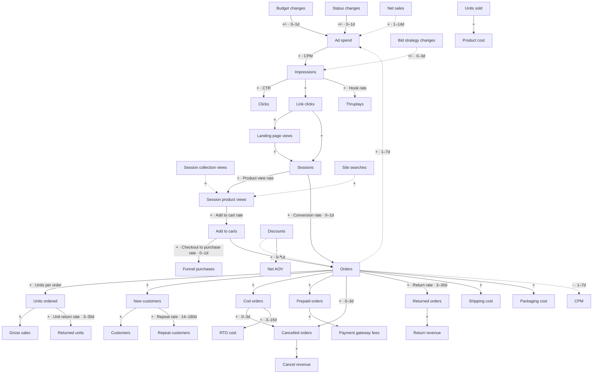
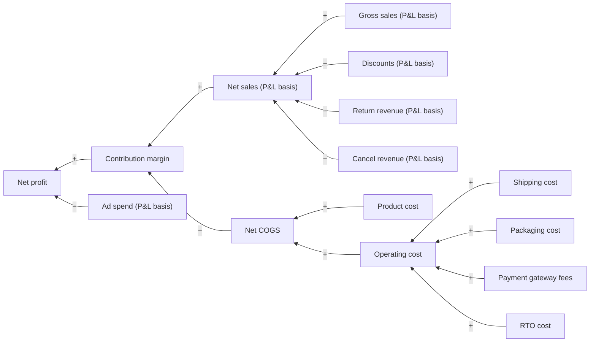
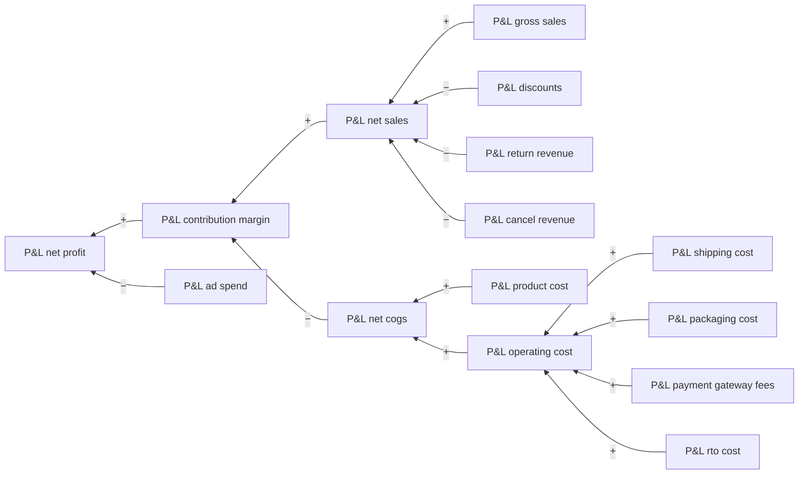
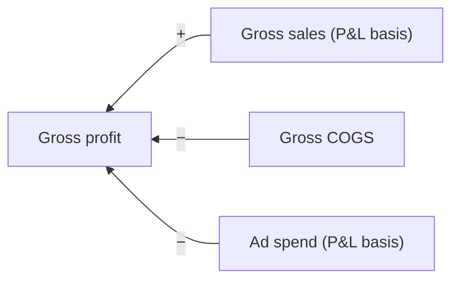
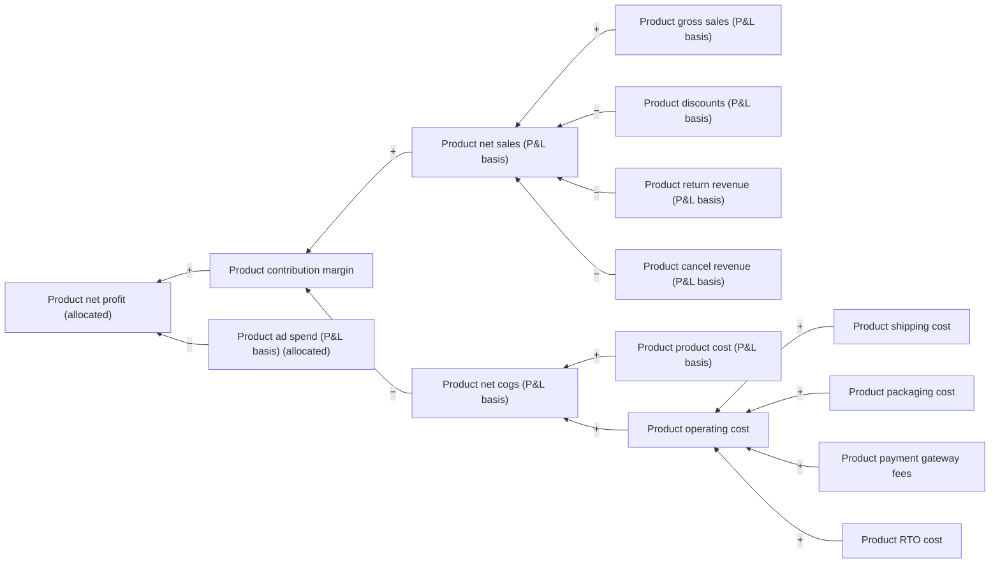
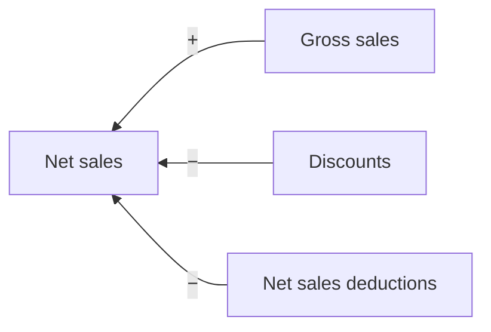
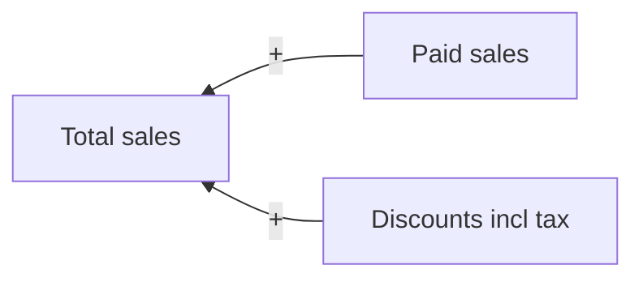
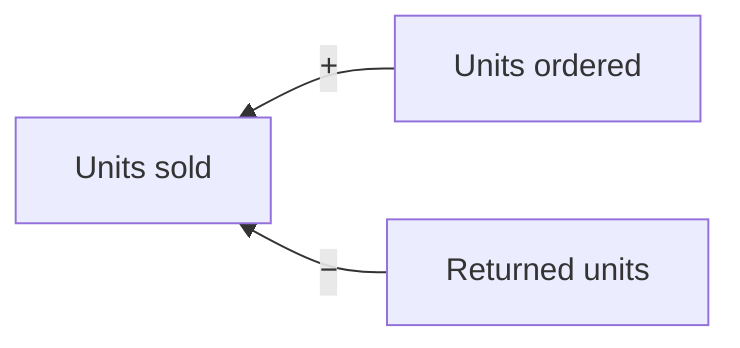

# Seleric metric dependency graph

GENERATED by `scripts/build_dependency_graph.py` from `catalogue_v2/` and `catalogue_v2_src/causal_priors.yaml`. Edit those, not this file. Machine-readable copy: `dependency_graph.json`.

**233 metrics, 464 edges.** allocation: 12, co_measure: 27, composition: 76, declared_input: 36, feedback: 3, mechanism: 37, ratio_component: 66, subset: 9, twin: 198.

## How far each edge can be trusted

| Layer | Edge kinds | Source | Trust |
|---|---|---|---|
| Accounting | composition, ratio_component | catalogue formulas | **Exact.** Checked on real rows by `verify_compositions.py` / `verify_ratio_components.py`; use without question |
| Declared input | declared_input | catalogue `depends_on` | Exact that the input is used; its role (numerator? factor?) is not stated |
| Same quantity | twin, co_measure, subset, allocation | concepts axes, reviewed priors | **Exact for twins** (same quantity, other date basis / grain); co-measures are reviewed and should be checked numerically. These are never causes of each other |
| Business mechanism | mechanism, feedback | reviewed priors | **Direction** is business knowledge (`structural` > `strong` > `moderate`); whether and how much it moved in a given case is for the data (DoWhy, discovery) |

Rates sit **on edges**: CTR is the impressions → clicks mechanism, conversion rate is sessions → orders. A rate that changed means the mechanism changed (creative, site, price), not that a separate node moved.

## 1. Business mechanism spine (what drives what)

Solid arrows: structural or strong. Dotted: moderate or lagged feedback. Labels: sign · rate on the edge · lag.

| From | To | Sign | Rate on the edge | Lag (days) | Confidence | Why |
|---|---|---|---|---|---|---|
| Budget changes | Ad spend | +/- |  | 0–1 | strong | A budget edit changes what the platform may spend from the next delivery hour |
| Status changes | Ad spend | +/- |  | 0–1 | strong | Pausing / enabling a campaign, ad set or ad stops or starts its spend |
| Bid strategy changes | Impressions | +/- |  | 0–3 | moderate | A new bid strategy changes how much delivery the same spend buys; platforms re-learn for days |
| Ad spend | Impressions | + | CPM | 0–0 | strong | Spend buys impressions at the auction price; CPM is the price of that mechanism (higher CPM = fewer impressions per rupee) |
| Impressions | Clicks | + | CTR | 0–0 | strong | CTR is the mechanism: creative fatigue or audience change shows up as a CTR change |
| Impressions | Link clicks | + |  | 0–0 | strong |  |
| Impressions | Thruplays | + | Hook rate | 0–0 | strong | Video ads only; hook and hold rates measure the creative |
| Link clicks | Landing page views | + |  | 0–0 | strong | Meta only; the gap is page-load loss (slow site, broken link) |
| Landing page views | Sessions | + |  | 0–0 | strong | Paid Meta arrivals; read on the paid / Meta slice of sessions, the rest is organic and other channels. LPV and paid Meta sessions count nearly the same arrivals in two systems, so a widening gap between them is a tracking or site-speed signal, not a cause |
| Link clicks | Sessions | + |  | 0–0 | strong | Paid arrivals incl. Google, which reports no landing page views |
| Sessions | Session product views | + | Product view rate | 0–0 | strong |  |
| Session collection views | Session product views | + |  | 0–0 | moderate | Browsing collections leads to product pages |
| Site searches | Session product views | + |  | 0–0 | moderate |  |
| Session product views | Add to carts | + | Add to cart rate | 0–0 | strong |  |
| Add to carts | Funnel purchases | + | Checkout to purchase rate | 0–1 | strong | Through checkout (add_to_cart_to_checkout_rate, checkout_to_purchase_rate); no reliable checkout count exists (checkout_steps is broken) |
| Sessions | Orders | + | Conversion rate | 0–1 | strong | The store-wide conversion mechanism; crosses from the web tracker to the order ledger |
| Add to carts | Orders | + |  | 0–1 | strong |  |
| Discounts | Orders | + |  | 0–0 | moderate | Deeper discounts win orders. Discounts in rupees also scale with orders, so test the discount RATE (discounts ÷ gross_sales) as the lever, not the rupee amount, or the edge is circular |
| Discounts | Net AOV | - |  | 0–0 | strong | Also an accounting fact (net sales deduct discounts); the behavioural part is basket composition |
| Orders | Units ordered | + | Units per order | 0–0 | structural |  |
| Units ordered | Gross sales | + |  | 0–0 | structural | Units × selling price; a price change is a change in this mechanism |
| Orders | New customers | + |  | 0–0 | structural | New customers are first orders; the share of new vs repeat is the mechanism |
| Orders | Cod orders | + |  | 0–0 | structural | COD share is the mechanism (checkout payment options, COD fees, pincode serviceability) |
| Orders | Prepaid orders | + |  | 0–0 | structural |  |
| Orders | Cancelled orders | + |  | 0–3 | structural |  |
| Cod orders | Cancelled orders | + |  | 0–3 | strong | COD orders are cancelled far more often than prepaid ones |
| Cod orders | RTO cost | + |  | 3–15 | strong | Return-to-origin is mostly refused COD deliveries |
| Orders | Returned orders | + | Return rate | 3–30 | structural | Order-date return metrics are incomplete for orders younger than the return window: a recent 'drop in returns' or 'rise in net sales' can be immaturity, not behaviour |
| Returned orders | Return revenue | + |  | 0–0 | structural |  |
| Cancelled orders | Cancel revenue | + |  | 0–0 | structural |  |
| Units ordered | Returned units | + | Unit return rate | 3–30 | structural |  |
| Units sold | Product cost | + |  | 0–0 | structural | Unit cost × units; a supplier price change is a change in this mechanism |
| Orders | Shipping cost | + |  | 0–0 | structural | Per-shipment rate × orders; a courier rate change is a change in this mechanism |
| Orders | Packaging cost | + |  | 0–0 | structural |  |
| Prepaid orders | Payment gateway fees | + |  | 0–0 | structural |  |
| New customers | Customers | + |  | 0–0 | structural |  |
| New customers | Repeat customers | + | Repeat rate | 14–180 | strong | Today's new customers are the repeat customers of the coming months |
| Net sales | Ad spend | + |  | 1–14 | strong (feedback) | Budget decisions follow results; value-based bidding spends more where it converts |
| Orders | Ad spend | + |  | 1–7 | moderate (feedback) | Conversion-optimised campaigns pace spend on conversions |
| Orders | CPM | - |  | 1–7 | moderate (feedback) | Conversion signal improves auction outcomes |

## 2. Accounting trees (exact)

### Order-date P&L: net profit

### Finance P&L (event date): net profit

### Order-date gross profit

### Product P&L (order date): net profit

### Commerce net sales

### Total sales incl. tax

### Net units

## 3. Ratios and what they are built from

| Ratio | Numerator | Denominator | View |
|---|---|---|---|
| AOV (`aov`) | `total_sales` | `orders` | commerce |
| Break-even ROAS (`be_roas`) | `order_pnl_net_sales` | `contribution_margin` | order_pnl |
| CAC (`cac`) | `ad_spend` | `new_customers` | unit_economics |
| CAC (by channel / campaign) (`channel_cac`) | `ad_spend` | `channel_new_customers` | order_pnl |
| Contribution margin % (`contribution_margin_pct`) | `contribution_margin` | `order_pnl_net_sales` | order_pnl |
| Cost per landing page view (`cost_per_landing_page_view`) | `ad_spend` | `landing_page_views` | paid_media |
| Cost per link click (`cost_per_link_click`) | `ad_spend` | `link_clicks` | paid_media |
| Cost per order (CPA) (`cost_per_order`) | `ad_spend` | `channel_orders` | order_pnl |
| CPC (`cpc`) | `ad_spend` | `clicks` | paid_media |
| CPM (`cpm`) | `ad_spend` | `impressions` | paid_media |
| CTR (`ctr`) | `clicks` | `impressions` | paid_media |
| Gross ROAS (`gross_roas`) | `gross_sales` | `ad_spend` | order_pnl |
| LTV:CAC ratio (`ltv_cac_ratio`) | `ltv` | `cac` | unit_economics |
| MER (`mer`) | `order_pnl_net_sales` | `ad_spend` | order_pnl |
| Net AOV (`net_aov`) | `net_sales` | `orders` | commerce |
| Net margin % (`net_margin_pct`) | `net_profit` | `order_pnl_net_sales` | order_pnl |
| Net ROAS (`net_roas`) | `contribution_margin` | `ad_spend` | order_pnl |
| P&L break-even ROAS (`pnl_be_roas`) | `pnl_net_sales` | `pnl_contribution_margin` | pnl |
| P&L contribution margin pct (`pnl_contribution_margin_pct`) | `pnl_contribution_margin` | `pnl_net_sales` | pnl |
| P&L MER (`pnl_mer`) | `pnl_net_sales` | `ad_spend` | pnl |
| P&L net margin pct (`pnl_net_margin_pct`) | `pnl_net_profit` | `pnl_net_sales` | pnl |
| P&L net ROAS (`pnl_net_roas`) | `pnl_contribution_margin` | `ad_spend` | pnl |
| Product cost per LPV (allocated) (`product_cost_per_landing_page_view`) | `product_ad_spend` | `product_landing_page_views` | product |
| Product cost per link click (allocated) (`product_cost_per_link_click`) | `product_ad_spend` | `product_link_clicks` | product |
| Product CPC (allocated) (`product_cpc`) | `product_ad_spend` | `product_clicks` | product |
| Product CPM (allocated) (`product_cpm`) | `product_ad_spend` | `product_impressions` | product |
| Product CTR (allocated) (`product_ctr`) | `product_clicks` | `product_impressions` | product |
| Product gross margin pct (`product_gross_margin_pct`) | `product_gross_profit` | `product_net_revenue` | product |
| Product return rate (`product_return_rate`) | `product_order_returned_orders` | `product_order_orders` | product_pnl |
| Repeat rate (`repeat_rate`) | `repeat_customers` | `customers` | customers |
| Return rate (`return_rate`) | `channel_returned_orders` | `channel_orders` | order_pnl |
| Unit return rate (`unit_return_rate`) | `returned_units` | `units_ordered` | product |
| Units per order (`units_per_order`) | `units_sold` | `orders` | product |

**36 ratios / metrics state an input but not the full formula** (the other side is not a catalogue metric, e.g. purchasing sessions for conversion rate). The engine can use them as rates on an edge but cannot decompose them exactly: `add_to_cart_rate`, `add_to_cart_to_checkout_rate`, `avg_page_depth`, `avg_seconds_to_add_to_cart`, `avg_seconds_to_checkout`, `avg_seconds_to_purchase`, `avg_touch_count`, `bounce_rate`, `checkout_rate`, `checkout_to_purchase_rate`, `conversion_rate`, `events_per_session`, `hold_rate_15s`, `hook_rate`, `ltv`, `new_customer_ltv`, `product_be_roas`, `product_cac`, `product_contribution_margin_pct`, `product_cost_per_order`, `product_gross_roas`, `product_hold_rate_15s`, `product_hook_rate`, `product_ltv_cac_ratio`, `product_mer`, `product_net_margin_pct`, `product_net_roas`, `product_pnl_be_roas`, `product_pnl_contribution_margin_pct`, `product_pnl_mer`, `product_pnl_net_margin_pct`, `product_pnl_net_roas`, `product_video_completion_rate`, `product_view_rate`, `session_bounce_rate`, `video_completion_rate`.

## 4. Same quantity: never explain one with the other

Each group below is one quantity seen on different date bases, grains or systems. Inside a group a divergence is a **data** observation (late sync, tracking loss, cohort immaturity), never a cause.

| Group | Members |
|---|---|
| 1 | `ad_spend`, `order_pnl_ad_spend`, `pnl_ad_spend`, `product_ad_spend`, `product_order_ad_spend`, `product_pnl_ad_spend` |
| 2 | `add_to_cart_events`, `add_to_carts`, `event_add_to_carts` |
| 3 | `be_roas`, `pnl_be_roas`, `product_be_roas`, `product_pnl_be_roas` |
| 4 | `bounce_rate`, `session_bounce_rate` |
| 5 | `cac`, `channel_cac`, `product_cac` |
| 6 | `cancel_revenue`, `order_pnl_cancel_revenue`, `pnl_cancel_revenue`, `product_cancel_revenue`, `product_order_cancel_revenue`, `product_pnl_cancel_revenue` |
| 7 | `cancelled_orders`, `pnl_cancelled_orders`, `product_pnl_cancelled_orders` |
| 8 | `channel_new_customers`, `new_customers`, `product_new_customers` |
| 9 | `channel_orders`, `funnel_order_purchases`, `funnel_purchases`, `orders`, `product_order_orders`, `product_orders` |
| 10 | `clicks`, `product_clicks` |
| 11 | `collection_view_events`, `event_collection_views`, `session_collection_views` |
| 12 | `contribution_margin`, `pnl_contribution_margin`, `product_contribution_margin`, `product_pnl_contribution_margin` |
| 13 | `contribution_margin_pct`, `pnl_contribution_margin_pct`, `product_contribution_margin_pct`, `product_gross_margin_pct`, `product_pnl_contribution_margin_pct` |
| 14 | `cost_per_landing_page_view`, `product_cost_per_landing_page_view` |
| 15 | `cost_per_link_click`, `product_cost_per_link_click` |
| 16 | `cost_per_order`, `product_cost_per_order` |
| 17 | `cpc`, `product_cpc` |
| 18 | `cpm`, `product_cpm` |
| 19 | `ctr`, `product_ctr` |
| 20 | `discounts`, `order_pnl_discounts`, `pnl_discounts`, `product_discounts`, `product_order_discounts`, `product_pnl_discounts` |
| 21 | `event_count`, `web_events` |
| 22 | `event_page_views`, `page_views`, `session_page_views` |
| 23 | `event_product_views`, `product_view_events`, `session_product_views` |
| 24 | `event_site_searches`, `site_search_events`, `site_searches` |
| 25 | `funnel_order_revenue`, `funnel_revenue`, `net_sales`, `order_pnl_net_sales`, `pnl_net_sales`, `product_net_revenue`, `product_order_net_sales`, `product_pnl_net_sales` |
| 26 | `gross_cogs`, `product_gross_cogs` |
| 27 | `gross_profit`, `product_gross_profit` |
| 28 | `gross_roas`, `product_gross_roas` |
| 29 | `gross_sales`, `order_pnl_gross_sales`, `pnl_gross_sales`, `product_gross_sale`, `product_order_gross_sales`, `product_pnl_gross_sales` |
| 30 | `hold_rate_15s`, `product_hold_rate_15s` |
| 31 | `hook_rate`, `product_hook_rate` |
| 32 | `impressions`, `product_impressions` |
| 33 | `landing_page_views`, `product_landing_page_views` |
| 34 | `link_clicks`, `product_link_clicks` |
| 35 | `ltv`, `new_customer_ltv` |
| 36 | `ltv_cac_ratio`, `product_ltv_cac_ratio` |
| 37 | `mer`, `pnl_mer`, `product_mer`, `product_pnl_mer` |
| 38 | `net_cogs`, `pnl_net_cogs`, `product_net_cogs`, `product_order_net_cogs`, `product_pnl_net_cogs` |
| 39 | `net_margin_pct`, `pnl_net_margin_pct`, `product_net_margin_pct`, `product_pnl_net_margin_pct` |
| 40 | `net_profit`, `pnl_net_profit`, `product_net_profit`, `product_pnl_net_profit` |
| 41 | `net_roas`, `pnl_net_roas`, `product_net_roas`, `product_pnl_net_roas` |
| 42 | `operating_cost`, `pnl_operating_cost`, `product_operating_cost`, `product_pnl_operating_cost` |
| 43 | `order_pnl_return_revenue`, `pnl_return_revenue`, `product_order_return_revenue`, `product_pnl_return_revenue`, `product_return_revenue`, `product_returns_excl_tax`, `return_revenue`, `returns_excl_tax` |
| 44 | `packaging_cost`, `pnl_packaging_cost`, `product_packaging_cost`, `product_pnl_packaging_cost` |
| 45 | `paid_sales`, `payment_amount` |
| 46 | `payment_gateway_fees`, `pnl_payment_gateway_fees`, `product_payment_gateway_fees`, `product_pnl_payment_gateway_fees` |
| 47 | `pnl_product_cost`, `product_cost`, `product_line_cost`, `product_order_product_cost`, `product_pnl_product_cost` |
| 48 | `pnl_return_cancel_revenue`, `product_pnl_return_cancel_revenue`, `return_cancel_revenue` |
| 49 | `pnl_returned_or_cancelled_orders`, `product_pnl_returned_or_cancelled_orders`, `returned_or_cancelled_orders` |
| 50 | `pnl_returned_orders`, `product_order_returned_orders`, `product_pnl_returned_orders`, `refund_count`, `returned_orders` |
| 51 | `pnl_rto_cost`, `product_pnl_rto_cost`, `product_rto_cost`, `rto_cost` |
| 52 | `pnl_shipping_cost`, `product_pnl_shipping_cost`, `product_shipping_cost`, `shipping_cost` |
| 53 | `pnl_taxes_on_net_sales`, `product_pnl_taxes_on_net_sales`, `product_taxes_on_net_sales`, `taxes_on_net_sales` |
| 54 | `product_refunded_amount_excl_tax`, `refunded_amount_excl_tax` |
| 55 | `product_return_rate`, `return_rate` |
| 56 | `product_thruplays`, `thruplays` |
| 57 | `product_video_completion_rate`, `video_completion_rate` |

### Co-measures (two systems, same events)

| A | B | Systems | Expected |
|---|---|---|---|
| `orders` | `funnel_purchases` | shopify / snowplow | funnel ≤ orders (ad blockers, app orders, server-side gaps) |
| `orders` | `funnel_order_purchases` | shopify / snowplow |  |
| `net_sales` | `funnel_revenue` | shopify / snowplow | Snowplow revenue is ex-tax at purchase; net sales also nets later returns / cancels |
| `net_sales` | `funnel_order_revenue` | shopify / snowplow |  |
| `ad_spend` | `pnl_ad_spend` | paid_media / finance_pnl | equal |
| `ad_spend` | `order_pnl_ad_spend` | paid_media / order_pnl | equal |
| `net_sales` | `order_pnl_net_sales` | commerce / order_pnl | near-equal, both order date |
| `gross_sales` | `order_pnl_gross_sales` | commerce / order_pnl | near-equal, both order date |
| `discounts` | `order_pnl_discounts` | commerce / order_pnl | near-equal, both order date |
| `return_revenue` | `order_pnl_return_revenue` | commerce / order_pnl | near-equal, both order date |
| `cancel_revenue` | `order_pnl_cancel_revenue` | commerce / order_pnl | near-equal, both order date |
| `product_cost` | `product_line_cost` | order_pnl / product | equal in total (catalogue: product-grain twin) |
| `gross_cogs` | `product_gross_cogs` | order_pnl / product | equal in total |
| `gross_sales` | `product_gross_sale` | commerce / product | equal in total (catalogue: product-grain twin) |
| `product_gross_sale` | `product_order_gross_sales` | product / product_pnl | near-equal, both order date |
| `product_net_revenue` | `product_order_net_sales` | product / product_pnl | near-equal, both order date |
| `product_orders` | `product_order_orders` | product / product_pnl |  |
| `product_line_cost` | `product_order_product_cost` | product / product_pnl |  |
| `product_discounts` | `product_order_discounts` | product / product_pnl |  |
| `product_return_revenue` | `product_order_return_revenue` | product / product_pnl |  |
| `product_cancel_revenue` | `product_order_cancel_revenue` | product / product_pnl |  |
| `product_net_cogs` | `product_order_net_cogs` | product / product_pnl |  |
| `product_ad_spend` | `product_order_ad_spend` | product / product_pnl | equal |
| `returns_excl_tax` | `pnl_return_revenue` | returns / finance_pnl | both on the return / refund date; near-equal |
| `refund_count` | `pnl_returned_orders` | returns / finance_pnl |  |
| `payment_amount` | `paid_sales` | payments / commerce | different dates (transaction vs order) and refunds negative |
| `page_views` | `session_page_views` | web_events / web_sessions | session_page_views ≈1.3% below page_views |

### Allocations (model output, circular as drivers)

| Allocated | From | Split by |
|---|---|---|
| `product_ad_spend` | `ad_spend` | product share of attributed line revenue |
| `product_order_ad_spend` | `ad_spend` | product share of attributed line revenue |
| `product_pnl_ad_spend` | `ad_spend` | product share of attributed line revenue |
| `product_impressions` | `impressions` | product share of attributed revenue |
| `product_clicks` | `clicks` | product share of attributed revenue |
| `product_link_clicks` | `link_clicks` | product share of attributed revenue |
| `product_landing_page_views` | `landing_page_views` | product share of attributed revenue |
| `product_thruplays` | `thruplays` | product share of attributed revenue |
| `product_shipping_cost` | `shipping_cost` | line revenue share of the order |
| `product_packaging_cost` | `packaging_cost` | line revenue share of the order |
| `product_payment_gateway_fees` | `payment_gateway_fees` | line revenue share of the order |
| `product_rto_cost` | `rto_cost` | line revenue share of the order |

### Subsets

| Part | Whole |
|---|---|
| `link_clicks` | `clicks` |
| `new_customers` | `orders` |
| `cod_orders` | `orders` |
| `prepaid_orders` | `orders` |
| `payment_orders` | `orders` |
| `orders_with_touchpoints` | `orders` |
| `cancelled_orders` | `orders` |
| `returned_orders` | `orders` |
| `repeat_customers` | `customers` |

## 5. Funnel tiers (the order discovery must respect)

A lag-0 causal edge may only point from a lower tier to a higher one; lagged feedback may point back.

| Tier | Additive metrics |
|---|---|
| 0 | `bid_strategy_changes`, `budget_changes`, `status_changes` |
| 1 | `ad_spend`, `discounts`, `discounts_incl_tax`, `order_pnl_ad_spend`, `order_pnl_discounts`, `pnl_ad_spend`, `pnl_discounts`, `product_ad_spend`, `product_discounts`, `product_order_ad_spend`, `product_order_discounts`, `product_pnl_ad_spend`, `product_pnl_discounts` |
| 2 | `impressions`, `product_impressions` |
| 3 | `clicks`, `landing_page_views`, `link_clicks`, `product_clicks`, `product_landing_page_views`, `product_link_clicks`, `product_thruplays`, `thruplays` |
| 4 | `event_count`, `event_page_views`, `page_views`, `session_page_views`, `sessions`, `web_events` |
| 5 | `add_to_cart_events`, `add_to_carts`, `checkout_steps`, `collection_view_events`, `event_add_to_carts`, `event_collection_views`, `event_product_views`, `event_site_searches`, `product_view_events`, `remove_from_carts`, `session_collection_views`, `session_product_views`, `site_search_events`, `site_searches`, `touches` |
| 6 | `channel_new_customers`, `channel_orders`, `cod_orders`, `customers`, `funnel_order_purchases`, `funnel_purchases`, `new_customers`, `orders`, `orders_with_touchpoints`, `payment_orders`, `prepaid_orders`, `product_new_customers`, `product_order_orders`, `product_orders`, `repeat_customers`, `units_ordered` |
| 7 | `gross_sales`, `order_pnl_gross_sales`, `order_value_incl_tax`, `paid_sales`, `payment_amount`, `pnl_gross_sales`, `product_gross_sale`, `product_order_gross_sales`, `product_pnl_gross_sales`, `total_sales` |
| 8 | `cancel_revenue`, `cancelled_orders`, `channel_returned_orders`, `funnel_order_revenue`, `funnel_revenue`, `net_sales`, `net_sales_deductions`, `order_pnl_cancel_revenue`, `order_pnl_net_sales`, `order_pnl_return_revenue`, `pnl_cancel_revenue`, `pnl_cancelled_orders`, `pnl_net_sales`, `pnl_return_cancel_revenue`, `pnl_return_revenue`, `pnl_returned_or_cancelled_orders`, `pnl_returned_orders`, `product_cancel_revenue`, `product_net_revenue`, `product_order_cancel_revenue`, `product_order_net_sales`, `product_order_return_revenue`, `product_order_returned_orders`, `product_pnl_cancel_revenue`, `product_pnl_cancelled_orders`, `product_pnl_net_sales`, `product_pnl_return_cancel_revenue`, `product_pnl_return_revenue`, `product_pnl_returned_or_cancelled_orders`, `product_pnl_returned_orders`, `product_refunded_amount_excl_tax`, `product_return_revenue`, `product_returns_excl_tax`, `refund_amount`, `refund_count`, `refund_lines`, `refunded_amount_excl_tax`, `return_cancel_revenue`, `return_recovered_cogs`, `return_revenue`, `returned_or_cancelled_orders`, `returned_orders`, `returned_units`, `returns_excl_tax`, `units_sold` |
| 9 | `gross_cogs`, `net_cogs`, `operating_cost`, `packaging_cost`, `payment_gateway_fees`, `pnl_net_cogs`, `pnl_operating_cost`, `pnl_packaging_cost`, `pnl_payment_gateway_fees`, `pnl_product_cost`, `pnl_rto_cost`, `pnl_shipping_cost`, `pnl_taxes_on_net_sales`, `product_cost`, `product_gross_cogs`, `product_line_cost`, `product_net_cogs`, `product_operating_cost`, `product_order_net_cogs`, `product_order_product_cost`, `product_packaging_cost`, `product_payment_gateway_fees`, `product_pnl_net_cogs`, `product_pnl_operating_cost`, `product_pnl_packaging_cost`, `product_pnl_payment_gateway_fees`, `product_pnl_product_cost`, `product_pnl_rto_cost`, `product_pnl_shipping_cost`, `product_pnl_taxes_on_net_sales`, `product_rto_cost`, `product_shipping_cost`, `product_taxes_on_net_sales`, `rto_cost`, `shipping_cost`, `taxes_on_net_sales` |
| 10 | `contribution_margin`, `gross_profit`, `net_profit`, `pnl_contribution_margin`, `pnl_net_profit`, `product_contribution_margin`, `product_gross_profit`, `product_net_profit`, `product_pnl_contribution_margin`, `product_pnl_net_profit` |

## 6. Where-graph: dimensions shared across views

Dimensions shared by many views are where a change can be followed from one domain to another (a campaign's spend, its sessions and its orders).

| Hierarchy | Levels (coarse → fine) | Views |
|---|---|---|
| geo | shipping_country → shipping_state → shipping_city → shipping_pincode | 1 |
| traffic | platform → channel → sub_channel | 9 |
| product | product_type → product_title → variant_title | 2 |
| ad | ad_platform → campaign_name → adset_name → ad_name | 15 |
| campaign | campaign_name → adset_name → ad_name | 15 |

| Conformed dimension | Views |
|---|---|
| `brand_id` | attribution, attribution_paths, commerce, customers, funnel_orders, order_pnl, paid_media, paid_media_breakdowns, paid_media_changes, paid_media_hourly, payments, pnl, product, product_pnl, returns, unit_economics, web_event_detail, web_events, web_funnel, web_sessions |
| `ad_platform` | attribution, attribution_paths, commerce, funnel_orders, order_pnl, paid_media, paid_media_breakdowns, paid_media_changes, paid_media_hourly, payments, pnl, product, product_pnl, returns, unit_economics, web_event_detail, web_funnel, web_sessions |
| `campaign_id` | attribution, attribution_paths, commerce, funnel_orders, order_pnl, paid_media, paid_media_breakdowns, paid_media_changes, paid_media_hourly, payments, pnl, product, product_pnl, returns, unit_economics, web_event_detail, web_sessions |
| `campaign_name` | attribution, attribution_paths, commerce, funnel_orders, order_pnl, paid_media, paid_media_breakdowns, paid_media_changes, paid_media_hourly, payments, pnl, product, product_pnl, returns, unit_economics, web_event_detail, web_sessions |
| `campaign_objective` | attribution, attribution_paths, commerce, funnel_orders, order_pnl, paid_media, paid_media_breakdowns, paid_media_changes, paid_media_hourly, payments, pnl, product, product_pnl, returns, unit_economics, web_event_detail, web_sessions |
| `campaign_status` | attribution, attribution_paths, commerce, funnel_orders, order_pnl, paid_media, paid_media_breakdowns, paid_media_changes, paid_media_hourly, payments, pnl, product, product_pnl, returns, unit_economics, web_event_detail, web_sessions |
| `campaign_type` | attribution, attribution_paths, commerce, funnel_orders, order_pnl, paid_media, paid_media_breakdowns, paid_media_changes, paid_media_hourly, payments, pnl, product, product_pnl, returns, unit_economics, web_event_detail, web_sessions |
| `finance_channel` | attribution, attribution_paths, commerce, funnel_orders, order_pnl, paid_media, paid_media_breakdowns, paid_media_hourly, payments, pnl, product, product_pnl, returns, unit_economics, web_event_detail, web_funnel, web_sessions |
| `is_paid` | attribution, attribution_paths, commerce, funnel_orders, order_pnl, paid_media, paid_media_breakdowns, paid_media_hourly, payments, pnl, product, product_pnl, returns, unit_economics, web_event_detail, web_funnel, web_sessions |
| `ad_format` | attribution, attribution_paths, commerce, funnel_orders, order_pnl, paid_media, paid_media_breakdowns, paid_media_changes, paid_media_hourly, pnl, product, product_pnl, returns, web_event_detail, web_sessions |
| `ad_id` | attribution, attribution_paths, commerce, funnel_orders, order_pnl, paid_media, paid_media_breakdowns, paid_media_changes, paid_media_hourly, pnl, product, product_pnl, returns, web_event_detail, web_sessions |
| `ad_name` | attribution, attribution_paths, commerce, funnel_orders, order_pnl, paid_media, paid_media_breakdowns, paid_media_changes, paid_media_hourly, pnl, product, product_pnl, returns, web_event_detail, web_sessions |
| `ad_status` | attribution, attribution_paths, commerce, funnel_orders, order_pnl, paid_media, paid_media_breakdowns, paid_media_changes, paid_media_hourly, pnl, product, product_pnl, returns, web_event_detail, web_sessions |
| `adset_id` | attribution, attribution_paths, commerce, funnel_orders, order_pnl, paid_media, paid_media_breakdowns, paid_media_changes, paid_media_hourly, pnl, product, product_pnl, returns, web_event_detail, web_sessions |
| `adset_name` | attribution, attribution_paths, commerce, funnel_orders, order_pnl, paid_media, paid_media_breakdowns, paid_media_changes, paid_media_hourly, pnl, product, product_pnl, returns, web_event_detail, web_sessions |
| `adset_status` | attribution, attribution_paths, commerce, funnel_orders, order_pnl, paid_media, paid_media_breakdowns, paid_media_changes, paid_media_hourly, pnl, product, product_pnl, returns, web_event_detail, web_sessions |
| `creative_type` | attribution, attribution_paths, commerce, funnel_orders, order_pnl, paid_media, paid_media_breakdowns, paid_media_changes, paid_media_hourly, pnl, product, product_pnl, returns, web_event_detail, web_sessions |
| `platform` | attribution, attribution_paths, commerce, funnel_orders, paid_media, paid_media_breakdowns, paid_media_hourly, payments, product, returns, unit_economics, web_event_detail, web_funnel, web_sessions |
| `sub_channel` | attribution, attribution_paths, commerce, funnel_orders, order_pnl, payments, product, product_pnl, returns, web_event_detail, web_sessions |
| `channel` | attribution, attribution_paths, commerce, funnel_orders, payments, product, returns, web_event_detail, web_funnel, web_sessions |
| `medium_group` | attribution, attribution_paths, commerce, funnel_orders, payments, product, returns, web_event_detail, web_funnel, web_sessions |
| `is_new_customer` | attribution_paths, commerce, order_pnl, payments, product, product_pnl, returns |
| `basket_product_title` | attribution, attribution_paths, commerce, funnel_orders, payments |
| `basket_product_type` | attribution, attribution_paths, commerce, funnel_orders, payments |
| `basket_sku` | attribution, attribution_paths, commerce, funnel_orders, payments |
| `payment_bucket` | commerce, order_pnl, product, product_pnl, returns |
| `is_cod` | commerce, payments, product, returns |
| `product_title` | product, product_pnl, returns, web_event_detail |
| `sku` | product, product_pnl, returns, web_event_detail |
| `payment_gateway` | commerce, payments, product |
| `payment_method` | commerce, payments, product |
| `product_type` | product, product_pnl, returns |
| `variant_title` | product, product_pnl, returns |

## 7. Gaps and checks

- Broken in the catalogue (do not use as evidence): `avg_seconds_to_checkout`, `avg_seconds_to_purchase`, `checkout_steps`.
- Metrics with no edge at all (6): `checkout_steps`, `order_value_incl_tax`, `refund_amount`, `refund_lines`, `remove_from_carts`, `return_recovered_cogs`. They can still be scanned for anomalies but the engine has no prior on how they relate.
- Validation: 0 errors, 0 warnings.
